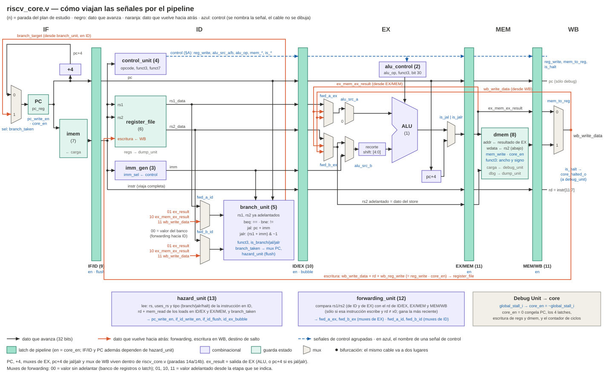
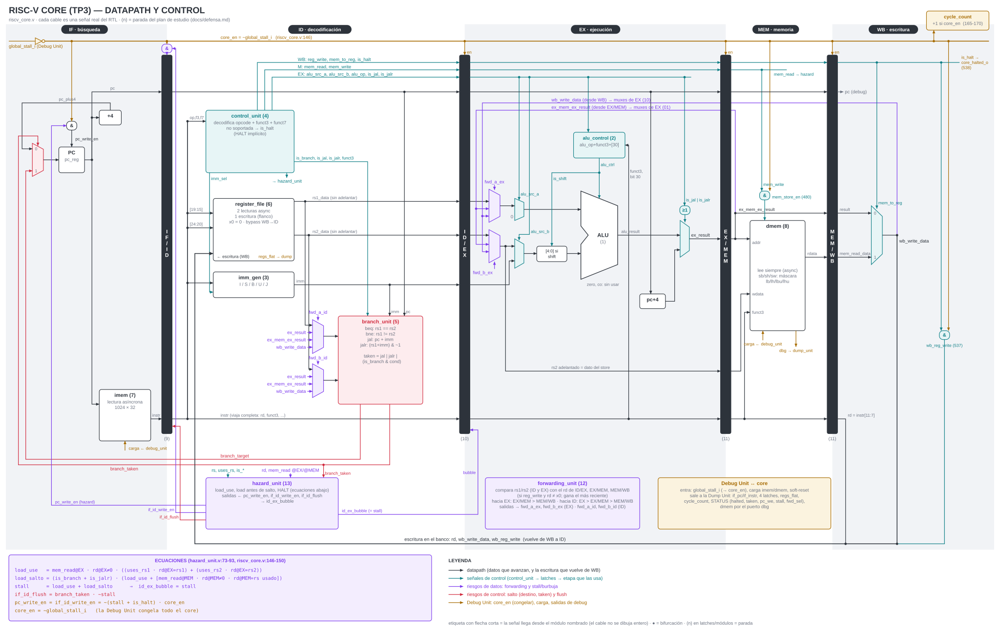

# Guía de defensa — TP3: Pipeline RISC-V + Debug Unit

Guía de estudio para preparar la defensa. Recorre el diseño **archivo por
archivo**, como un conjunto de cajitas: qué hace cada una, qué recibe y de
dónde, qué entrega y a quién. Se va completando a medida que avanzamos con
el plan de estudio (§3).

Criterio: todo lo que dice este documento sale del código (se cita
`archivo:línea`) o de una simulación del RTL real. Cuando algo no está
cubierto por un test del repositorio, se dice explícitamente.

Algunas secciones mencionan **el fuzzer**: un generador de programas
aleatorios que corre cada programa sobre el RTL y sobre un modelo de la
ISA en Python y compara los resultados (también con el núcleo congelado
al azar entre ciclos). Se usó durante la revisión previa a la defensa,
pero **no está en el repositorio**: en la defensa se pueden mostrar los
testbenches de `tp3/tb/`, no el fuzzer.

## Índice

0. [Estado del proyecto](#0-estado-del-proyecto)
1. [Panorama general](#1-panorama-general)
2. [La instrucción HALT](#2-la-instrucción-halt)
3. [Plan de estudio: mapa del core y paradas](#3-plan-de-estudio-mapa-del-core-y-paradas) (incluye los diagramas de cableado, §3.3 y §3.4)
4. [Parada 1 — La ALU](#4-parada-1--la-alu-tp1aluv)
5. [Parada 2 — alu_control](#5-parada-2--alu_control-alu_controlv)
6. [Parada 7 — imem](#6-parada-7--imem-imemv)
7. [Parada 8 — dmem](#7-parada-8--dmem-dmemv)
8. [Parada 6 — register_file](#8-parada-6--register_file-register_filev)
9. [Parada 3 — imm_gen](#9-parada-3--imm_gen-imm_genv)
10. [Parada 4 — control_unit](#10-parada-4--control_unit-control_unitv)
11. [Parada 5 — branch_unit](#11-parada-5--branch_unit-branch_unitv)
12. [Parada 9 — if_id_reg](#12-parada-9--if_id_reg-if_id_regv)
13. [Stall, burbuja, flush, HALT y congelado (diagramas temporales)](#13-stall-burbuja-flush-halt-y-congelado-diagramas-temporales)
14. [Parada 10 — id_ex_reg](#14-parada-10--id_ex_reg-id_ex_regv)
15. [Parada 11 — ex_mem_reg y mem_wb_reg](#15-parada-11--ex_mem_reg-y-mem_wb_reg-ex_mem_regv-mem_wb_regv)
16. [Parada 12 — forwarding_unit](#16-parada-12--forwarding_unit-forwarding_unitv)
17. [Parada 13 — hazard_unit](#17-parada-13--hazard_unit-hazard_unitv)
18. [Parada 16 — debug_unit](#18-parada-16--debug_unit-debug_unitv)
19. [Parada 17 — dump_unit y riscv_uart_top (y el top de la placa)](#19-parada-17--dump_unit-y-riscv_uart_top-dump_unitv-riscv_uart_topv)

Apéndices (material de consulta, se actualiza con cada parada):

- A. [Tabla completa de decodificación](#a-tabla-completa-de-decodificación)
- B. [Banco de preguntas de defensa](#b-banco-de-preguntas-de-defensa)
- C. [Glosario](#c-glosario)

---

## 0. Estado del proyecto

Al 2026-10-12:

- **Simulación:** la regresión completa pasa **796/796**: 710 chequeos en
  Verilog con Icarus (incluidos los 162 de la ALU de TP1 y los 46 del
  panel de la placa) + 86 tests de Python del host. Cómo correr cada
  testbench: `tp3/README.md`.
- **Síntesis e implementación (Vivado 2026.1, Basys 3): hechas.** El top
  para la placa es [riscv_fpga_top.v](../rtl/fpga/riscv_fpga_top.v)
  (§1.2): el Clock Wizard genera **65MHz** a partir del oscilador de
  100MHz de la placa, y el diseño **cierra timing**: WNS = +0,254ns,
  TNS = 0, WHS = +0,090ns (implementación del 2026-10-12, ya con el
  panel).
- **Recursos:** 5358 LUTs (1760 de ellas usadas como memoria: la imem y
  la dmem), 2173 flip-flops, **0 Block RAM** y 1 MMCM (el Clock Wizard).
- **Pendiente:** probar en la Basys 3 con los programas de
  [scripts/](../scripts/README.md), y la parada 19 (clock, camino crítico
  y skew en detalle).

**Si preguntan por el clock** (el enunciado lo pregunta explícitamente):

- *¿Por qué no 100MHz?* Porque se priorizó el CPI por sobre la
  frecuencia: los saltos se resuelven en ID con adelantamiento desde EX
  (§11.4), y eso deja en serie, en un mismo ciclo, la ALU y el comparador
  de saltos.
- *¿Cuál es el camino crítico?* En el núcleo: selector de forwarding →
  ALU → adelantamiento a ID → comparador → `branch_taken` → mux del
  próximo PC. Tarda 14,47ns (15 niveles de lógica; ~76% del tiempo es
  ruteo). El peor de todo el diseño es la misma cadena pero terminando en
  la Dump Unit, en la captura del STATUS (que incluye `branch_taken`):
  14,98ns.
- *¿Genera skew?* Sí, poco: −0,050ns en el peor camino (el clock llega un
  poco antes al flip-flop de destino que al de origen, y al dato le queda
  ese tiempo de menos). Vivado ya lo descuenta del slack, así que el WNS
  positivo lo incluye. Es chico porque el clock viaja por la red global
  (BUFG).
- *¿Cómo se eligió la frecuencia?* Se implementó el diseño a 50, 60, 65,
  70 y 75MHz: cierra sin excepciones hasta 65MHz, a 70MHz sólo falla la
  captura del STATUS y a 75MHz ya falla un camino del núcleo (su límite
  está cerca de 72MHz). Además, 65MHz deja la UART a +0,76% de 115200
  baudios ([riscv_fpga_top.v:20-26](../rtl/fpga/riscv_fpga_top.v#L20-L26)).
- *¿El Clock Wizard no es "intervenir el clock"?* No: configura un MMCM,
  el bloque dedicado del FPGA para sintetizar frecuencias, y su salida
  entra a la red global de clock igual que el oscilador. No se divide con
  un contador ni se gatea
  ([riscv_fpga_top.v:13-18](../rtl/fpga/riscv_fpga_top.v#L13-L18)).

---

## 1. Panorama general

### 1.1 Las tres piezas que pide el enunciado

| Pieza | Dónde está |
|---|---|
| Pipeline RISC-V de 5 etapas | `tp3/rtl/core/` |
| Debug Unit por UART | `tp3/rtl/debug/` + la UART de TP2 (`tp2/rtl/`), reutilizada con un solo cambio (abajo) |
| Interfaz para usarlo (ensamblador, CLI, GUI) | `tp3/host/` |

Además, para la placa: `tp3/rtl/fpga/` (el top con el Clock Wizard y el
panel de display y LEDs, §1.2) y diez programas de prueba en
[tp3/scripts/](../scripts/README.md), cada uno pensado para mostrar una
parte del enunciado.

**El único cambio en la UART de TP2** está en `baud_generator.v`. El
registro que recuerda el selector de baudios (`baud_sel_reg`, para
detectar cuándo cambia) se cargaba con la entrada `baud_sel_i` dentro de
la rama del reset asíncrono. Un reset asíncrono sólo puede cargar una
constante (el flip-flop de la FPGA tiene preset y clear, nada más), así
que Vivado lo armaba con un latch y lógica sobre esos pines, y lo marcaba
en el reporte de metodología. Se pasó a un flip-flop sin reset
([baud_generator.v:54-64](../../tp2/rtl/baud_generator.v#L54-L64)).

### 1.2 Cómo se conectan

```
                   ┌──────────────────────────┐
                   │  PC (Python)             │
                   │  ensamblador, CLI, GUI   │
                   └────────────┬─────────────┘
                                │ UART 115200 8N1 (ida y vuelta)
 ┌ FPGA Basys 3 · riscv_fpga_top ─────────────────────────────────┐
 │ ┌ riscv_uart_top ────────────────────────────────────────────┐ │
 │ │               ┌───────────▼──────────────┐                 │ │
 │ │               │ UART de TP2              │                 │ │
 │ │               │ rx, tx, interface        │                 │ │
 │ │               └─────┬──────────────▲─────┘                 │ │
 │ │          bytes que  │              │ bytes que             │ │
 │ │          llegan     ▼              │ salen                 │ │
 │ │      ┌──────────────────┐   ┌──────┴───────────┐           │ │
 │ │      │ debug_unit       │   │ dump_unit        │           │ │
 │ │      │ comandos y carga │   │ volcado (Tx)     │           │ │
 │ │      └────────┬─────────┘   └──────▲───────────┘           │ │
 │ │  stall,       │                    │ estado completo       │ │
 │ │  soft-reset,  ▼                    │ (latches, regs, dmem) │ │
 │ │  carga ┌─────────────────────────────────────────┐         │ │
 │ │        │ riscv_core                              │         │ │
 │ │        │ pipeline IF · ID · EX · MEM · WB        │         │ │
 │ │        │ + imem + dmem                           │         │ │
 │ │        └─────────────────────────────────────────┘         │ │
 │ └────────────────────────────────┬───────────────────────────┘ │
 │                                  │ estado del núcleo y de la   │
 │                                  ▼ Debug Unit (sólo lectura)   │
 │              ┌──────────────────────────────────────┐          │
 │              │ panel_basys3: display de 7 segmentos │          │
 │              │ y 16 LEDs; sólo observa              │          │
 │              └──────────────────────────────────────┘          │
 │  clk_wiz_0 (Clock Wizard): de los 100MHz de la placa saca      │
 │  los 65MHz que usan todos los bloques de este recuadro         │
 └────────────────────────────────────────────────────────────────┘
```

- `debug_unit` usa sólo el lado de **recepción** de la UART (comandos y
  datos del programa) y `dump_unit` sólo el de **transmisión** (el
  volcado). Como cada una usa una mitad distinta, no hace falta arbitrar
  entre las dos.
- `debug_unit` es la única que controla al core: lo congela
  (`global_stall_i`), lo resetea (`core_soft_reset`) y le carga la
  memoria de programa y de datos (§18).
- `riscv_fpga_top` existe sólo para la placa: genera el clock con el
  Clock Wizard (§0), fija la UART en 115200 baudios y agrega el panel.
  Los testbenches simulan `riscv_uart_top`, porque Icarus no conoce el IP
  del Clock Wizard
  ([riscv_fpga_top.v:5-11](../rtl/fpga/riscv_fpga_top.v#L5-L11),
  [:49-52](../rtl/fpga/riscv_fpga_top.v#L49-L52); detalle en §19.5).
- `panel_basys3` sólo observa: ninguna de sus salidas vuelve al núcleo.
  El display muestra qué está haciendo la placa (`rISC-5` al encender,
  `LoAd` durante una carga, `rUn` y una animación mientras corre, `HALt`
  alternando con los ciclos al terminar, `StOP` tras una pausa, y
  `CYCLE_COUNT` en paso a paso); los LEDs muestran los riesgos del ciclo
  con las mismas reglas que la GUI
  ([panel_basys3.v:5-35](../rtl/fpga/panel_basys3.v#L5-L35)).

### 1.3 El recorrido de un programa, de punta a punta

1. **Ensamblar.** Se escribe un `.asm` y `host/riscv_asm.py` lo traduce
   a palabras de 32 bits (el "mecanismo para traducir instrucciones a
   lenguaje máquina" que pide el enunciado).
2. **Cargar** (`CMD_LOAD_PROG = 0x10`). La PC manda el comando, la
   cantidad de palabras y las palabras (little-endian). Mientras dura la
   carga, `debug_unit` mantiene el core en soft-reset, **limpia la imem
   completa** y la escribe palabra por palabra. Todo por UART y **sin
   resintetizar**.
3. **Ejecutar.**
   - `CMD_RUN` (`0x20`): el core corre hasta que el HALT llega a WB, es
     decir, hasta que el pipeline quedó vacío.
   - `CMD_STEP` (`0x21`): el core avanza **exactamente un ciclo de
     clock**.
4. **Volcar.** `dump_unit` manda 55 palabras fijas (palabra de sincronía
   `AA55AA55`, status, contador de ciclos, los 4 latches, los 32
   registros y la etapa IF) y después toda la dmem. Formato exacto:
   [debug_protocol.md](debug_protocol.md).
5. **Mostrar.** El host decodifica el volcado y lo dibuja (datapath,
   flechas de forwarding, diagrama multiciclo).

### 1.4 La idea central: el clock nunca se toca

El enunciado lo prohíbe explícitamente ("el clock no debe verse
intervenido en ninguna parte del proyecto"). Todo el control de flujo se
hace con dos mecanismos:

- **Enables síncronos.** Un solo cable, `core_en = ~global_stall_i`
  ([riscv_core.v:146](../rtl/core/riscv_core.v#L146)), habilita o congela
  *todo* el estado del core: PC, los 4 latches, banco de registros, dmem
  y contador de ciclos. El clock sigue llegando a todos los flip-flops;
  lo que cambia es si se les permite actualizarse.
- **Resets.** El soft-reset de la Debug Unit sale de un flip-flop, no de
  lógica combinacional: un glitch sobre un reset asíncrono resetearía el
  core de verdad ([debug_unit.v:25-34](../rtl/debug/debug_unit.v#L25-L34)).

### 1.5 Paso a paso = un ciclo, no una instrucción

En un pipeline, cada ciclo **todas** las instrucciones en vuelo avanzan
una etapa a la vez, y cada instrucción necesita 5 ciclos para recorrer
IF→WB. Un `CMD_STEP` avanza un ciclo, no una instrucción completa.

Simulación del core real con el programa `addi x1,x0,7 ; addi x2,x0,9 ;
addi x3,x0,5 ; halt`, recién cargado (los latches arrancan con NOPs):

| Tras N STEP | PC (IF) | IF/ID | ID/EX | EX/MEM | MEM/WB | x1 |
|---|---|---|---|---|---|---|
| 0 | 0 | nop | nop | nop | nop | 0 |
| 1 | 4 | `addi x1` | nop | nop | nop | 0 |
| 2 | 8 | `addi x2` | `addi x1` | nop | nop | 0 |
| 3 | 12 | `addi x3` | `addi x2` | `addi x1` | nop | 0 |
| 4 | 16 | `halt` | `addi x3` | `addi x2` | `addi x1` | 0 |
| 5 | 16 | `halt` | `halt` | `addi x3` | `addi x2` | **7** |

- Tras 4 STEP la primera instrucción está en el latch MEM/WB (etapa WB);
  recién **tras el 5º** queda escrita en el banco de registros.
- En el STEP 5 el PC ya no avanza (16 → 16): el HALT llegó a ID y frenó
  la búsqueda (ver §2.3).

---

## 2. La instrucción HALT

### 2.1 Qué es y por qué hace falta

Un procesador no sabe dónde termina un programa: su ciclo es infinito
(buscar en PC, ejecutar, PC+4, repetir). Si el programa tiene 3
instrucciones, después de la tercera busca la cuarta, la quinta, y así,
ejecutando lo que haya en memoria. En una computadora con sistema
operativo, el programa le avisa al SO que terminó; acá **no hay sistema
operativo**, así que hace falta una instrucción que le diga al hardware
"el programa terminó".

El enunciado lo pide por tres lados:

- El modo continuo ejecuta "hasta llegar al final del programa" y ahí
  muestra los resultados: el hardware tiene que poder reconocer el final.
- "Contar con una instrucción HALT o instrucción de stop."
- "Es necesario que el pipeline quede vacío al momento de terminar la
  ejecución": eso define *cuándo* se considera terminado.

### 2.2 Por qué una instrucción propia

La lista de instrucciones del enunciado no incluye ninguna de parada, y
RV32I base tampoco tiene un "halt" como tal. Se definió una propia en el
opcode **`custom-0` (`0001011`)**, con el resto de los bits en 0: la
palabra **`0x0000000B`**. En el ensamblador se escribe `halt`, sin
operandos.

`custom-0..3` son opcodes que la especificación RISC-V **reserva** para
extensiones no estándar: usar uno no pisa ninguna instrucción oficial.
La alternativa habitual es reutilizar `ecall`, que también es válida,
pero `ecall` ya tiene un significado estándar (una llamada al entorno de
ejecución, un *trap*); usarla como HALT le cambia el significado a una
instrucción de la especificación. Ver [informe §3.2](../informe.md).

### 2.3 Cómo frena un pipeline

No alcanza con "parar apenas aparece el HALT": cuando se decodifica en
ID, las instrucciones anteriores todavía están a medio camino en EX, MEM
y WB, y si se frenara todo ahí, nunca escribirían su resultado. Por eso
el diseño hace dos cosas distintas:

1. **HALT en ID → no se buscan instrucciones nuevas.** `hazard_unit`
   congela el PC y el latch IF/ID
   ([hazard_unit.v:88-91](../rtl/core/hazard_unit.v#L88-L91)). ID/EX, en
   cambio, sigue avanzando, así que en cada ciclo entra a EX una nueva
   copia del HALT (que no escribe nada).
2. **HALT en WB → terminó.** Las instrucciones de adelante siguieron
   avanzando solas; cuando el HALT llega a WB, todo lo anterior ya
   terminó y el pipeline está vacío. `core_halted_o = mem_wb_is_halt`
   ([riscv_core.v:538](../rtl/core/riscv_core.v#L538)) y la Debug Unit
   detiene el core y dispara el volcado.

Ejemplo, verificado por simulación:

```
0:  addi x1, x0, 5
4:  sw   x1, 0(x0)
8:  halt
```

| Ciclo | IF | ID | EX | MEM | WB |
|---|---|---|---|---|---|
| 1 | addi | – | – | – | – |
| 2 | sw | addi | – | – | – |
| 3 | halt | sw | addi | – | – |
| 4 | (dir. 12) | **halt** ← se detecta | sw | addi | – |
| 5 | (dir. 12) | halt | halt | sw | addi → escribe x1 |
| 6 | (dir. 12) | halt | halt | halt | sw (ya escribió la memoria en MEM) |
| 7 | (dir. 12) | halt | halt | halt | **halt** → terminado |

- Desde el ciclo 4 el PC queda clavado en 12: esa instrucción se busca,
  pero nunca entra a ID.
- El HALT es como el último de una fila con un cartel "soy el último":
  cuando él sale por la puerta, salieron todos.

### 2.4 HALT implícito: "¿qué pasa si no hay instrucción de parada?"

Es una pregunta explícita del enunciado. Dos mecanismos:

1. **`CMD_LOAD_PROG` limpia la imem completa** antes de escribir el
   programa, así que toda dirección después del programa vale
   `0x00000000`. El opcode `0000000` no existe en RV32I, y
   `control_unit` trata **cualquier instrucción fuera del subset** como
   HALT implícito ([control_unit.v:124-129](../rtl/core/control_unit.v#L124-L129)):
   el procesador frena solo al llegar a la memoria vacía. "Fuera del
   subset" se decide con la codificación completa (opcode, `funct3` y
   `funct7`, [control_unit.v:80-103](../rtl/core/control_unit.v#L80-L103)):
   un `blt`, un `mul` o un `ecall` también son HALT implícito.
2. **Pausa del modo continuo.** Si el programa nunca llega a memoria
   vacía (un loop infinito), cualquier byte que llegue por la UART
   durante `CMD_RUN` detiene la ejecución y dispara el volcado con
   `core_halted = 0`; el host usa `CMD_BREAK` (`0x24`) por convención
   ([debug_unit.v:36-41](../rtl/debug/debug_unit.v#L36-L41),
   [:277-291](../rtl/debug/debug_unit.v#L277-L291)).

---

## 3. Plan de estudio: mapa del core y paradas

Orden "de las hojas al tronco": primero cada cajita sola, después los
latches que separan las etapas, después las unidades que deciden qué
hacer con los riesgos, y recién al final `riscv_core.v`, que es el
cableado entre todas.

### 3.1 Mapa del core por etapa

```
 IF   ┌──────────┐ ┌──────────┐
      │ PC (14a) │ │ imem (7) │
      └──────────┘ └──────────┘
     ════════════════ if_id_reg (9) ═════════════════════════
 ID   ┌────────────────┐ ┌───────────┐ ┌───────────────┐ ┌───────────────────┐
      │ control_unit(4)│ │ imm_gen(3)│ │ branch_unit(5)│ │ register_file (6) │◄─┐
      └────────────────┘ └───────────┘ └───────────────┘ └───────────────────┘  │
     ════════════════ id_ex_reg (10) ════════════════════════                   │
 EX   ┌────────────────┐ ┌───────────┐ ┌────────────────┐                       │
      │ alu_control (2)│ │ ALU (1)   │ │ muxes EX (14b) │                       │
      └────────────────┘ └───────────┘ └────────────────┘                       │
     ════════════════ ex_mem_reg (11) ═══════════════════════                   │
 MEM  ┌──────────┐                                                              │
      │ dmem (8) │                                                              │
      └──────────┘                                                              │
     ════════════════ mem_wb_reg (11) ═══════════════════════                   │
 WB                                        ┌────────────────┐                   │
                                           │ mux WB (14b)   │───────────────────┘
                                           └────────────────┘   escribe rd
 riesgos  ┌─────────────────────┐ ┌─────────────────┐
          │ forwarding_unit (12)│ │ hazard_unit (13)│
          └─────────────────────┘ └─────────────────┘
```

(El número entre paréntesis es la parada. Las demás conexiones de
retorno —salto → PC, forwarding— se arman en la parada 14.)

### 3.2 Paradas

Estado: ✅ vista · ⏳ pendiente.

| # | Archivo | Recibe de | Entrega a | Idea clave | Estado |
|---|---|---|---|---|---|
| 1 | [ALU.v](../../tp1/ALU.v) | `alu_control` (operación), muxes de EX (operandos) | EX/MEM, forwarding hacia ID | La ALU de TP1, a 32 bits | ✅ §4 |
| 2 | [alu_control.v](../rtl/core/alu_control.v) | `control_unit` (`alu_op` vía ID/EX), `instr` (`funct3`, bit 30) | ALU | Control de 2 niveles | ✅ §5 |
| 3 | [imm_gen.v](../rtl/core/imm_gen.v) | IF/ID (`instr`), `control_unit` (formato) | ID/EX, `branch_unit` | Armar el inmediato de cada formato | ✅ §9 |
| 4 | [control_unit.v](../rtl/core/control_unit.v) | IF/ID (opcode, `funct3`, `funct7`) | ID/EX, `imm_gen`, `branch_unit`, `hazard_unit` | Señales de control + HALT implícito | ✅ §10 (tabla en §A) |
| 5 | [branch_unit.v](../rtl/core/branch_unit.v) | IF/ID (PC), registros adelantados, `imm_gen`, `control_unit` | Mux del PC, `hazard_unit` (flush) | Saltos resueltos en ID | ✅ §11 |
| 6 | [register_file.v](../rtl/core/register_file.v) | IF/ID (`rs1`, `rs2`), MEM/WB (`rd`, dato, write) | ID/EX, comparador de saltos, `dump_unit` | x0 = 0; bypass escritura→lectura | ✅ §8 |
| 7 | [imem.v](../rtl/core/imem.v) | PC, `debug_unit` (carga) | IF/ID | Lectura asíncrona, no Block RAM | ✅ §6 |
| 8 | [dmem.v](../rtl/core/dmem.v) | EX/MEM (dirección, dato, `funct3`) | MEM/WB, `dump_unit` | sb/sh/sw; lb/lh/lbu/lhu | ✅ §7 |
| 9 | [if_id_reg.v](../rtl/core/if_id_reg.v) | PC + imem | ID | Congelar le gana a vaciar; NOP = `0x13` | ✅ §12 |
| 10 | [id_ex_reg.v](../rtl/core/id_ex_reg.v) | Todo lo que produce ID | EX | Burbuja = todo el control a 0 | ✅ §14 |
| 11 | [ex_mem_reg.v](../rtl/core/ex_mem_reg.v), [mem_wb_reg.v](../rtl/core/mem_wb_reg.v) | EX / MEM | MEM / WB | Sin burbuja ni flush: sólo se congelan | ✅ §15 |
| 12 | [forwarding_unit.v](../rtl/core/forwarding_unit.v) | `rs` de ID y EX; `rd` de EX, MEM, WB | Muxes de operandos (EX) y del comparador (ID) | De dónde sale cada operando | ✅ §16 |
| 13 | [hazard_unit.v](../rtl/core/hazard_unit.v) | ID, loads en EX/MEM, `branch_taken` | PC, IF/ID, ID/EX | Cuándo frenar, burbujear o vaciar | ✅ §17 |
| 14a | [riscv_core.v](../rtl/core/riscv_core.v) — IF + ID | | | PC, mux del próximo PC, forwarding hacia ID | ⏳ |
| 14b | riscv_core.v — EX + MEM + WB | | | Muxes de la ALU, PC+4 de jal/jalr, habilitación de store y de WB | ⏳ |
| 14c | riscv_core.v — control de flujo | | | `core_en`, contador de ciclos, HALT drenando | ⏳ |
| 15 | Verlo andar | | | Un programa real ciclo a ciclo (`tb_pipeline_trace`) | ⏳ |
| 16 | [debug_unit.v](../rtl/debug/debug_unit.v) | Bytes de la UART (lado Rx), `core_halted`, fin del volcado | Core (congelar, soft-reset, carga), `dump_unit` (disparo) | Comandos, carga, RUN/STEP/pausa, soft-reset | ✅ §18 |
| 17 | [dump_unit.v](../rtl/debug/dump_unit.v) + [riscv_uart_top.v](../rtl/debug/riscv_uart_top.v) | Todo el estado del core (latches, registros, dmem por el puerto de debug) | UART (lado Tx) | Qué se manda y en qué orden; cableado | ✅ §19 |
| 18 | Host: `riscv_asm.py` → `riscv_protocol.py` → `riscv_client.py` → GUI | | | | ⏳ |
| 19 | Clock, camino crítico, skew + simulacro | | | | ⏳ |

Formato de cada parada: (1) la cajita en una frase; (2) sus puertos, de
dónde viene y a dónde va cada uno; (3) recorrido del código; (4) ejemplo
con números reales; (5) cómo se prueba + preguntas de defensa (las
respuestas quedan en el apéndice B).

### 3.3 Cómo viajan las señales: el cableado de `riscv_core.v`

`riscv_core.v` es el "top" del procesador: instancia todas las cajitas y
las conecta. El diagrama muestra **cada conexión real** de ese archivo
(verificadas una por una contra el código): dónde cae cada archivo, cada
mux y cada latch. Para verlo en grande, abrir
[img/datapath_core.svg](img/datapath_core.svg).



**Cómo leerlo:**

- **De izquierda a derecha avanza la instrucción** (negro): IF → IF/ID →
  ID → ID/EX → EX → EX/MEM → MEM → MEM/WB → WB. Cada barra verde es un
  latch: lo que está a su izquierda se copia a su derecha en cada flanco
  de clock (si su `en` lo permite).
- **En naranja, lo que vuelve hacia atrás**: los tres caminos que rompen
  el "siempre hacia adelante" del pipeline.
  1. **Destino de salto** (`branch_target`): de `branch_unit` (ID) al mux
     del PC (IF).
  2. **Forwarding**: el resultado que todavía no llegó al banco de
     registros vuelve desde EX/MEM y desde WB a los muxes de EX y de ID.
  3. **Escritura en WB** (`wb_write_data`): de la última etapa al banco
     de registros, que está en ID.
- **En azul, el control.** Las señales de `control_unit` viajan juntas
  por los latches (línea punteada) y cada etapa usa las suyas. Las que
  generan `hazard_unit` y `forwarding_unit` sólo se nombran donde se
  usan (p.ej. `fwd_a_ex` arriba de su mux), sin dibujar el cable.
- **Lo que está en `riscv_core.v` y no en un archivo propio:** el PC, el
  `+4`, el mux del próximo PC, los muxes de EX, el recorte del shift, el
  `pc+4` de `jal`/`jalr` y el mux de WB (paradas 14a/14b).

**Recorrido de una instrucción: `lw x5, 8(x1)`**

| Etapa | Qué pasa, siguiendo los cables |
|---|---|
| IF | El PC direcciona la `imem`, que devuelve la instrucción; `pc+4` vuelve por el mux al PC (no hay salto). PC e instrucción entran a IF/ID. |
| ID | `control_unit` genera `reg_write=1`, `alu_src_b=1`, `alu_op=00`, `mem_read=1`, `mem_to_reg=1`, `imm_sel=I`. El banco de registros lee `x1`; `imm_gen` arma `8`. Todo entra a ID/EX (el valor de `x1` **sin adelantar**). Si la instrucción anterior fuera un load que escribe `x1`, `hazard_unit` frenaría acá un ciclo. |
| EX | El mux `fwd_a_ex` elige de dónde sale `x1` (banco o adelantado), `alu_src_a=0` lo deja pasar, `alu_src_b=1` elige el inmediato, la ALU suma: dirección = `x1 + 8`. No es `jal`/`jalr`, así que `ex_result` = dirección → EX/MEM. |
| MEM | `ex_mem_ex_result` direcciona la `dmem`; `funct3 = 010` → palabra completa. `mem_write = 0`, no se escribe. MEM/WB guarda la dirección y el dato leído. |
| WB | `mem_to_reg = 1` → `wb_write_data` = dato leído, que se escribe en `x5` (`rd` sale de la instrucción en MEM/WB) y además vuelve por forwarding a quien lo necesite. |

**Palabras clave (nombres reales de las señales):**

| Señal | Nace en | Qué es / a dónde va |
|---|---|---|
| `pc_next` | IF (mux) | `branch_taken ? branch_target : pc+4` → PC |
| `branch_taken`, `branch_target` | `branch_unit` (ID) | ¿Se salta? ¿A dónde? → mux del PC; `branch_taken` también a `hazard_unit` |
| `pc_write_en` | `hazard_unit` · `core_en` | Habilita el PC; en 0 el PC se queda quieto (stall o HALT) |
| `if_id_flush` | `hazard_unit` | Salto tomado: la instrucción recién buscada se reemplaza por un NOP |
| `id_ex_bubble` | `hazard_unit` | Stall por load: entra un NOP a ID/EX en vez de la instrucción de ID |
| `id_rs1_data_raw`, `id_rs2_data_raw` | `register_file` | Lo que se leyó del banco, **sin adelantar** → ID/EX y muxes de ID |
| `fwd_a_id`, `fwd_b_id` | `forwarding_unit` | Selectores de los muxes de ID → operandos de `branch_unit` |
| `fwd_a_ex`, `fwd_b_ex` | `forwarding_unit` | Selectores de los muxes de EX → operandos de la ALU (y dato del store) |
| `ex_result` | EX | Resultado de EX (ALU, o `pc+4` si es `jal`/`jalr`) → EX/MEM; fuente `01` del forwarding a ID |
| `ex_mem_ex_result` | EX/MEM | Dirección para la `dmem` y resultado que sigue a WB; fuente `01` (EX) / `10` (ID) del forwarding |
| `ex_mem_rs2_data` | EX/MEM | Dato que escribe un store (ya adelantado en EX) |
| `wb_write_data` | WB (mux) | Lo que se escribe en `rd` (ALU o memoria); fuente `10` (EX) / `11` (ID) del forwarding |
| `wb_reg_write` | WB | `reg_write · core_en`: habilita la escritura del banco |
| `core_en` | `~global_stall_i` | Enable global del core (Debug Unit): en 0 nada con estado cambia |
| `core_halted_o` | `mem_wb_is_halt` | El HALT llegó a WB: el programa terminó → Debug Unit |

### 3.4 Diagrama detallado: datapath y control

Versión completa del mismo cableado, con **todas** las señales de
control dibujadas (también las de `hazard_unit`, `forwarding_unit` y la
Debug Unit), las compuertas que combinan cada `enable` con `core_en`, y
las ecuaciones de la unidad de riesgos copiadas del RTL. Abrir
[img/datapath_control.svg](img/datapath_control.svg) para verlo en
grande (es de 2720 × 1720).



| Color | Qué es |
|---|---|
| Gris oscuro | Datapath: los datos que avanzan, y la escritura que vuelve de WB al banco |
| Verde azulado | Señales de control: de `control_unit` a los latches, agrupadas como en el Patterson (**EX**: `alu_src_a/b`, `alu_op`, `is_jal`, `is_jalr` · **M**: `mem_read`, `mem_write` · **WB**: `reg_write`, `mem_to_reg`, `is_halt`), y cada grupo termina en la etapa que lo usa |
| Violeta | Riesgos de datos: `forwarding_unit`, los muxes de forwarding, el stall y la burbuja |
| Rojo | Riesgos de control: destino y `branch_taken` de `branch_unit`, y el flush de IF/ID |
| Ocre | Debug Unit: `core_en` (el bus de arriba que llega a cada `enable`), la carga de las memorias y las salidas de debug |

Lo que conviene mirar:

- **El bus ocre de arriba** es `core_en = ~global_stall_i`. Llega al
  `enable` del PC, de los 4 latches, del store de la `dmem` y de la
  escritura del banco, y al contador de ciclos: así se congela todo el
  core para el modo paso a paso **sin tocar el clock**.
- **Las compuertas `&`**: `pc_write_en` e `if_id_write_en` son la
  decisión de `hazard_unit` **y** `core_en`; `mem_store_en` es
  `mem_write` **y** `core_en`; `wb_reg_write` es `reg_write` **y**
  `core_en`.
- **Los grupos de control "se van cayendo"** (§15.3): el grupo EX termina
  en EX, M en MEM, WB en WB.
- **Las etiquetas con flecha corta** (por ejemplo `fwd_a_id` o
  `ex_mem_ex_result` en los muxes de ID) son señales que llegan desde el
  módulo nombrado sin dibujar el cable completo, para que no se vuelva
  ilegible.
- **El recuadro de ecuaciones** (abajo a la izquierda) dice de dónde sale
  cada señal de la Hazard Unit, copiado de
  [hazard_unit.v:73-93](../rtl/core/hazard_unit.v#L73-L93).

Si cambia el cableado de `riscv_core.v`, el diagrama se regenera con
`python tp3/docs/img/gen_datapath_control.py`; con `--pdf` también
sale [img/datapath_control.pdf](img/datapath_control.pdf) (A3 apaisado,
para imprimir).

---

## 4. Parada 1 — La ALU ([tp1/ALU.v](../../tp1/ALU.v))

### 4.1 La cajita

Recibe dos números de 32 bits y un código de operación, y devuelve el
resultado. Es **combinacional**: no tiene clock ni memoria; si cambia la
entrada, la salida cambia sola.

### 4.2 Puertos

```
                    opcode (6 bits)
                    ← alu_control  (parada 2)
                          │
                          ▼
 in1 ← rs1, o 0 si es lui ─►┌───────┐─► out ──► mux jal/jalr ──► latch EX/MEM
                            │  ALU  │      └──► forwarding hacia ID (parada 12)
 in2 ← rs2, o el inmediato ─►└───────┘─► zero, co ──► sin usar
       (en shifts: sólo in2[4:0])
```

| Puerto | Viene de / va a | Dónde se cablea |
|---|---|---|
| `opcode` | ← `alu_control` | [riscv_core.v:409-414](../rtl/core/riscv_core.v#L409-L414) |
| `in1` | ← mux A: `rs1` (ya adelantado), o **0** para `lui` | [riscv_core.v:405](../rtl/core/riscv_core.v#L405) |
| `in2` | ← mux B: `rs2` (ya adelantado) o el inmediato; recortado a 5 bits si es un shift | [riscv_core.v:406](../rtl/core/riscv_core.v#L406), [:419-423](../rtl/core/riscv_core.v#L419-L423) |
| `out` | → `ex_result` → latch EX/MEM, y al forwarding hacia ID | [riscv_core.v:440](../rtl/core/riscv_core.v#L440) |
| `zero`, `co` | → **no se usan** (`alu_zero_unused`, `alu_co_unused`) | [riscv_core.v:426](../rtl/core/riscv_core.v#L426) |

### 4.3 Recorrido del código

- **Parámetro `N`** ([ALU.v:23-33](../../tp1/ALU.v#L23-L33)). La misma ALU
  de TP1, que se usó con `N = 8` (switches de la placa). En TP3 se
  instancia con `N = 32` ([riscv_core.v:428](../rtl/core/riscv_core.v#L428)):
  el parámetro permitió reutilizarla sin copiarla.
- **Códigos de operación** ([ALU.v:37-48](../../tp1/ALU.v#L37-L48)). Los
  valores originales coinciden con el campo `funct` de MIPS
  (`add = 100000`, `sub = 100010`, ...). Para TP3 se agregaron `SLL`,
  `SLT` y `SLTU`, que RV32I necesita, sin tocar las 8 originales. `SLL`
  usa `000001` y no `000000` porque el testbench de TP1 ya usa ese código
  para probar un opcode inválido ([ALU.v:15-17](../../tp1/ALU.v#L15-L17)).
- **`always @(*)` con valores por defecto**
  ([ALU.v:52-56](../../tp1/ALU.v#L52-L56)). Si algún camino del `case` no
  asignara `out`, la síntesis inferiría un *latch* para recordar el valor
  anterior y la ALU dejaría de ser combinacional. Asignar defaults arriba
  garantiza que todo camino asigne algo.
- **Operaciones:**
  - ADD ([:59-63](../../tp1/ALU.v#L59-L63)): suma con un bit extra
    (`N+1`) para capturar el acarreo en `co`.
  - SUB ([:65-67](../../tp1/ALU.v#L65-L67)): `{co, out} = in1 - in2`;
    `co` queda como el "pido prestado".
  - AND, OR, XOR, NOR: bit a bit. NOR es herencia de TP1; RV32I no la
    tiene y `alu_control` nunca la pide.
  - SRA vs SRL ([:81-87](../../tp1/ALU.v#L81-L87)): desplazamiento a la
    derecha **aritmético** (rellena con el bit de signo, `$signed` +
    `>>>`) o **lógico** (rellena con ceros).
  - SLT vs SLTU ([:97-103](../../tp1/ALU.v#L97-L103)): 1 si
    `in1 < in2`, comparando **con signo** o **sin signo**.
- **`zero`** ([ALU.v:112](../../tp1/ALU.v#L112)): `~|out`, vale 1 si el
  resultado es 0.

**El recorte del shift está fuera de la ALU**
([riscv_core.v:416-423](../rtl/core/riscv_core.v#L416-L423)). RV32I dice
que los shifts usan **sólo los 5 bits bajos** de la cantidad a
desplazar (con 32 bits nunca tiene sentido desplazar más de 31). La ALU
es genérica (sirve igual en TP1/TP2) y no lo hace; lo hace quien la
instancia ([ALU.v:18-21](../../tp1/ALU.v#L18-L21)). Simulación:

| Caso | Resultado |
|---|---|
| ALU sola: `SLL 10 << 33` | **0** (corrió 33 lugares) |
| Core: `sll x3, x1, x2` con `x1 = 10`, `x2 = 33` | **20** (`33 & 31 = 1`, o sea `10 << 1`), como pide RV32I |

### 4.4 Para qué usa la ALU cada instrucción

| Instrucción | Qué calcula la ALU | ¿Se usa el resultado? |
|---|---|---|
| Tipo R e I aritméticas | La operación misma | Sí, va a `rd` |
| Loads y stores | `rs1 + imm` = la **dirección** de memoria | Sí, va a la dmem |
| `lui` | `0 + imm` (el mux A fuerza el 0) | Sí |
| `jal`, `jalr` | Algo irrelevante | **No**: se reemplaza por PC+4 ([riscv_core.v:439-440](../rtl/core/riscv_core.v#L439-L440)) |
| `beq`, `bne` | `rs1 + rs2`, irrelevante | **No**: no escribe nada; el salto ya se decidió en ID |

### 4.5 Ejemplos (simulación de la ALU a 32 bits)

| Operación | Entradas | `out` |
|---|---|---|
| SLT | −1 < 1 (con signo) | 1 |
| SLTU | `0xFFFFFFFF` < 1 (sin signo) | 0 (sin signo, −1 es el número más grande) |
| SRA | `0xFFFFFF00` >>> 4 | `0xFFFFFFF0` (conserva el signo) |
| SRL | `0xFFFFFF00` >> 4 | `0x0FFFFFF0` (entra un 0) |
| SUB | 5 − 5 | 0, con `zero = 1` |

### 4.6 Cómo se prueba

- [tp1/tb_alu.v](../../tp1/tb_alu.v): las operaciones originales de TP1,
  a 8 bits, con valores aleatorios, más el opcode inválido.
- Las operaciones nuevas y el ancho de 32 bits se prueban dentro del
  core: secciones 1 y 2 de
  [tb_riscv_core.v:307-356](../tb/tb_riscv_core.v#L307-L356) (`sll`,
  `srl`, `slt`, `sltu`, `slli`, `srli`, `srai`, `slti`, `sltiu`).
- **Hueco a saber:** ningún test del repositorio ejecuta el `sra` de
  tipo R (entre registros) ni un shift por registro con cantidad ≥ 32.

Preguntas: §B.2.

---

## 5. Parada 2 — `alu_control` ([alu_control.v](../rtl/core/alu_control.v))

### 5.1 La cajita

El traductor entre la instrucción y la ALU: mira de qué clase es la
instrucción y sus campos `funct`, y le dice a la ALU exactamente qué
operación hacer, con el código de 6 bits que la ALU entiende.

### 5.2 Puertos

```
 control_unit (en ID) ── alu_op (2 bits) ──► [latch ID/EX] ──┐
                                                             ▼
 instr en ID/EX ── funct3 = instr[14:12] ──────────►┌─────────────┐
               └── bit 30 = instr[30] ─────────────►│ alu_control │──► opcode (6 bits) ──► ALU
                                                    └─────────────┘         └──► ¿es un shift?
```

| Puerto | Viene de / va a | Dónde se cablea |
|---|---|---|
| `alu_op_i` | ← `control_unit` (se decide en ID y viaja por el latch ID/EX) | [riscv_core.v:410](../rtl/core/riscv_core.v#L410) |
| `funct3_i` | ← bits `[14:12]` de la instrucción que está en EX | [riscv_core.v:369](../rtl/core/riscv_core.v#L369) |
| `funct7_bit5_i` | ← bit `[30]` de esa instrucción | [riscv_core.v:370](../rtl/core/riscv_core.v#L370) |
| `alu_ctrl_o` | → `opcode` de la ALU, y al detector de shifts que decide el recorte a 5 bits | [riscv_core.v:422](../rtl/core/riscv_core.v#L422), [:429](../rtl/core/riscv_core.v#L429) |

### 5.3 Recorrido del código

**Decodificador de 2 niveles**, el esquema del Patterson
([alu_control.v:1-17](../rtl/core/alu_control.v#L1-L17)):

- **Nivel 1:** `control_unit` mira el opcode y lo reduce a 2 bits
  (`alu_op`): *qué clase* de operación es.
- **Nivel 2:** `alu_control` combina esos 2 bits con `funct3` y el bit
  30 para elegir *la operación exacta*.

| `alu_op` | Significa | Quién lo usa |
|---|---|---|
| `00` | "Sumá, sin preguntar" | Loads, stores, `lui` (y, por defecto, las que no usan la ALU) |
| `01` | Tipo R: mirá `funct3` y el bit 30 | `add` … `and` |
| `10` | I aritmética: mirá `funct3` (y el bit 30 sólo en shifts) | `addi` … `srai` |

En el libro los tres casos son "sumar" (load/store), "restar" (para
`beq`) y "mirar funct" (tipo R). Acá el caso "restar para `beq`" no hace
falta porque `beq` no usa la ALU (se resuelve en ID); ese lugar lo ocupa
el caso I-type, que RISC-V necesita porque las I-type no tienen `funct7`.

- **Constantes duplicadas**
  ([alu_control.v:29-38](../rtl/core/alu_control.v#L29-L38)): tienen que
  coincidir bit a bit con las de [ALU.v:37-48](../../tp1/ALU.v#L37-L48).
  El Verilog que usa el proyecto no tiene forma de importar constantes
  entre módulos, así que están copiadas y el comentario avisa la
  dependencia.
- **Caso `00`** ([:46](../rtl/core/alu_control.v#L46)): siempre ADD.
- **Tipo R** ([:48-59](../rtl/core/alu_control.v#L48-L59)): `funct3`
  elige entre 8 operaciones; el bit 30 desempata los dos pares que
  comparten `funct3`: `000` = `add`/`sub` y `101` = `srl`/`sra`.
- **I-type** ([:62-73](../rtl/core/alu_control.v#L62-L73)): para `addi`
  (`funct3 = 000`) **no** se mira el bit 30 ("no existe subi",
  [:64](../rtl/core/alu_control.v#L64)). El bit 30 sólo se consulta en
  `funct3 = 101`, para separar `srli` de `srai`.

  Por qué la asimetría: en una I-type, los bits `[31:20]` son **el
  inmediato**. Para `addi`, el bit 30 es un bit del número (`imm[10]`),
  no un `funct7`. En cambio `slli`/`srli`/`srai` sólo necesitan 5 bits de
  inmediato (la cantidad, `[24:20]`), y la especificación usa `[31:25]`
  como un `funct7` de verdad.
- **`default`** ([:76](../rtl/core/alu_control.v#L76)): ADD. El código
  `11` no lo genera nadie, pero así ningún caso queda sin asignar.

### 5.4 Ejemplos (simulación de `alu_control` + `imm_gen` + ALU reales)

| Instrucción | Palabra | bit 30 | `funct3` | `alu_ctrl` |
|---|---|---|---|---|
| `addi x5, x1, -1024` | `c0008293` | **1** | `000` | `100000` = ADD ✔ |
| `sub x4, x1, x2` | `40208233` | **1** | `000` | `100010` = SUB |
| `srai x10, x9, 1` | `4014d513` | **1** | `101` | `000011` = SRA |

- `-1024` en 12 bits es `110000000000`: el bit 30 sale en 1 por
  casualidad. Si `alu_control` mirara el bit 30 en `addi`, esa suma se
  volvería una resta.
- El `funct7` de `srai` (`0100000`) queda **adentro del inmediato**:
  `imm_gen` entrega **1025**, no 1. Con x9 = −50:

| `srai x10, x9, 1` | Resultado |
|---|---|
| ALU sin el recorte a 5 bits (desplaza 1025) | **−1** ✘ |
| Con el recorte de [riscv_core.v:419-423](../rtl/core/riscv_core.v#L419-L423) (desplaza 1) | **−25** ✔ |

O sea: el recorte del shift no es sólo para casos raros; **todo `srai`
depende de él**.

### 5.5 Cómo se prueba

- [tb_alu_control.v](../tb/tb_alu_control.v): 20 chequeos (las 10 de
  tipo R, las 9 I-type y el caso `00` ignorando los `funct`).
- "`addi` con el bit 30 en 1" no está en el test unitario, pero sí en el
  de integración: la sección 2 de
  [tb_riscv_core.v](../tb/tb_riscv_core.v#L337-L356) prueba
  `addi x9, x0, -50` (bit 30 = 1) y `srai` de −50 (= −25, ejercita el
  recorte).

Preguntas: §B.3.

---

## 6. Parada 7 — `imem` ([imem.v](../rtl/core/imem.v))

### 6.1 La cajita

La memoria de programa: 1024 palabras de 32 bits (4KB). **El pipeline
sólo la lee** (en IF, con el PC). La única que la escribe es la Debug
Unit, cuando carga un programa por UART.

### 6.2 Puertos

```
                   ┌───────────────────────────┐
 PC (pc_reg) ─────►│ addr_i                    │
                   │           imem            │──► instr_o ──► latch IF/ID (y a la Dump Unit: palabra 54)
                   │  1024 × 32 bits           │
 debug_unit ──────►│ load_en/addr/data, clear  │──► clear_busy_o ──► debug_unit
                   └───────────────────────────┘
```

| Puerto | Viene de / va a | Dónde se cablea |
|---|---|---|
| `addr_i` | ← `pc_reg` (el PC actual) | [riscv_core.v:175](../rtl/core/riscv_core.v#L175) |
| `instr_o` | → `imem_instr` → entrada `instr` de IF/ID; también `if_instr_o` para el volcado | [riscv_core.v:176](../rtl/core/riscv_core.v#L176), [:195](../rtl/core/riscv_core.v#L195), [:545](../rtl/core/riscv_core.v#L545) |
| `load_en_i`, `load_addr_i`, `load_data_i` | ← `debug_unit` (estado `LOAD_WRITE`) | [debug_unit.v:265-275](../rtl/debug/debug_unit.v#L265-L275) |
| `load_clear_i` | ← `debug_unit` (estado `LOAD_CLEAR`) | [debug_unit.v:205-210](../rtl/debug/debug_unit.v#L205-L210) |
| `clear_busy_o` | → `debug_unit` (estado `LOAD_CLEAR_WAIT`, espera a que termine el borrado) | [debug_unit.v:212-215](../rtl/debug/debug_unit.v#L212-L215) |

**Lo que no tiene, y por qué:**

- **No tiene reset.** El soft-reset de la Debug Unit (y `CMD_RESET`)
  pone en cero PC, registros y latches, pero **no borra el programa**:
  después de un reset se puede volver a correr el mismo programa. La
  memoria sólo se vacía a propósito, con `load_clear_i`.
- **No depende de `core_en`.** `core_en` congela todo lo que el pipeline
  *escribe*; a la `imem` el pipeline nunca le escribe (no hay
  instrucciones que modifiquen el programa), y una lectura no cambia
  nada.
- **Es una memoria separada de la `dmem`** (arquitectura Harvard): por
  eso IF y MEM nunca compiten por la misma memoria y no hay riesgo
  estructural ([informe §3.4](../informe.md)).

### 6.3 Recorrido del código

- **Tamaño** ([imem.v:51-53](../rtl/core/imem.v#L51-L53)): con
  `DEPTH_WORDS = 1024`, `ADDR_BITS = $clog2(1024) = 10` bits de índice;
  `mem` es un arreglo de 1024 palabras de 32 bits.
- **Lectura** ([imem.v:79](../rtl/core/imem.v#L79)):
  `assign instr_o = mem[addr_i[ADDR_BITS+1:2]];`
  - Es **asíncrona** (un `assign`, sin clock): apenas el PC cambia, la
    instrucción aparece en la salida, y el latch IF/ID la captura en el
    flanco siguiente. Por eso IF entra completa en un ciclo.
  - Usa los bits `[11:2]` del PC: el PC cuenta **bytes** y avanza de a 4,
    así que los 2 bits bajos se descartan (`0x0C / 4 = 3` → palabra 3).
    Los bits de arriba también se descartan: una dirección más allá de
    4KB se pliega sobre el principio.
- **Escritura** ([imem.v:63-76](../rtl/core/imem.v#L63-L76)): un único
  `always @(posedge clk_i)`, con esta prioridad:
  1. `load_clear_i` ([:64-67](../rtl/core/imem.v#L64-L67)): arranca el
     borrado (`clearing = 1`, contador en 0).
  2. `clearing` ([:68-72](../rtl/core/imem.v#L68-L72)): escribe 0 en una
     dirección por ciclo y avanza el contador; al llegar a la última,
     termina.
  3. `load_en_i` ([:73-75](../rtl/core/imem.v#L73-L75)): escribe la
     palabra que llegó por UART.
- **`clear_busy_o`** ([imem.v:78](../rtl/core/imem.v#L78)) avisa que el
  borrado sigue en curso, y **`initial`** ([:58-61](../rtl/core/imem.v#L58-L61))
  da el valor inicial de esos dos registros (en la FPGA se cargan con el
  bitstream; el módulo no tiene reset).

**Por qué el borrado es de a una dirección por ciclo** (una de las
mejores historias para la defensa,
[informe §3.6](../informe.md)): la primera versión borraba con un `for`
que escribía las 1024 direcciones **en el mismo ciclo**. En simulación
andaba perfecto (todos los tests pasaban), pero en la primera síntesis
real la implementación falló: el diseño pedía **43337 flip-flops contra
41600 disponibles** (104%). Una RAM real (LUTRAM o Block RAM) sólo puede
escribir **una dirección por ciclo**; un `for` que toca todas a la vez
no encaja en ese molde, así que Vivado tuvo que armar cada palabra con
flip-flops sueltos más un mux de lectura gigante. Con el barrido
secuencial, el módulo vuelve a ser "una escritura, una dirección, por
ciclo" y Vivado lo puede mapear a LUTRAM. Lección: **la simulación
verifica el comportamiento, no cuánto hardware cuesta**.

**Por qué lectura asíncrona y no Block RAM**
([imem.v:5-12](../rtl/core/imem.v#L5-L12), informe §3.6): la Block RAM
de Vivado tiene lectura **síncrona**: el dato sale un flanco después de
dar la dirección. Dándole el PC actual, IF pasaría a necesitar dos
ciclos y el datapath dejaría de ser el de 5 etapas del Patterson. Con
lectura asíncrona, Vivado usa LUTRAM (memoria armada con LUTs).

- *Matiz (posible pregunta trampa):* hay un truco conocido para usar
  Block RAM sin perder el ciclo: darle `pc_next` en vez del PC, y que el
  registro de salida de la Block RAM haga de mitad "instr" del latch
  IF/ID. Es posible, pero ese registro tendría que hacer todo lo que hoy
  hace `if_id_reg`: congelarse (stall, HALT, `core_en`) y cargar un NOP
  en un salto tomado. Complica justo la parte más delicada; con lectura
  asíncrona el datapath queda igual al del libro.
- *Costo:* 1024 × 32 bits = 32 Kbit. En la Artix-7 una LUT usada como
  RAM guarda 64 bits, así que son unas **512 LUTs** sólo para guardar,
  de las 20800 de la xc7a35t (≈2,5%), más la lógica de lectura
  (estimación propia; el comentario de `imem.v` dice ~1-2%). Medido en
  Vivado (implementación del 2026-10-12): el diseño completo usa **1760
  LUTs como RAM distribuida** (la imem y la dmem juntas) y **0 Block
  RAM**. El reporte global no separa cuánto es de cada memoria; para eso
  hace falta el reporte por jerarquía (*Report Utilization* →
  *Hierarchy*).

### 6.4 Ejemplos (simulación de la `imem` real)

**Del PC al índice de palabra** (cargadas 4 palabras `0xA0..0xA3`):

| PC | Bits `[11:2]` | Lee |
|---|---|---|
| `0x0000` | 0 | `0x000000A0` |
| `0x000C` | 3 | `0x000000A3` |
| `0x000E` | 3 | `0x000000A3` (los bits `[1:0]` se ignoran) |
| `0x1004` | 1 | `0x000000A1` (fuera de rango: se pliega) |

El borrado tarda **una palabra por ciclo** (~1024 ciclos con
`clear_busy_o = 1`, unos 16µs a 65MHz), y después todo lee `0x00000000`.

**¿Por qué vaciar la `imem` al reprogramar?** Simulación del core real:
primero un programa A de 6 instrucciones (`x1..x5 = 11..15` y `halt`);
después un programa B de **una sola** instrucción (`addi x10, x0, 1`)
**sin** `halt`:

| Caso | x10 | x1..x5 | Termina en el ciclo |
|---|---|---|---|
| Programa A | 0 | 11, 12, 13, 14, 15 | 9 |
| B **sin** vaciar la `imem` | 1 | 0, **12, 13, 14, 15** | 9 |
| B vaciando la `imem` (lo que hace el diseño) | 1 | 0, 0, 0, 0, 0 | 5 |

Sin vaciar, después de la única instrucción de B se ejecutan los **restos
de A** que quedaron en la memoria (incluido su `halt`). Vaciando, después
de B hay `0x00000000` → HALT implícito, y el programa termina donde
termina de verdad.

### 6.5 Quién escribe la `imem`: de la PC a la memoria

Sólo la `debug_unit`, a través del puerto de carga (la escritura en sí
la hace la `imem` en su flanco). La `debug_unit` no ve bits: le llegan
bytes ya armados por la UART de TP2.

```
 PC (Python)
   │  cable USB (puerto serie)
   ▼
 pin rx_i ──► uart_rx (TP2) ──► uart_interface (TP2) ──► debug_unit ──► puerto de carga ──► imem
              bits → 1 byte      guarda 1 byte,          lee el byte      imem_load_en/      escribe en
                                 avisa rx_empty = 0      y lo interpreta  addr/data          su flanco
```

([riscv_uart_top.v:105-119](../rtl/debug/riscv_uart_top.v#L105-L119),
[:146-162](../rtl/debug/riscv_uart_top.v#L146-L162),
[debug_unit.v:174-275](../rtl/debug/debug_unit.v#L174-L275),
[riscv_core.v:173-182](../rtl/core/riscv_core.v#L173-L182).) La vuelta
(el volcado) va por el otro lado: `dump_unit` → `uart_interface` (Tx) →
`uart_tx` → pin `tx_o`.

Bytes reales que manda el host para cargar `addi x1, x0, 5 ; halt`
(generados con `riscv_protocol.py`): `10 02 00 93 00 50 00 0B 00 00 00`.

| Bytes | Significado | Estado de la `debug_unit` |
|---|---|---|
| `10` | `CMD_LOAD_PROG` | `RECV_CMD` → `LOAD_CLEAR`: pide el borrado y sostiene el soft-reset del core |
| — | (espera ~1024 ciclos) | `LOAD_CLEAR_WAIT`, hasta `clear_busy = 0` |
| `02 00` | Cantidad de palabras = 2 (byte bajo primero) | `LOAD_SZ_LO`, `LOAD_SZ_HI` |
| `93 00 50 00` | `0x00500093` = `addi x1, x0, 5` (little-endian) | `LOAD_B0`…`B3` la arman; `LOAD_WRITE` la escribe en la dirección 0 |
| `0B 00 00 00` | `0x0000000B` = `halt` | `LOAD_B0`…`B3`; `LOAD_WRITE` en la dirección 4; última → `RECV_CMD`, se suelta el soft-reset |

Con `CMD_LOAD_DATA` (`0x11`) se recorren los mismos estados, pero
`LOAD_WRITE` usa el puerto de carga de la `dmem`
([debug_unit.v:43-47](../rtl/debug/debug_unit.v#L43-L47)).

Un buffer de un solo byte alcanza: a 115200 baudios cada byte tarda
~87µs en llegar (~5600 ciclos a 65MHz), la `debug_unit` lo consume en
un ciclo, y la única espera larga (el borrado, ~16µs) es más corta que
lo que tarda el byte siguiente.

### 6.6 Cómo se prueba

- [tb_imem.v](../tb/tb_imem.v): 5 chequeos. Carga 3 palabras y las lee
  por dirección; dispara el borrado, espera `clear_busy_o = 0` y verifica
  que quedó en 0.
- `tb_riscv_uart_top.v` ejercita el camino completo por UART:
  `CMD_LOAD_PROG` → borrado → `LOAD_CLEAR_WAIT` → carga, con la `imem`
  real.

Preguntas: §B.6.

---

## 7. Parada 8 — `dmem` ([dmem.v](../rtl/core/dmem.v))

### 7.1 La cajita: para qué existe

Un programa tiene **instrucciones** (qué hacer) y **datos** (con qué
trabajar). La `imem` guarda las instrucciones; la **`dmem` guarda los
datos**: arreglos, variables que no entran en los registros, resultados.

Los registros también guardan datos, pero son sólo 32 (31 usables) y
sirven para lo que se usa *en este momento* (un contador, una suma
parcial). Para trabajar con más datos que eso, el programa los guarda en
la `dmem`. Las instrucciones aritméticas sólo operan entre registros:
para usar un dato de la `dmem` hay que traerlo con un **load** (`lw`,
`lb`, ...) y para guardar un resultado hay que llevarlo con un **store**
(`sw`, `sb`, ...). Son las únicas instrucciones que la tocan, y sin ella
las 8 de carga/almacenamiento que pide el enunciado no tendrían sobre qué
operar.

| | Cuándo | Cómo |
|---|---|---|
| **Escribe la `debug_unit`** | Antes de correr: datos de entrada | `CMD_LOAD_DATA` (`0x11`) por UART (CLI: `--data datos.txt`) |
| **Escribe el programa** | Durante la ejecución | `sw`, `sh`, `sb` (etapa MEM) |
| **Lee el programa** | Durante la ejecución | `lw`, `lh`, `lb`, `lhu`, `lbu` (etapa MEM) |
| **Lee la `dump_unit`** | Después de cada STEP/RUN | Puerto de debug → volcado ("contenido de la memoria de datos usada", enunciado) |

Ejemplo corrido sobre el RTL real: `datos.txt` = `3, 7, 10, 20, 5`
cargado con `CMD_LOAD_DATA`, y un programa que recorre el arreglo con
`lw`, suma y guarda el total con `sw`:

```asm
        addi x1, x0, 0        # x1 = dirección actual
        addi x2, x0, 20       # x2 = dirección donde termina el arreglo
        addi x3, x0, 0        # x3 = suma
loop:
        lw   x4, 0(x1)        # trae un número de la dmem
        add  x3, x3, x4       # suma += número
        addi x1, x1, 4        # siguiente palabra
        bne  x1, x2, loop
        sw   x3, 20(x0)       # guarda el total en la dmem
        halt
```

| | dir 0 | 4 | 8 | 12 | 16 | 20 |
|---|---|---|---|---|---|---|
| `dmem` antes (cargada por la PC) | 3 | 7 | 10 | 20 | 5 | 0 |
| `dmem` después (escrita por el programa) | 3 | 7 | 10 | 20 | 5 | **45** |

(37 ciclos: el `add` usa `x4` justo después del `lw` que lo trae, y el
pipeline frena un ciclo por vuelta — *load-use hazard*, §17. Es
`scripts/04_suma_arreglo.asm` con los datos de `04_datos.txt`.)

**Por qué es una memoria separada de la `imem` (Harvard):** así IF
(busca una instrucción) y MEM (hace un load/store) acceden a memoria en
el mismo ciclo sin competir; con una sola memoria habría riesgo
estructural ([informe §3.4](../informe.md)). La etapa MEM existe sólo
por la `dmem`: si la instrucción no es load ni store, pasa sin hacer
nada.

Frente a la `imem` (mismo puerto de carga, mismo borrado, lectura
asíncrona), tiene dos diferencias grandes: **el pipeline sí la escribe**,
y entiende **bytes y medias palabras**, no sólo palabras.

| | `imem` (parada 7) | `dmem` |
|---|---|---|
| ¿La escribe el pipeline? | No | **Sí** (stores, en MEM) |
| ¿Depende de `core_en`? | No | **Sí**: `mem_store_en = mem_write · core_en` |
| Ancho de acceso | Palabra | Byte, media palabra o palabra, según `funct3` |
| Puertos de lectura | 1 (IF) | **2**: el del pipeline (MEM) y uno de debug para `dump_unit` |
| ¿Se vacía con `CMD_LOAD_PROG`? | Sí | **No**: sólo con `CMD_LOAD_DATA` ([informe §3.3](../informe.md)) |
| Tamaño en el top sintetizable | 1024 palabras | **256 palabras** (1KB) |

¿Por qué 256 en el top? Porque el volcado manda **toda** la `dmem` en
cada `CMD_STEP`/`CMD_RUN`: con 256 palabras, un volcado completo tarda
~100ms a 115200 baudios; con 1024 serían ~375ms
([riscv_uart_top.v:41-44](../rtl/debug/riscv_uart_top.v#L41-L44)).

### 7.2 Puertos

```
                         ┌──────────────────────────────┐
 EX/MEM: ex_result ─────►│ addr_i                       │
 EX/MEM: rs2 (store) ───►│ wdata_i                      │──► rdata_o ──► MEM/WB (dato leído)
 EX/MEM: instr[14:12] ──►│ funct3_i   (ancho y signo)   │
 mem_write · core_en ───►│ mem_write_i                  │
                         │            dmem              │
 debug_unit ────────────►│ load_en/addr/data, clear     │──► clear_busy_o ──► debug_unit
 dump_unit ─────────────►│ dbg_addr_i                   │──► dbg_rdata_o ──► dump_unit
                         └──────────────────────────────┘
```

| Puerto | Viene de / va a | Dónde se cablea |
|---|---|---|
| `addr_i` | ← `ex_mem_ex_result` (la dirección que calculó la ALU) | [riscv_core.v:485](../rtl/core/riscv_core.v#L485) |
| `wdata_i` | ← `ex_mem_rs2_data` (dato del store, ya adelantado en EX) | [riscv_core.v:486](../rtl/core/riscv_core.v#L486) |
| `funct3_i` | ← bits `[14:12]` de la instrucción en EX/MEM | [riscv_core.v:476](../rtl/core/riscv_core.v#L476), [:487](../rtl/core/riscv_core.v#L487) |
| `mem_write_i` | ← `mem_store_en = ex_mem_mem_write & core_en` | [riscv_core.v:480](../rtl/core/riscv_core.v#L480), [:488](../rtl/core/riscv_core.v#L488) |
| `rdata_o` | → `dmem_rdata` → entrada `mem_read_data` de MEM/WB | [riscv_core.v:489](../rtl/core/riscv_core.v#L489), [:511](../rtl/core/riscv_core.v#L511) |
| `load_*`, `clear_busy_o` | ↔ `debug_unit` (`CMD_LOAD_DATA`), igual que en `imem` | [riscv_core.v:490-494](../rtl/core/riscv_core.v#L490-L494) |
| `dbg_addr_i`, `dbg_rdata_o` | ↔ `dump_unit` (recorre toda la memoria para el volcado) | [riscv_core.v:495-496](../rtl/core/riscv_core.v#L495-L496) |

### 7.3 Recorrido del código

- **Partir la dirección** ([dmem.v:87-89](../rtl/core/dmem.v#L87-L89)):
  `word_addr = addr_i[ADDR_BITS+1:2]` (qué palabra) y
  `byte_off = addr_i[1:0]` (qué byte dentro de la palabra). `raw_word`
  es la palabra completa en esa posición.
- **Lectura** ([dmem.v:93-122](../rtl/core/dmem.v#L93-L122)), asíncrona,
  según `funct3`:
  - `lb` (`000`) / `lbu` (`100`): elige 1 de los 4 bytes con `byte_off`
    y lo extiende a 32 bits **copiando su bit de signo** (`lb`) o **con
    ceros** (`lbu`).
  - `lh` (`001`) / `lhu` (`101`): elige la media palabra alta o baja con
    `byte_off[1]`, con signo o con ceros.
  - `lw` (`010`) y cualquier otro: la palabra completa.

  La lectura es **incondicional**: siempre hay un dato en `rdata_o`,
  aunque la instrucción no sea un load. Si no lo es, el mux de WB
  (`mem_to_reg = 0`) simplemente no lo elige. Por eso la `dmem` no
  necesita `mem_read` ([dmem.v:24-28](../rtl/core/dmem.v#L24-L28)).
- **Lectura de debug** ([dmem.v:124](../rtl/core/dmem.v#L124)): un tercer
  acceso, independiente y combinacional, que devuelve la palabra **cruda**
  (sin recortar ni extender). Lo usa `dump_unit` para recorrer la memoria
  entera durante el volcado sin tocar el puerto del pipeline. Varias
  lecturas simultáneas no generan conflicto; sólo dos escritores lo
  harían.
- **Escritura** ([dmem.v:127-159](../rtl/core/dmem.v#L127-L159)), con
  esta prioridad: borrado (`load_clear_i`, barrido de una dirección por
  ciclo, igual que `imem`) → carga desde la `debug_unit` (`load_en_i`,
  palabra cruda) → **store del pipeline** (`mem_write_i`), con máscara
  según `funct3`:
  - `sb` (`000`): escribe **sólo un byte** (el que indica `byte_off`)
    con `wdata[7:0]`; los otros 3 bytes no se tocan.
  - `sh` (`001`): escribe sólo la media palabra alta o baja con
    `wdata[15:0]`.
  - `sw`: la palabra completa.
- **Accesos desalineados** ([dmem.v:18-22](../rtl/core/dmem.v#L18-L22),
  [informe §2.2](../informe.md)): no hay excepciones; un `lw` a `0x2`
  accede a la palabra alineada de `0x0`. Un RISC-V completo resolvería el
  acceso o daría una excepción.

**¿Por qué el store depende de `core_en`?**
([riscv_core.v:478-480](../rtl/core/riscv_core.v#L478-L480)) Con el core
congelado (por ejemplo, entre dos `CMD_STEP`, mientras se transmite el
volcado), un store puede estar esperando en EX/MEM. Sin la condición, la
memoria se escribiría en el primer flanco congelado y el volcado
mostraría el store **ya hecho** antes del STEP que lo ejecuta. Con
`core_en`, la escritura ocurre exactamente en el ciclo en que el core
avanza. Es el mismo criterio que la escritura en el banco de registros
(`wb_reg_write`).

**¿Hay riesgo de datos a través de la memoria?** No. Loads y stores
acceden a la `dmem` en la misma etapa (MEM) y en orden de programa: un
`lw` justo después de un `sw` a la misma dirección llega a MEM un ciclo
después de que el `sw` escribió, y lee el valor nuevo (ver `x10` en el
ejemplo).

### 7.4 Ejemplo (programa corrido sobre el RTL real)

```asm
        lui  x1, 0x80FF8
        addi x1, x1, -255      # x1 = 0x80FF7F01
        sw   x1, 0(x0)         # mem[0] = 0x80FF7F01 (bytes: [0]=01 [1]=7F [2]=FF [3]=80)
        lw   x10, 0(x0)        # justo después del sw
        lb   x2, 2(x0)         # byte 2 = FF
        lbu  x3, 2(x0)
        lh   x4, 2(x0)         # media palabra alta = 80FF
        lhu  x5, 2(x0)
        lb   x6, 1(x0)         # byte 1 = 7F
        addi x7, x0, 0xAB
        sb   x7, 1(x0)         # byte 1 <- AB (el dato llega adelantado desde el addi)
        sh   x7, 2(x0)         # bytes 2-3 <- 00AB
        lw   x8, 0(x0)
        lw   x9, 2(x0)         # dirección desalineada
        halt
```

| Registro | Valor | Por qué |
|---|---|---|
| `x10` | `0x80FF7F01` | El `lw` inmediatamente posterior al `sw` ya ve el valor nuevo |
| `x2` (`lb`) | `0xFFFFFFFF` = −1 | Byte `FF`, su bit 7 es 1: se copia el signo |
| `x3` (`lbu`) | `0x000000FF` = 255 | El mismo byte, rellenado con ceros |
| `x4` (`lh`) | `0xFFFF80FF` = −32513 | Media palabra `80FF`, bit 15 en 1 |
| `x5` (`lhu`) | `0x000080FF` = 33023 | La misma, con ceros |
| `x6` (`lb`) | `0x0000007F` = 127 | Byte `7F`: bit 7 en 0, positivo |
| `x8` | `0x00ABAB01` | `sb` cambió sólo el byte 1 (`7F` → `AB`) y `sh` sólo los bytes 2-3 (`80FF` → `00AB`) |
| `x9` | `0x00ABAB01` | `lw` a `0x2` (desalineado) lee la palabra alineada de `0x0` |

Terminó por HALT en 18 ciclos, sin stalls. Coincide con el modelo de
la ISA del fuzzer y da lo mismo corrido con congelamientos aleatorios
del core (verificación fuera del repositorio, ver el criterio al
principio). Es el mismo programa de `scripts/03_memoria.asm`.

### 7.5 Cómo se prueba

- [tb_dmem.v](../tb/tb_dmem.v): 20 chequeos. Carga por el puerto de la
  Debug Unit, `sw`, `sb` en los 4 bytes, `sh` en las dos mitades,
  `lb`/`lbu`/`lh`/`lhu` con valores positivos y negativos, que el puerto
  de debug no interfiere con el del pipeline, y el borrado.
- Sección 3 de [tb_riscv_core.v](../tb/tb_riscv_core.v): loads y stores
  de todos los anchos dentro del pipeline completo.
- Vivado (implementación del 2026-10-12) confirma que la escritura por
  bytes (`sb`/`sh`) sigue infiriendo LUTRAM: hay 0 Block RAM, y el
  diseño entero tiene 2173 flip-flops, menos que los 8192 bits de la
  `dmem`. Si se hubiera armado con flip-flops sueltos, como pasó en la
  primera síntesis (§6.3), no podría ser.

Preguntas: §B.7.

---

## 8. Parada 6 — `register_file` ([register_file.v](../rtl/core/register_file.v))

### 8.1 La cajita

El **banco completo de los 32 registros** (`x0` a `x31`, de 32 bits cada
uno) más la lógica para leerlos y escribirlos. Es la "mesada" de la
analogía de §7.1: donde el programa tiene a mano los datos con los que
está trabajando. Todas las instrucciones aritméticas operan entre
registros, y los loads/stores son el único puente con la `dmem`.

Tiene **dos puertos de lectura** y **uno de escritura**:

- **Dos lecturas a la vez** (`rs1` y `rs2`): un `add`, un `sw` o un `beq`
  necesitan dos operandos en el mismo ciclo, en ID.
- **Una escritura por ciclo** (`rd`): como mucho una instrucción termina
  por ciclo, en WB.
- Se lee en **ID** y se escribe desde **WB**: por eso en el diagrama de
  §3.3 la escritura es un cable naranja que vuelve de WB hasta ID.

### 8.2 Puertos

```
 IF/ID: instr[19:15] ──► rs1_addr ┐                    ┌─► rs1_data ─► ID/EX (sin adelantar) y mux fwd_a_id
 IF/ID: instr[24:20] ──► rs2_addr ┤                    ├─► rs2_data ─► ID/EX (sin adelantar) y mux fwd_b_id
                                  │   register_file    │
 MEM/WB: instr[11:7] ──► rd_addr  ┤   x0..x31          │
 WB: wb_write_data ────► rd_data  ┤                    ├─► regs_flat (los 32) ─► dump_unit (palabras 21-52)
 wb_reg_write ─────────► reg_write┘                    │
   (= reg_write · core_en)                             │
 reset del core ───────► rst  (los 32 vuelven a 0)
```

| Puerto | Viene de / va a | Dónde se cablea |
|---|---|---|
| `rs1_addr_i`, `rs2_addr_i` | ← bits `[19:15]` y `[24:20]` de la instrucción en IF/ID | [riscv_core.v:204-205](../rtl/core/riscv_core.v#L204-L205), [:240-241](../rtl/core/riscv_core.v#L240-L241) |
| `rs1_data_o`, `rs2_data_o` | → `id_rs1/rs2_data_raw` → ID/EX y muxes de forwarding hacia ID | [riscv_core.v:242-243](../rtl/core/riscv_core.v#L242-L243), [:332-333](../rtl/core/riscv_core.v#L332-L333) |
| `rd_addr_i` | ← `mem_wb_rd_addr` = bits `[11:7]` de la instrucción en MEM/WB | [riscv_core.v:528](../rtl/core/riscv_core.v#L528), [:244](../rtl/core/riscv_core.v#L244) |
| `rd_data_i` | ← `wb_write_data` (mux de WB: ALU o memoria) | [riscv_core.v:529](../rtl/core/riscv_core.v#L529), [:245](../rtl/core/riscv_core.v#L245) |
| `reg_write_i` | ← `wb_reg_write = mem_wb_reg_write & core_en` | [riscv_core.v:537](../rtl/core/riscv_core.v#L537), [:246](../rtl/core/riscv_core.v#L246) |
| `regs_flat_o` | → `dump_unit` (los 32 registros en el volcado) | [riscv_core.v:247](../rtl/core/riscv_core.v#L247) |

El banco no recibe `core_en` directamente: el congelamiento llega a
través de `reg_write_i`, que ya viene condicionado (misma idea que el
store de la `dmem`, §7.3).

### 8.3 Recorrido del código

- **El arreglo** ([register_file.v:49](../rtl/core/register_file.v#L49)):
  `reg [31:0] regs [0:31]`.
- **Escritura** ([:52-61](../rtl/core/register_file.v#L52-L61)): con
  reset (soft-reset o físico) los 32 vuelven a 0 — por eso al cargar un
  programa los registros arrancan limpios ([informe §3.3](../informe.md)).
  Si no, en el flanco de subida escribe `rd_data` en `regs[rd]`, **salvo
  que `rd` sea 0**: escribir `x0` se ignora sin error, así WB no necesita
  tratarlo como caso especial.
- **Lectura** ([:63-74](../rtl/core/register_file.v#L63-L74)),
  asíncrona, con tres casos en orden:
  1. si se pide `x0`, devuelve **0** (aunque nunca se haya escrito);
  2. si en **este mismo ciclo** se está escribiendo el registro pedido
     (`bypass`), devuelve el **valor nuevo** (`rd_data`);
  3. si no, el valor guardado en el arreglo.
- **`regs_flat_o`** ([:76-81](../rtl/core/register_file.v#L76-L81)): los
  32 registros pegados en un bus de 1024 bits, para que `dump_unit` los
  mande en el volcado. Verilog-2001 no permite sacar un arreglo por un
  puerto, así que se aplana.

**El bypass de escritura → lectura** ([register_file.v:11-24](../rtl/core/register_file.v#L11-L24),
[informe §3.5](../informe.md)). Es la **corrección** de un bug que se
encontró al integrar el core en la Fase 1: la primera versión del banco
no tenía bypass. **El diseño actual sí lo tiene y funciona** (regresión
completa, y también el fuzzer fuera del repositorio). El problema que resuelve: cuando una instrucción
depende de otra que está **exactamente 3 instrucciones antes**:

- cuando la consumidora está en ID (leyendo el banco), la productora está
  en WB, escribiendo **en ese mismo ciclo**;
- sin bypass, ID lee el valor **viejo** y lo guarda en ID/EX;
- al ciclo siguiente la consumidora está en EX, pero la productora ya
  salió de EX/MEM y de MEM/WB: el forwarding ya no la encuentra.

Ese caso puntual no lo cubre ni el forwarding ni "ya estaba escrito". El
bypass hace que la lectura vea el valor que se está escribiendo. Es la
misma idea del Patterson ("se escribe en la primera mitad del ciclo y se
lee en la segunda"), implementada sin usar el flanco de bajada: se
escribe en el flanco de subida y un mux deja pasar el dato nuevo a la
lectura. (La alternativa de escribir en el flanco de bajada también es
válida, pero mezcla flancos y le deja medio ciclo al camino de
escritura.)

**Por qué es útil un `x0` que siempre vale 0:** da la constante 0 gratis
(`add x1, x0, x0`), y sirve para descartar resultados (`nop` =
`addi x0, x0, 0`; un salto sin guardar retorno es `jal x0, ...`).

### 8.4 Ejemplos (simulación del core real)

**El bypass, distancia por distancia.** Programa `addi x1, x0, 5`, luego
`d−1` `nop`, luego `add x2, x1, x1` (debería dar 10). La columna "con
bypass" es **el diseño real**; la otra es una **copia modificada a
propósito** (fuera del repositorio) con el bypass apagado, para mostrar
qué pasaría sin él (verificación por mutación):

| Distancia | ¿Quién le da `x1` al `add`? | Diseño real (con bypass) | Copia sin bypass (sólo para la prueba) |
|---|---|---|---|
| 1 | Forwarding desde EX/MEM | 10 | 10 |
| 2 | Forwarding desde MEM/WB | 10 | 10 |
| **3** | **El bypass del banco** (se escribe y se lee en el mismo ciclo) | **10** | **0** ✘ |
| 4 | El banco (ya estaba escrito) | 10 | 10 |
| 5 | El banco | 10 | 10 |

**`x0`:** `addi x0, x0, 5` seguido de `add x1, x0, x0` → `x0 = 0`,
`x1 = 0`. La escritura en `x0` se ignora.

### 8.5 Cómo se prueba

- [tb_register_file.v](../tb/tb_register_file.v): 15 chequeos. Reset,
  escritura y lectura por los dos puertos, intento de escribir `x0`,
  bypass **antes** del flanco (ya ve el valor nuevo), `x0` ignora el
  bypass, `regs_flat_o` y reset de nuevo.
- [tb_riscv_core.v](../tb/tb_riscv_core.v) no tiene un test dedicado a
  la distancia 3, pero sus programas la ejercitan: corrido contra la
  copia sin bypass, fallan varios chequeos (p.ej. `sub`, `and`, `xori`,
  saltos).

Preguntas: §B.8.

---

## 9. Parada 3 — `imm_gen` ([imm_gen.v](../rtl/core/imm_gen.v))

### 9.1 La cajita

Un **inmediato** es una constante escrita dentro de la propia
instrucción: el `5` de `addi x1, x0, 5`, el `8` de `lw x2, 8(x1)`, el
desplazamiento de un `beq`. `imm_gen` lo **saca de la instrucción y lo
arma como un número de 32 bits**, listo para usar. Es combinacional y
está en ID.

El problema es que cada formato guarda el inmediato en lugares
distintos (y en B y J, "desordenado"); `imm_gen` sabe dónde está en cada
uno. **No mira el opcode**: el formato se lo dice `control_unit` con
`imm_sel`, para que la tabla de decisión esté en un solo lugar
([imm_gen.v:8-11](../rtl/core/imm_gen.v#L8-L11)).

### 9.2 Puertos

```
 IF/ID: instr (32 bits) ──────► instr_i ┐
                                        │  imm_gen  ├──► imm_o (32 bits) ──► ID/EX (operando B de la ALU, con alu_src_b = 1)
 control_unit: imm_sel (3 bits) ► imm_sel_i ┘          └──► branch_unit (destino de beq/bne/jal/jalr)
```

| Puerto | Viene de / va a | Dónde se cablea |
|---|---|---|
| `instr_i` | ← la instrucción completa de IF/ID | [riscv_core.v:252](../rtl/core/riscv_core.v#L252) |
| `imm_sel_i` | ← `control_unit` (`I`, `S`, `B`, `U` o `J`, según el opcode; ver §A.1) | [riscv_core.v:230](../rtl/core/riscv_core.v#L230), [:253](../rtl/core/riscv_core.v#L253) |
| `imm_o` | → `id_imm` → ID/EX (`imm`) y → `branch_unit` | [riscv_core.v:254](../rtl/core/riscv_core.v#L254), [:282](../rtl/core/riscv_core.v#L282), [:334](../rtl/core/riscv_core.v#L334) |

Quién elige cada formato (de la tabla de decodificación, §A.1): **I**
para aritméticas con inmediato, loads y `jalr`; **S** para stores; **B**
para `beq`/`bne`; **U** para `lui`; **J** para `jal`. En tipo R y `halt`
el inmediato se calcula igual pero nadie lo usa.

### 9.3 Recorrido del código

Un `case` sobre `imm_sel` ([imm_gen.v:32-48](../rtl/core/imm_gen.v#L32-L48)),
una línea por formato:

| Formato | Línea | Fórmula | Rango |
|---|---|---|---|
| I | [:34](../rtl/core/imm_gen.v#L34) | `{20 copias de instr[31], instr[31:20]}` | −2048 … +2047 |
| S | [:36](../rtl/core/imm_gen.v#L36) | `{20 copias de instr[31], instr[31:25], instr[11:7]}` | −2048 … +2047 |
| B | [:38-39](../rtl/core/imm_gen.v#L38-L39) | `{19 copias de instr[31], instr[31], instr[7], instr[30:25], instr[11:8], 0}` | −4096 … +4094 (pares) |
| U | [:41](../rtl/core/imm_gen.v#L41) | `{instr[31:12], 12 ceros}` | los 20 bits altos |
| J | [:43-44](../rtl/core/imm_gen.v#L43-L44) | `{11 copias de instr[31], instr[31], instr[19:12], instr[20], instr[30:21], 0}` | ±1 MiB (pares) |

Dos ideas que se repiten:

- **Extensión de signo:** "copias de `instr[31]`" rellenan los bits altos
  con el bit de signo, para que un número negativo de 12 (o 13, o 21)
  bits siga siendo negativo en 32 bits. U no la necesita: ya ocupa la
  parte alta.
- **B y J terminan en `0`:** los saltos siempre van a direcciones pares,
  así que el bit 0 no se guarda en la instrucción (se agrega acá). Eso
  duplica el alcance con los mismos bits. Por eso el ensamblador exige
  que el offset de un salto sea par.

### 9.4 Por qué los bits están "desordenados"

Mirando qué bit de la instrucción termina en cada bit del inmediato:

| Formato | `imm[31:20]` | `imm[19:12]` | `imm[11]` | `imm[10:5]` | `imm[4:1]` | `imm[0]` |
|---|---|---|---|---|---|---|
| I | signo (`instr[31]`) | signo | `instr[31]` | `instr[30:25]` | `instr[24:21]` | `instr[20]` |
| S | signo | signo | `instr[31]` | `instr[30:25]` | `instr[11:8]` | `instr[7]` |
| B | signo | signo | `instr[7]` | `instr[30:25]` | `instr[11:8]` | 0 |
| U | `instr[31:20]` | `instr[19:12]` | 0 | 0 | 0 | 0 |
| J | signo | `instr[19:12]` | `instr[20]` | `instr[30:25]` | `instr[24:21]` | 0 |

No es capricho: el orden de RISC-V está elegido **para simplificar el
hardware** (especificación RISC-V, formatos de inmediatos):

1. **El signo está siempre en `instr[31]`**, en todos los formatos: la
   extensión de signo puede arrancar sin saber todavía qué formato es.
2. **Cada bit del inmediato sale de pocos lugares posibles.** Por
   ejemplo `imm[10:5]` es `instr[30:25]` en todos menos U, y `imm[4:1]`
   tiene sólo dos orígenes posibles. Menos opciones = muxes más chicos.
3. **`rs1`, `rs2` y `rd` nunca se mueven**, en ningún formato. El
   inmediato ocupa "lo que sobra". Por eso el banco de registros puede
   leer `rs1`/`rs2` directamente de la instrucción, sin esperar a
   decodificarla (así lo hace `riscv_core.v`,
   [:204-205](../rtl/core/riscv_core.v#L204-L205)).

### 9.5 Ejemplos (simulación del `imm_gen` real)

| Instrucción | Formato | Palabra | `imm` |
|---|---|---|---|
| `addi x5, x1, -1024` | I | `0xC0008293` | `0xFFFFFC00` = −1024 |
| `srai x10, x9, 1` | I | `0x4014D513` | `0x00000401` = **1025** |
| `sw x2, 8(x1)` | S | `0x0020A423` | 8 |
| `beq x4, x0, -12` | B | `0xFE020AE3` | `0xFFFFFFF4` = −12 |
| `lui x1, 0x12345` | U | `0x123450B7` | `0x12345000` |
| `jal x0, -4` | J | `0xFFDFF06F` | −4 |

- El **1025** de `srai` es el que vimos en §5.4: el `funct7` (`0100000`)
  queda dentro del formato I y aporta 1024. Por eso el recorte del shift
  a 5 bits en EX es imprescindible.
- El `beq` del ejemplo de la suma (§B.5), bit por bit:

```
0xFE020AE3 = 1111111 00000 00100 000 1010 1 1100011
             └ [31:25]                 │    └ instr[7] = 1  → imm[11]
             instr[31] = 1  → imm[12] (signo)
             instr[30:25] = 111111 → imm[10:5]
             instr[11:8]  = 1010   → imm[4:1]
imm = 1 1 111111 1010 0 (13 bits) = 1111111110100 = −12  → vuelve 3 instrucciones
```

### 9.6 Cómo se prueba

- [tb_imm_gen.v](../tb/tb_imm_gen.v): 11 chequeos, valores positivos y
  negativos en los 5 formatos (I: +100, −5, 0; S: −4, +20; B: +8, −8;
  U: `0xABCDE000`; J: +2, −2, +4096).
- Indirectamente, todos los tests del core (y el fuzzer, fuera del
  repositorio): cualquier error en un formato haría saltar a un lugar
  equivocado o calcular una dirección incorrecta.

Preguntas: §B.9.

---

## 10. Parada 4 — `control_unit` ([control_unit.v](../rtl/core/control_unit.v))

### 10.1 La cajita

El **decodificador principal**: mira la instrucción que está en ID y
genera todas las señales de control que dicen qué tiene que hacer cada
etapa con ella (¿escribe un registro? ¿lee memoria? ¿es un salto? ¿qué
formato de inmediato?). Es combinacional. Qué genera para cada
instrucción está en la tabla del **apéndice A**; esta parada es sobre
**cómo** lo decide y sobre lo que la tabla no muestra.

Es el "nivel 1" del control de 2 niveles (§5.3): decide la *clase* de
operación (`alu_op`) y deja la operación exacta para `alu_control`, en
EX ([control_unit.v:5-10](../rtl/core/control_unit.v#L5-L10)).

### 10.2 Puertos: a dónde va cada salida

Entran `opcode`, `funct3` y `funct7` de la instrucción en IF/ID. Las
salidas se reparten en dos grupos:

| Salidas | Van a | ¿Viajan por los latches? |
|---|---|---|
| `reg_write`, `alu_src_a`, `alu_src_b`, `alu_op`, `mem_read`, `mem_write`, `mem_to_reg`, `is_jal`, `is_jalr`, `is_halt` | ID/EX ([riscv_core.v:336-345](../rtl/core/riscv_core.v#L336-L345)), y de ahí a la etapa que las usa | **Sí**: se usan en EX, MEM o WB |
| `imm_sel` | `imm_gen` ([:253](../rtl/core/riscv_core.v#L253)) | No: se usa en ID |
| `is_branch`, `is_jal`, `is_jalr` | `branch_unit` ([:284-286](../rtl/core/riscv_core.v#L284-L286)) | `is_branch` no; `is_jal`/`is_jalr` también siguen a EX (para guardar PC+4) |
| `uses_rs1`, `uses_rs2`, `is_branch`, `is_jalr`, `is_halt` | `hazard_unit` ([:302-306](../rtl/core/riscv_core.v#L302-L306)) | Se usan en ID |

Idea: **una señal sólo viaja por los latches si la necesita una etapa
posterior**. `is_branch`, `imm_sel` y `uses_rs*` se consumen en ID, así
que ID/EX ni siquiera las tiene.

### 10.3 Recorrido del código

Dos bloques combinacionales:

**1. ¿La instrucción está soportada?** (`supported`,
[control_unit.v:80-103](../rtl/core/control_unit.v#L80-L103)). Valida la
**codificación completa**, no sólo el opcode:

| Opcode | Se acepta si… |
|---|---|
| Tipo R | `funct7 = 0000000`, o `0100000` sólo con `funct3` de `sub`/`sra` |
| I aritméticas | Cualquiera, salvo los shifts: `slli` exige `funct7 = 0000000`; `srli`/`srai`, `0000000` o `0100000` (en las demás los bits altos son el inmediato) |
| Loads | `funct3` de `lb`, `lh`, `lw`, `lbu`, `lhu` |
| Stores | `funct3` de `sb`, `sh`, `sw` |
| Saltos | `funct3` de `beq` o `bne` |
| `jalr` | `funct3 = 000` |
| `jal`, `lui`, `halt` | Siempre |
| Cualquier otro opcode | Nunca |

**2. Las salidas** ([:105-209](../rtl/core/control_unit.v#L105-L209)):

- **Arranca con todo en "inerte"** ([:109-122](../rtl/core/control_unit.v#L109-L122)):
  ninguna escritura, ninguna lectura de memoria, ningún salto. Dos
  motivos: (a) en un bloque combinacional, toda salida tiene que
  asignarse en todos los caminos o la síntesis infiere un *latch* (§4.3);
  (b) si algo no se reconoce, el default es **no hacer nada dañino**.
- **Si no está soportada → HALT implícito** ([:124-129](../rtl/core/control_unit.v#L124-L129)):
  `is_halt = 1` y todo lo demás inerte.
- **Si está soportada**, un `case` por opcode
  ([:131-207](../rtl/core/control_unit.v#L131-L207)) prende sólo las
  señales que esa instrucción necesita (la tabla del apéndice A). El
  `default` del `case` es inalcanzable (ya lo filtró `supported`), pero
  se deja por seguridad.

**Por qué validar la codificación completa** ([:21-27](../rtl/core/control_unit.v#L21-L27),
[informe §3.2](../informe.md)). Se corrigió en la revisión previa a la
defensa: antes sólo se miraba el opcode, y una instrucción fuera del
enunciado con un opcode conocido **se ejecutaba como otra, en silencio**:
`blt` corría como `beq` (`branch_unit` sólo mira `funct3[0]`), `mul` como
`add`, `ld` como `lw`. Ahora todas caen en el HALT implícito: el programa
se detiene en vez de dar un resultado equivocado sin aviso.

**`uses_rs1` / `uses_rs2`** ([:29-34](../rtl/core/control_unit.v#L29-L34)).
Los campos `rs1` (`[19:15]`) y `rs2` (`[24:20]`) existen en toda
instrucción, pero no siempre son registros: en una I-type los bits
`[24:20]` son parte del inmediato, y en `lui`/`jal` también los de `rs1`.
`hazard_unit` usa estas señales para no frenar por una "dependencia" con
algo que en realidad es un número.

### 10.4 Ejemplos (simulación)

**Validación de la codificación completa** (`control_unit` real):

| Instrucción | Opcode / campo | `is_halt` |
|---|---|---|
| `beq` | salto, `funct3 = 000` | 0 (se ejecuta) |
| `blt` | salto, `funct3 = 100` | **1** |
| `lw` / `ld` | load, `funct3 = 010` / `011` | 0 / **1** |
| `sw` / `sd` | store, `funct3 = 010` / `011` | 0 / **1** |
| `add` / `mul` | tipo R, `funct7 = 0000000` / `0000001` | 0 / **1** |
| `addi x1, x2, -1024` | I aritmética (bits altos = inmediato) | 0 |
| `slli` con `funct7 = 0100000` | shift inexistente | **1** |
| `0x00000000` | memoria vacía | **1** |
| `halt` (`0x0000000B`) | `custom-0` | **1** (explícito) |

**`uses_rs`**: `lw x5, 0(x0)` seguido de `addi x6, x2, 5`. El `addi` no
lee `x5`, pero su inmediato `5` ocupa los bits `[24:20]` (`00101`), que
"parecen" `rs2 = x5`. Diseño real contra una **copia modificada a
propósito** (fuera del repositorio) que ignora `uses_rs`, como era antes
de la corrección:

| Programa | Diseño real | Copia sin `uses_rs` |
|---|---|---|
| `lw x5` ; `addi x6, x2, 5` (sin dependencia real) | **6 ciclos** | 7 ciclos (un stall de más) |
| `lw x5` ; `addi x6, x5, 5` (dependencia real) | 7 ciclos | 7 ciclos |

El resultado es correcto en los dos casos: la diferencia es sólo un
ciclo perdido, que se veía en `CYCLE_COUNT` y en el modo paso a paso.

### 10.5 Cómo se prueba

- [tb_control_unit.v](../tb/tb_control_unit.v): 59 chequeos. Cada tipo
  de instrucción, HALT implícito (incluido `0x00000000`), `uses_rs1`/
  `uses_rs2` de cada tipo, opcodes conocidos con `funct3`/`funct7` fuera
  del subset, y que las válidas que comparten opcode siguen andando.
- [tb_riscv_core.v](../tb/tb_riscv_core.v), secciones 11a/11b: los mismos
  casos dentro del pipeline completo (agregadas junto con la corrección).

Preguntas: §B.10.

---

## 11. Parada 5 — `branch_unit` ([branch_unit.v](../rtl/core/branch_unit.v))

### 11.1 La cajita

Decide, **en ID**, dos cosas: **si hay que saltar** (`branch_taken`) y
**a dónde** (`target_pc`). Cubre los 4 cambios de flujo: `beq`, `bne`,
`jal`, `jalr`. Es combinacional y chica (unas 10 líneas de lógica), pero
es la base de la decisión de diseño más importante del TP: **resolver
los saltos en ID**, y no en MEM como el datapath sin optimizar del libro
([informe §3.1](../informe.md)).

No sabe nada de forwarding ni de riesgos: recibe los registros **ya
adelantados** y sólo compara y suma.

### 11.2 Puertos

```
 IF/ID: pc ───────────────────► pc_i         ┐
 mux fwd_a_id: rs1 adelantado ► rs1_data_i   │                ├─► branch_taken ──► mux del PC (IF) y hazard_unit (flush de IF/ID)
 mux fwd_b_id: rs2 adelantado ► rs2_data_i   │  branch_unit   │
 imm_gen: imm ────────────────► imm_i        │                └─► target_pc ─────► mux del PC (IF)  (cable naranja de §3.3)
 control_unit: funct3, is_branch/jal/jalr ►  ┘
```

| Puerto | Viene de / va a | Dónde se cablea |
|---|---|---|
| `pc_i` | ← PC de la instrucción en IF/ID | [riscv_core.v:279](../rtl/core/riscv_core.v#L279) |
| `rs1_data_i`, `rs2_data_i` | ← salidas de los muxes de forwarding hacia ID (`id_rs1_fwd`, `id_rs2_fwd`) | [riscv_core.v:261-276](../rtl/core/riscv_core.v#L261-L276), [:280-281](../rtl/core/riscv_core.v#L280-L281) |
| `imm_i` | ← `imm_gen` (formato B, J, o I para `jalr`) | [riscv_core.v:282](../rtl/core/riscv_core.v#L282) |
| `funct3_i`, `is_branch_i`, `is_jal_i`, `is_jalr_i` | ← `control_unit` / la instrucción | [riscv_core.v:283-286](../rtl/core/riscv_core.v#L283-L286) |
| `branch_taken_o` | → mux del próximo PC; → `hazard_unit` (vaciar IF/ID); → bit de STATUS del volcado | [riscv_core.v:142](../rtl/core/riscv_core.v#L142), [:311](../rtl/core/riscv_core.v#L311), [:295](../rtl/core/riscv_core.v#L295) |
| `target_pc_o` | → mux del próximo PC: `pc_next = branch_taken ? target : pc+4` | [riscv_core.v:142](../rtl/core/riscv_core.v#L142) |

### 11.3 Recorrido del código

- **Condición** ([branch_unit.v:39-40](../rtl/core/branch_unit.v#L39-L40)):
  `funct3[0]` distingue `beq` (0: ¿iguales?) de `bne` (1: ¿distintos?).
  Alcanza con un bit porque `control_unit` ya filtró cualquier otro
  `funct3` (`blt`, `bge`...) como HALT implícito (§10.3). Sin ese filtro,
  un `blt` llegaría acá y se evaluaría como `beq`.
- **¿Se salta?** ([:42](../rtl/core/branch_unit.v#L42)):
  `branch_taken = is_jal | is_jalr | (is_branch & condición)`. `jal` y
  `jalr` se toman siempre.
- **¿A dónde?** ([:44-47](../rtl/core/branch_unit.v#L44-L47)):
  - `beq`/`bne`/`jal`: `PC + imm`.
  - `jalr`: `(rs1 + imm)` con el bit 0 forzado a 0 (así lo define la
    especificación).
  - El destino se calcula **siempre**, aunque la instrucción no salte:
    si `branch_taken = 0`, nadie lo usa (mismo criterio que la lectura
    incondicional de la `dmem`).
- **Lo que no hace:** el valor de retorno de `jal`/`jalr` (`rd = PC+4`)
  no se calcula acá: se calcula en EX y se escribe en WB como cualquier
  resultado (§4.4).

### 11.4 Por qué en ID y no más adelante

Ninguna de las versiones predice: se sigue buscando `PC+4` (equivale a
"predecir no tomado"). Si el salto **no** se toma, no se pierde nada. Si
**se toma**, hay que descartar lo que se buscó de más, y cuanto más tarde
se decide, más hay que descartar:

| Si el salto se decide en… | Instrucciones mal buscadas cuando se decide | Penalidad por salto tomado |
|---|---|---|
| MEM (Patterson, datapath **sin optimizar**, fig. 4.59: la ALU compara en EX, el PC cambia en MEM) | 3 (las que están en IF, ID y EX) | 3 ciclos |
| EX (alternativa intermedia, no es la del libro) | 2 (IF e ID) | 2 ciclos |
| **ID** (Patterson 4.8, fig. 4.62; **este diseño**) | 1 (la que está en IF) | **1 ciclo** |

El libro lo dice así: en la versión sin optimizar, *"the branch
instruction decides whether to branch in the MEM stage"* (fig. 4.59), y
moverlo a ID *"reduces the penalty of a branch to only one
instruction"*. La mejora del libro es **de 3 ciclos a 1**.

Esa instrucción mal buscada se reemplaza por un NOP (`if_id_flush`, que
pide `hazard_unit` al ver `branch_taken`).

**El costo** de decidir en ID: (1) un comparador propio en ID (en EX se
usaría la ALU); (2) forwarding también hacia ID, porque los operandos
pueden no estar en el banco todavía; (3) un riesgo nuevo, **load antes de
un salto**: el dato de un load recién existe al final de MEM, así que un
salto que lo usa espera 2 ciclos si el load está justo antes, 1 si hay
una instrucción en el medio.

**La decisión propia (más allá del libro): adelantar a ID la salida de EX
del mismo ciclo.** En el Patterson 4.8, si la instrucción
*inmediatamente anterior* al salto es una de ALU que produce su operando,
se frena 1 ciclo. Acá se toma directo de la salida de EX (`ex_result`,
fuente `01` de los muxes de ID), sin stall. Es el patrón con el que
termina casi cualquier loop (`addi x1, x1, 1` + `bne x1, x2, loop`).
Medido en el informe: **12–17% menos ciclos** en programas con loops
(suma de arreglo, bubble sort, Fibonacci). El precio: la ALU y el
comparador quedan en serie en un mismo ciclo, que es **el camino crítico**
medido en Vivado (§0) — por eso el clock baja a 65MHz. Se priorizó el CPI (lo que se ve en `CYCLE_COUNT`) sobre la
frecuencia, que en este sistema queda tapada por los ~107ms de cada
volcado por UART.

### 11.5 Ejemplos (simulación: diseño real vs. variante del libro)

La "variante del libro" es una **copia modificada sólo para comparar**
(fuera del repositorio): sin la fuente EX → ID y con 1 ciclo de stall en
ese caso, como en Patterson 4.8. Cuenta de ciclos: `instrucciones
ejecutadas + 3 (llenado del pipeline) + flushes + stalls`.

| Caso | Ejecutadas | Flushes | Stalls (real) | Ciclos real | Ciclos libro |
|---|---|---|---|---|---|
| `beq x0, x0, fin` (tomado, saltea un `addi`) ; `halt` | 2 | 1 | 0 | 6 | 6 |
| `bne x0, x0, fin` (no tomado) ; `addi` ; `halt` | 3 | 0 | 0 | 6 | 6 |
| `addi x1, x0, 5` ; **`bne x1, x0, fin`** (depende del anterior) ; `halt` | 3 | 1 | **0** | **7** | **8** |
| **`lw x1`** ; `beq x1, x0, fin` (load justo antes) ; `addi` ; `halt` | 4 | 0 | **2** | 9 | 9 |
| `lw x1` ; `nop` ; `beq x1, ...` ; `addi` ; `halt` | 5 | 0 | 1 | 9 | 9 |
| `lw x1` ; `nop` ; `nop` ; `beq x1, ...` ; `addi` ; `halt` | 6 | 0 | 0 | 9 | 9 |
| `jal x1, f` … `f: addi x2` ; `jalr x0, 0(x1)` (llamada y retorno) | 5 | 2 | 0 | 10 | 10 |

- Las dos primeras filas: el salto tomado "gasta" el lugar de la
  instrucción que salteó (1 ciclo de penalidad).
- La tercera es **la diferencia del diseño**: 0 stalls acá, 1 en el
  libro.
- Las tres de `lw`: los `nop` no ayudan ni empeoran — ocupan el mismo
  tiempo que los stalls que reemplazan. El load antes de un salto cuesta
  igual en los dos diseños.
- La última: `jal` guarda en `x1` la dirección de retorno (4) y `jalr`
  vuelve ahí (`x1 = 4`, `x2 = 2`, `x3 = 3`).

### 11.6 Cómo se prueba

- [tb_branch_unit.v](../tb/tb_branch_unit.v): 7 chequeos (`beq`/`bne`
  tomados y no tomados, `jal`, `jalr` con el bit 0 forzado, y "sin
  control de salto nunca se toma").
- [tb_riscv_core.v](../tb/tb_riscv_core.v): sección 4 (`jal`/`jalr`,
  valor de retorno y destino), 5 (saltos tomados y no tomados, flush), 8
  (load antes de un salto, sin y con una instrucción en el medio).
- El adelantamiento EX → ID lo ejercitan el programa de
  `tb_pipeline_trace.v` (lo incluye a propósito) y el fuzzer (fuera del
  repositorio); la
  comparación de ciclos contra la variante del libro está en el informe
  §3.1. No hay un test del repositorio que verifique la *ausencia* del
  stall con un conteo de ciclos.

Preguntas: §B.11.

---

## 12. Parada 9 — `if_id_reg` ([if_id_reg.v](../rtl/core/if_id_reg.v))

### 12.1 Qué es un latch de pipeline (vale para las paradas 9, 10 y 11)

Las barras verdes del diagrama (§3.3). Son registros (flip-flops) que
separan una etapa de la siguiente: en cada flanco de clock **copian** lo
que produjo la etapa de la izquierda, y durante todo el ciclo siguiente
se lo **muestran** a la etapa de la derecha. Así cada etapa trabaja con
"su" instrucción mientras la anterior ya está con la siguiente: eso es
el pipeline.

Cada latch puede hacer, como mucho, tres cosas en un flanco:

| Acción | Qué hace | Para qué |
|---|---|---|
| **Avanzar** | Copia la entrada | Funcionamiento normal |
| **Congelarse** (`write_en = 0`) | Se queda con lo que tenía | Stall, HALT, modo paso a paso |
| **Vaciarse** (*flush* o *burbuja*) | Carga un NOP en vez de la entrada | Descartar una instrucción |

| Latch | Avanza | Se congela | Se vacía |
|---|---|---|---|
| IF/ID (parada 9) | ✔ | ✔ (stall, HALT, `core_en`) | ✔ **flush** (salto tomado) |
| ID/EX (parada 10) | ✔ | ✔ (sólo `core_en`) | ✔ **burbuja** (stall de load) |
| EX/MEM, MEM/WB (parada 11) | ✔ | ✔ (sólo `core_en`) | ✘ nunca |

### 12.2 La cajita

`if_id_reg` separa IF de ID. Transporta sólo dos cosas: el **PC** y la
**instrucción** que se buscó con él
([if_id_reg.v:5-9](../rtl/core/if_id_reg.v#L5-L9)).

**¿Y los registros?** Depende de qué se entienda por "registros":

- **Los números de registro** (`rs1`, `rs2`, `rd`, y también `funct3`,
  `opcode`) **ya están dentro de la instrucción**, siempre en las mismas
  posiciones (§9.4). Guardarlos aparte sería duplicarlos: ID los separa
  con simples cables
  ([riscv_core.v:203-207](../rtl/core/riscv_core.v#L203-L207)):

  ```
  add x3, x1, x2 = 0x002081B3
   0000000   00010   00001   000     00011   0110011
   funct7    rs2=x2  rs1=x1  funct3  rd=x3   opcode
  ```
- **Los valores de los registros** (lo que contienen `x1`, `x2`) **todavía
  no existen en IF**: en IF sólo se buscó la instrucción. El banco de
  registros está en ID; los valores se leen ahí y se guardan en el latch
  siguiente, **ID/EX**.

Simulado con el core real (`x1 = 10`, `x2 = 20`):

| Latch | Contiene | Lo produjo |
|---|---|---|
| IF/ID | `pc = 20`, `instr = 0x002081B3` (dice "rs1 = x1, rs2 = x2, rd = x3", sin los valores) | IF |
| ID/EX | la misma `instr` + `rs1_data = 10`, `rs2_data = 20` | ID |
| EX/MEM | resultado = 30 | EX |

Regla general: **cada latch guarda lo que produjo la etapa de su
izquierda**, más lo que las etapas siguientes todavía necesitan.

### 12.3 Puertos

```
 pc_reg (IF) ──────► pc_i    ┐                    ┌─► pc_o ────► branch_unit, ID/EX
 imem (IF) ────────► instr_i │    if_id_reg       ├─► instr_o ─► control_unit, register_file (rs1/rs2),
                             │                    │              imm_gen, hazard/forwarding (rs), ID/EX
 hazard · core_en ─► write_en_i   (0 = congelar)  │
 hazard_unit ──────► flush_i      (1 = vaciar)    ┘
```

| Puerto | Viene de | Dónde se cablea |
|---|---|---|
| `pc_i`, `instr_i` | ← `pc_reg` e `imem_instr` (IF) | [riscv_core.v:194-195](../rtl/core/riscv_core.v#L194-L195) |
| `write_en_i` | ← `if_id_write_en = hazard_ifid_we & core_en`: es 0 si `hazard_unit` pide stall (load), si hay un HALT en ID, o si la Debug Unit congela el core | [riscv_core.v:150](../rtl/core/riscv_core.v#L150), [hazard_unit.v:91](../rtl/core/hazard_unit.v#L91) |
| `flush_i` | ← `hazard_ifid_flush = branch_taken & ~stall_hazard` | [riscv_core.v:193](../rtl/core/riscv_core.v#L193), [hazard_unit.v:92](../rtl/core/hazard_unit.v#L92) |

### 12.4 Recorrido del código

Un solo `always` ([if_id_reg.v:40-56](../rtl/core/if_id_reg.v#L40-L56)),
con esta **prioridad**:

1. **Reset** → `pc = 0`, `instr = NOP`.
2. **`write_en = 0`** → no cambia nada (congelado).
3. **`flush = 1`** → `pc = 0`, `instr = NOP`.
4. Si no → copia `pc` e `instr`.

Dos decisiones que vale la pena saber defender:

**¿Por qué el NOP es `0x00000013` y no `0x00000000`?**
([:16-23](../rtl/core/if_id_reg.v#L16-L23), [:38](../rtl/core/if_id_reg.v#L38))
`0x00000013` es `addi x0, x0, 0`: una instrucción real que no hace nada.
`0x00000000` es un opcode inválido, que `control_unit` trata como **HALT
implícito**: si se vaciara con 0, **cada salto tomado detendría el
programa**.

**¿Por qué congelar le gana a vaciar?** ([:11-15](../rtl/core/if_id_reg.v#L11-L15))
Si el core está congelado (por ejemplo, entre dos `CMD_STEP`) justo
cuando hay un salto tomado en ID, `branch_taken` vale 1 aunque nada
avance. Si el flush ganara, la instrucción de IF/ID —**el salto mismo**,
que todavía no pasó a EX— se reemplazaría por un NOP y desaparecería del
programa. `hazard_unit` ya evita el flush durante un stall propio
(`& ~stall_hazard`), pero no sabe nada de `core_en`: por eso la prioridad
se refuerza en el propio latch.

### 12.5 Ejemplos (simulación: diseño real vs. copias modificadas)

Las "copias" son **versiones rotas a propósito, fuera del repositorio**,
para mostrar qué pasaría sin cada decisión. **El diseño real es el que
está en el repositorio.**

**Vaciar con `0x00000000`** — programa `beq x0, x0, L` ; `addi x9, x0, 9`
; `L: addi x3, x0, 3` ; `halt`:

| | `x3` | Ciclos | Qué pasó |
|---|---|---|---|
| Diseño real (NOP = `0x13`) | 3 | 7 | El `addi x9` se descarta y el programa sigue |
| Copia que vacía con `0x0` | **0** | 5 | El `0x00000000` del flush llegó a ID como HALT implícito: el programa se cortó |

**Invertir la prioridad (flush antes que freeze)** — el loop de la suma
(§B.5, 4 saltos tomados), corrido 40 veces con congelamientos aleatorios
del core, como en el modo paso a paso:

| | Resultados correctos |
|---|---|
| Diseño real | 40/40 |
| Copia con el flush primero | **10/40** |
| Copia con el flush primero, **sin** congelamientos | correcta (suma = 15) |

**El diseño real no tiene este problema** (40/40, y la sección 10 de
`tb_riscv_core.v` lo verifica). La tabla muestra por qué la prioridad
importa: si alguien la invirtiera, el error sólo se vería en el modo paso
a paso, porque en una corrida continua nunca hay `core_en = 0` con un
salto en ID — justamente el tipo de error que una prueba sólo en modo
continuo no encontraría.

### 12.6 Cómo se prueba

- [tb_pipeline_regs.v](../tb/tb_pipeline_regs.v) (sección `if_id_reg`):
  reset a NOP, avanzar, congelarse, y flush a NOP real.
- [tb_riscv_core.v](../tb/tb_riscv_core.v): sección 10 compara, paso a
  paso, una corrida con congelamientos contra una corrida libre, ciclo
  por ciclo (detecta la copia con la prioridad invertida); el chequeo
  `c7` verifica que tras un flush IF/ID tiene `0x00000013`.
- El test unitario no prueba "congelado y vaciado a la vez"; ese caso lo
  cubre el test de integración.

Preguntas: §B.12.

---

## 13. Stall, burbuja, flush, HALT y congelado (diagramas temporales)

Repaso transversal antes de seguir con los latches. Las cuatro tablas
salen de **simulaciones del core real**: cada fila es un ciclo y cada
columna una etapa (qué instrucción hay en cada una durante ese ciclo).
"contador" es el valor de `CYCLE_COUNT` en ese ciclo.

### 13.1 Los cuatro mecanismos

| Mecanismo | Quién lo decide | Por qué | PC | IF/ID | ID/EX | EX/MEM y MEM/WB | ¿Cuenta ciclos? |
|---|---|---|---|---|---|---|---|
| **Stall** | `hazard_unit` | El dato de un load todavía no está | quieto | quieto | **burbuja** | avanzan | sí (+1; +2 si es un salto) |
| **Flush** | `hazard_unit`, por `branch_taken` | Se buscó una instrucción que no tocaba | → destino | **NOP** (descarta) | avanza | avanzan | sí (+1 por salto tomado) |
| **HALT** | La instrucción `halt` en ID | Fin del programa | quieto | quieto (retiene el halt) | avanza (copias del halt) | avanzan → se vacían | sí, hasta que el halt llega a WB |
| **Congelado** (`core_en = 0`) | La Debug Unit | Entre dos STEP, durante un volcado, después del fin | quieto | quieto | quieto | quietos (sin escribir banco ni `dmem`) | **no** |

- **Congelar** (`write_en = 0`) es la acción básica: un registro no se
  actualiza. Los demás mecanismos la usan sobre partes distintas.
- **Stall vs. congelado:** el stall congela sólo la parte de adelante
  (PC, IF/ID) y deja avanzar el resto; es una decisión del propio
  pipeline y sus ciclos cuentan. El congelado frena todo, lo decide la
  Debug Unit desde afuera y no cuenta ciclos.
- **Burbuja vs. flush:** las dos meten un NOP. La burbuja es una
  **espera** (la instrucción de ID no se pierde, se ejecuta un ciclo
  después); el flush es un **descarte** (la instrucción de IF/ID no debía
  ejecutarse y desaparece).
- **Stall vs. HALT:** los dos frenan PC e IF/ID, pero el HALT no mete
  burbuja: deja pasar copias de sí mismo hasta WB, y así su llegada a WB
  marca que el pipeline quedó vacío.
- **Decisión vs. efecto:** una decisión se toma *durante* un ciclo y se
  ve *en el siguiente* (en el stall: se decide en el ciclo 3, en el 4 el
  `add` sigue en ID y hay una burbuja en EX).

### 13.2 Normal + HALT

`addi x1, x0, 1` · `addi x2, x0, 2` · `add x3, x1, x2` · `halt`

| Ciclo | IF | ID | EX | MEM | WB | Contador | Qué pasa |
|---|---|---|---|---|---|---|---|
| 1 | `addi x1` @0 | — | — | — | — | 0 | |
| 2 | `addi x2` @4 | `addi x1` | — | — | — | 1 | Todo avanza una etapa por ciclo |
| 3 | `add x3` @8 | `addi x2` | `addi x1` | — | — | 2 | |
| 4 | `halt` @12 | `add x3` | `addi x2` | `addi x1` | — | 3 | |
| 5 | (vacía) @16 | **halt** | `add x3` | `addi x2` | `addi x1` | 4 | HALT en ID: PC e IF/ID quietos |
| 6 | (vacía) @16 | halt | halt | `add x3` | `addi x2` | 5 | Copias del halt avanzan |
| 7 | (vacía) @16 | halt | halt | halt | `add x3` | 6 | Última instrucción útil |
| 8 | (vacía) @16 | halt | halt | halt | **halt** | 7 | HALT en WB: pipeline vacío, fin |

### 13.3 Stall (load-use)

`lw x1, 0(x0)` · `add x2, x1, x1` · `addi x3, x0, 3` · `halt`

| Ciclo | IF | ID | EX | MEM | WB | Contador | Qué pasa |
|---|---|---|---|---|---|---|---|
| 1 | `lw` @0 | — | — | — | — | 0 | |
| 2 | `add` @4 | `lw` | — | — | — | 1 | |
| 3 | `addi x3` @8 | `add` | `lw` | — | — | 2 | **Se decide stall**: `add` usa `x1` y el `lw` está en EX |
| 4 | `addi x3` @8 | `add` | **burbuja** | `lw` | — | 3 | PC e IF/ID quietos; burbuja en EX |
| 5 | `halt` @12 | `addi x3` | `add` | burbuja | `lw` | 4 | `add` recibe `x1` por forwarding desde MEM/WB |
| 6 | (vacía) @16 | halt | `addi x3` | `add` | burbuja | 5 | La burbuja sale sin escribir nada |
| 7 | (vacía) @16 | halt | halt | `addi x3` | `add` | 6 | |
| 8 | (vacía) @16 | halt | halt | halt | `addi x3` | 7 | |
| 9 | (vacía) @16 | halt | halt | halt | halt | 8 | Fin: un ciclo más que el normal |

### 13.4 Flush (salto tomado)

`addi x1, x0, 1` · `beq x1, x1, L` · `addi x5, x0, 5` · `L: addi x6, x0, 6` · `halt`

| Ciclo | IF | ID | EX | MEM | WB | Contador | Qué pasa |
|---|---|---|---|---|---|---|---|
| 1 | `addi x1` @0 | — | — | — | — | 0 | |
| 2 | `beq` @4 | `addi x1` | — | — | — | 1 | |
| 3 | `addi x5` @8 | `beq` | `addi x1` | — | — | 2 | **Se decide flush**: el `beq` salta, `addi x5` no debe ejecutarse |
| 4 | `addi x6` @12 | **flush** | `beq` | `addi x1` | — | 3 | `addi x5` desapareció; IF ya está en el destino |
| 5 | `halt` @16 | `addi x6` | flush | `beq` | `addi x1` | 4 | El NOP avanza sin efecto |
| 6 | (vacía) @20 | halt | `addi x6` | flush | `beq` | 5 | |
| 7 | (vacía) @20 | halt | halt | `addi x6` | flush | 6 | |
| 8 | (vacía) @20 | halt | halt | halt | `addi x6` | 7 | `x5` nunca se escribió |
| 9 | (vacía) @20 | halt | halt | halt | halt | 8 | Fin |

### 13.5 Congelado por la Debug Unit

El programa de §13.2, con `core_en = 0` en los ciclos 3 y 4 (como entre
dos `CMD_STEP`):

| Ciclo | IF | ID | EX | MEM | WB | Contador | Qué pasa |
|---|---|---|---|---|---|---|---|
| 1 | `addi x1` @0 | — | — | — | — | 0 | |
| 2 | `addi x2` @4 | `addi x1` | — | — | — | 1 | |
| 3 | `add x3` @8 | `addi x2` | `addi x1` | — | — | 2 | **Congelado**: al final del ciclo nada cambia |
| 4 | `add x3` @8 | `addi x2` | `addi x1` | — | — | 2 | Sigue congelado: fila idéntica, contador quieto |
| 5 | `add x3` @8 | `addi x2` | `addi x1` | — | — | 2 | `core_en = 1`: sigue desde donde quedó |
| 6 | `halt` @12 | `add x3` | `addi x2` | `addi x1` | — | 3 | |
| 7 | (vacía) @16 | halt | `add x3` | `addi x2` | `addi x1` | 4 | |
| 8 | (vacía) @16 | halt | halt | `add x3` | `addi x2` | 5 | |
| 9 | (vacía) @16 | halt | halt | halt | `add x3` | 6 | |
| 10 | (vacía) @16 | halt | halt | halt | halt | 7 | Fin: 10 ciclos de reloj, contador = 7 (igual que el normal) |

Preguntas: §B.13.

---

## 14. Parada 10 — `id_ex_reg` ([id_ex_reg.v](../rtl/core/id_ex_reg.v))

### 14.1 La cajita

Separa ID de EX y es **el latch más grande**: es el primero que lleva
**valores** y **señales de control**. Guarda todo lo que produjo ID y
todavía necesitan EX, MEM o WB ([id_ex_reg.v:5-10](../rtl/core/id_ex_reg.v#L5-L10)):

| Qué lleva | De dónde sale (en ID) | Para qué |
|---|---|---|
| `pc` | IF/ID | `pc+4` de `jal`/`jalr` en EX; debug |
| `rs1_data`, `rs2_data` | banco de registros, **sin adelantar** | operandos de la ALU (EX los corrige con forwarding) |
| `imm` | `imm_gen` | operando B de la ALU |
| `instr` | IF/ID | EX saca de ahí `rs1`, `rs2`, `rd`, `funct3`, bit 30 |
| `reg_write`, `alu_src_a`, `alu_src_b`, `alu_op`, `mem_read`, `mem_write`, `mem_to_reg`, `is_jal`, `is_jalr`, `is_halt` | `control_unit` | las etapas siguientes (§10.2) |

Las señales de control **hay que guardarlas**: en EX no hay otro
`control_unit` que las vuelva a calcular. Las que se usan sólo en ID
(`is_branch`, `imm_sel`, `uses_rs*`) no están.

### 14.2 Puertos de control: se congela distinto que IF/ID

| Entrada | Viene de | Dónde |
|---|---|---|
| `write_en_i` | **sólo `core_en`** (la Debug Unit) | [riscv_core.v:329](../rtl/core/riscv_core.v#L329) |
| `bubble_i` | `hazard_idex_bubble` (= el stall de `hazard_unit`) | [riscv_core.v:330](../rtl/core/riscv_core.v#L330) |

Diferencia clave con IF/ID: **ID/EX nunca se congela por un stall: en
su lugar recibe una burbuja.** En un stall, la instrucción de ID tiene
que esperar (la retiene IF/ID, congelado), pero las de adelante tienen
que seguir avanzando. Si ID/EX también se congelara, la instrucción que
está en EX (el `lw`) seguiría en EX y además entraría a EX/MEM: se
ejecutaría dos veces. En el límite entre "lo que espera" y "lo que
sigue" hace falta poner *algo* que no haga nada: la burbuja.

### 14.3 Recorrido del código

Un `always` ([id_ex_reg.v:75-130](../rtl/core/id_ex_reg.v#L75-L130)),
con esta prioridad:

1. **Reset** ([:76-92](../rtl/core/id_ex_reg.v#L76-L92)) → todo en 0,
   `instr` = NOP.
2. **`write_en = 0`** ([:93-95](../rtl/core/id_ex_reg.v#L93-L95)) → no
   cambia nada (congelado por la Debug Unit).
3. **`bubble = 1`** ([:96-112](../rtl/core/id_ex_reg.v#L96-L112)) →
   **todos** los campos a 0 e `instr` = NOP.
4. Si no ([:113-129](../rtl/core/id_ex_reg.v#L113-L129)) → copia todo.

**Decisión 1: la burbuja pone en 0 *todo*, no sólo `instr`**
([:18-26](../rtl/core/id_ex_reg.v#L18-L26)). Durante el stall,
`control_unit` sigue decodificando la instrucción que espera en ID. Si
la burbuja sólo cambiara `instr` por un NOP, las señales de control de
esa instrucción (por ejemplo `mem_write = 1` de un store) entrarían
igual a EX, con datos todavía viejos: la instrucción se ejecutaría "a
medias" un ciclo antes.

**Decisión 2: congelar le gana a la burbuja**
([:13-17](../rtl/core/id_ex_reg.v#L13-L17)). Mismo razonamiento que en
IF/ID (§12.4): con el core congelado, la instrucción que está en ID/EX
todavía no pasó a EX/MEM; si una burbuja la pisara, desaparecería.

**Los valores van sin adelantar.** `rs1_data`/`rs2_data` son lo que leyó
el banco de registros (con su bypass, §8.3). Si un productor todavía no
escribió, el valor guardado está viejo, y lo corrige el forwarding hacia
EX un ciclo después (parada 12), con la información más actualizada. Del
mismo modo, en un tipo R `imm` tiene un valor sin sentido (`imm_gen`
calcula algo igual) que nadie usa, porque `alu_src_b = 0`.

### 14.4 Ejemplos (simulación)

**Diseño real: `lw x1, 0(x0)` ; `add x2, x1, x1`** (con `dmem[0] = 7`).
Lo que hay en ID/EX en los ciclos clave:

| Ciclo | En ID/EX | `rs1_data` guardado | `reg_write` / `mem_read` | Operando A que usa EX | Qué pasa |
|---|---|---|---|---|---|
| 2 | `lw x1` | 0 | 1 / 1 | — | `hazard_unit` decide stall: `add` en ID usa `x1` |
| 3 | **burbuja** (NOP) | 0 | **0 / 0** | — | Todo el control en 0: no hace nada |
| 4 | `add x2, x1, x1` | **0** (viejo) | 1 / 0 | **7** (adelantado desde MEM/WB) | El forwarding corrige el valor viejo |

Resultado: `x1 = 7`, `x2 = 14`.

Las dos copias siguientes son **versiones rotas a propósito, fuera del
repositorio**, para mostrar qué pasaría sin cada decisión. **El diseño
real es el del repositorio.**

**Burbuja incompleta (sólo `instr` = NOP)**: programa `addi x2, x0, 55` ;
`lw x1, 0(x0)` ; `sw x2, 0(x1)` ; `lw x3, 0(x0)` ; `halt`, con
`dmem[0] = 8`. El `sw` usa como base `x1`, que trae el `lw`, así que
hay stall:

| | `dmem[0]` | `dmem[2]` | `x3` |
|---|---|---|---|
| Diseño real | 8 ✔ | 55 ✔ | 8 ✔ |
| Copia con burbuja incompleta | **0** ✘ | 55 | **0** ✘ |

La burbuja de la copia llevó `mem_write = 1` del `sw` que esperaba en ID,
con la base todavía vieja (`x1 = 0`): escribió en la dirección 0 un
ciclo antes y **pisó un dato**. El error queda en la memoria.

**Burbuja antes que el congelamiento**: la suma del arreglo (§7.1, un
load-use en cada vuelta), corrida 40 veces con congelamientos aleatorios:

| | Correctos |
|---|---|
| Diseño real | 40/40 |
| Copia con la burbuja primero | **5/40** |
| La misma copia, sin congelamientos | correcta (total = 45) |

**El diseño real no tiene este problema** (40/40). Como en IF/ID: si
alguien invirtiera la prioridad, el error sólo se vería en el modo paso
a paso.

### 14.5 Cómo se prueba

- [tb_pipeline_regs.v](../tb/tb_pipeline_regs.v), sección `id_ex_reg`
  ([:188-200](../tb/tb_pipeline_regs.v#L188-L200)): avanzar, congelarse,
  y que la burbuja ponga en 0 `instr` (NOP), `reg_write`, `mem_read`,
  `is_halt`, `is_jal` y `pc` aunque las entradas estén activas. Detecta
  las dos copias (5 y 2 fallos).
- [tb_riscv_core.v](../tb/tb_riscv_core.v): la sección 10 (paso a paso
  contra corrida libre) detecta la copia con la prioridad invertida (38
  fallos). **No** detecta la copia con la burbuja incompleta: ningún
  programa del test tiene un store que espere a un load. Ese caso lo
  cubre sólo el test unitario.

Preguntas: §B.14.

---

## 15. Parada 11 — `ex_mem_reg` y `mem_wb_reg` ([ex_mem_reg.v](../rtl/core/ex_mem_reg.v), [mem_wb_reg.v](../rtl/core/mem_wb_reg.v))

### 15.1 Las cajitas

Los dos últimos latches, y los más simples: **sólo avanzan o se
congelan**. Nunca se vacían (ni flush ni burbuja).

Un único `always` en cada uno
([ex_mem_reg.v:45-68](../rtl/core/ex_mem_reg.v#L45-L68),
[mem_wb_reg.v:37-56](../rtl/core/mem_wb_reg.v#L37-L56)):

1. **Reset** → todo en 0, `instr` = NOP.
2. **`write_en = 1`** → copia la entrada.
3. Si no → no cambia (congelado).

`write_en` es `core_en` en los dos
([riscv_core.v:451](../rtl/core/riscv_core.v#L451),
[:508](../rtl/core/riscv_core.v#L508)): sólo los congela la Debug Unit.

### 15.2 Por qué nunca se vacían

Porque **todos los descartes del pipeline pasan antes de EX**
([ex_mem_reg.v:5-10](../rtl/core/ex_mem_reg.v#L5-L10)):

- el flush de un salto, en IF/ID (los saltos se deciden en ID, así que
  ninguna instrucción "equivocada" llega más allá de IF);
- la burbuja de un stall, en ID/EX.

Una instrucción que entró a EX es válida y tiene que terminar. (En el
datapath sin optimizar del libro, que decide los saltos en MEM, sí habría
que vaciar también ID/EX y EX/MEM: es otra ventaja de decidir en ID.)

### 15.3 Qué lleva cada uno

Cada latch lleva lo que produjo la etapa anterior más lo que todavía
necesitan las siguientes. Las señales de control **se van cayendo** a
medida que se usan:

| | ID/EX | EX/MEM | MEM/WB | Se usa en |
|---|---|---|---|---|
| `alu_src_a`, `alu_src_b`, `alu_op`, `is_jal`, `is_jalr` | ✔ | | | EX |
| `mem_write` | ✔ | ✔ | | MEM |
| `mem_read` | ✔ | ✔ | | `hazard_unit` (load en EX o en MEM) |
| `reg_write`, `mem_to_reg`, `is_halt` | ✔ | ✔ | ✔ | WB (y forwarding; `is_halt` en WB = fin) |

| Datos | EX/MEM | MEM/WB |
|---|---|---|
| `pc`, `instr` | ✔ (MEM saca `rd` y `funct3`) | ✔ (WB saca `rd`; la Debug Unit muestra qué instrucción termina) |
| `ex_result` / `result` | resultado de EX: ALU, dirección de memoria, o `pc+4` de `jal`/`jalr` | el mismo valor, que sigue de largo |
| `rs2_data` | dato que escribe un store (ya adelantado en EX) | — (ya se usó en MEM) |
| `mem_read_data` | — | lo leído de la `dmem` |

MEM/WB lleva **los dos candidatos** (`result` y `mem_read_data`) y el mux
de WB elige con `mem_to_reg`, como en el Patterson (el mux *MemtoReg*
está en WB).

### 15.4 Lo que alimentan además

No sólo pasan datos a la etapa siguiente: también son fuentes para
otras cajitas.

| Señal | La usa |
|---|---|
| `ex_mem_ex_result` | Dirección de la `dmem`; forwarding (fuente `01` hacia EX, `10` hacia ID) |
| `ex_mem_rd`, `ex_mem_reg_write` | `forwarding_unit` |
| `ex_mem_rd`, `ex_mem_mem_read` | `hazard_unit` (load en MEM antes de un salto) |
| `wb_write_data` (de `mem_wb_result` / `mem_wb_mem_read_data`) | Banco de registros; forwarding (fuente `10` hacia EX, `11` hacia ID) |
| `mem_wb_rd`, `mem_wb_reg_write` | Banco de registros; `forwarding_unit` |
| `mem_wb_is_halt` | `core_halted_o` → Debug Unit |

### 15.5 Ejemplo (simulación del diseño real)

`addi x2, x0, 55` ; `sw x2, 8(x0)` ; `lw x3, 8(x0)` ; `halt`:

| Latch | Instrucción | Contenido |
|---|---|---|
| EX/MEM | `sw x2, 8(x0)` | `ex_result = 8` (dirección), `rs2_data = 55` (dato, adelantado desde el `addi`), `mem_write = 1`, `reg_write = 0` |
| EX/MEM | `lw x3, 8(x0)` | `ex_result = 8` (dirección), `mem_read = 1`, `mem_to_reg = 1`, `reg_write = 1` |
| MEM/WB | `lw x3, 8(x0)` | `result = 8` (la dirección, sigue de largo), `mem_read_data = 55`, `mem_to_reg = 1` → se escribe **55** en `x3` |
| MEM/WB | `addi x2, x0, 55` | `result = 55`, `mem_read_data` sin importancia (la `dmem` lee siempre), `mem_to_reg = 0` → se escribe **55** en `x2` |

Final: `x2 = 55`, `x3 = 55`, `dmem[2] = 55`.

### 15.6 Cómo se prueba

- [tb_pipeline_regs.v](../tb/tb_pipeline_regs.v)
  ([:223-248](../tb/tb_pipeline_regs.v#L223-L248)): reset a NOP, copiar
  todos los campos, mantenerlos con `write_en = 0` aunque las entradas
  cambien, y volver a copiar al soltar el congelamiento.
- [tb_riscv_core.v](../tb/tb_riscv_core.v), sección 10: el paso a paso
  comparado ciclo por ciclo contra una corrida libre.

Preguntas: §B.15.

---

## 16. Parada 12 — `forwarding_unit` ([forwarding_unit.v](../rtl/core/forwarding_unit.v))

### 16.1 La cajita

Decide **de dónde sale cada operando** cuando el valor que se necesita
todavía no llegó al banco de registros. No mueve datos: sólo genera los
**selectores** de los muxes de forwarding (los violetas del diagrama
§3.4). Es combinacional y cubre dos destinos:

| Destino | Muxes que controla | Fuentes posibles (selector) |
|---|---|---|
| **EX** (operandos de la ALU y dato del store) | `fwd_a_ex`, `fwd_b_ex` | `00` lo que trae ID/EX · `01` EX/MEM · `10` MEM/WB |
| **ID** (operandos de `branch_unit`) | `fwd_a_id`, `fwd_b_id` | `00` banco · `01` **salida de EX del mismo ciclo** · `10` EX/MEM · `11` MEM/WB |

Hacia ID hay una fuente más (`01`, el `ex_result` combinacional): es la
decisión propia del diseño (§11.4) para que un salto que depende de la
instrucción de ALU anterior no frene. Hacia EX esa fuente no existe: la
instrucción en EX sería la misma que consume.

### 16.2 Puertos

| Entradas | De dónde | Para qué |
|---|---|---|
| `id_rs1_addr`, `id_rs2_addr` | instrucción en IF/ID | qué registros lee el salto en ID |
| `id_ex_rs1_addr`, `id_ex_rs2_addr` | instrucción en ID/EX | qué registros lee la instrucción en EX |
| `id_ex_rd_addr` + `id_ex_reg_write` | ID/EX | productor en EX (sólo sirve hacia ID) |
| `ex_mem_rd_addr` + `ex_mem_reg_write` | EX/MEM | productor en MEM |
| `mem_wb_rd_addr` + `mem_wb_reg_write` | MEM/WB | productor en WB |

Conexión: [riscv_core.v:372-387](../rtl/core/riscv_core.v#L372-L387).
Salidas: `fwd_a_ex`/`fwd_b_ex` → muxes de EX
([:389-403](../rtl/core/riscv_core.v#L389-L403)); `fwd_a_id`/`fwd_b_id`
→ muxes de ID ([:261-276](../rtl/core/riscv_core.v#L261-L276)); los
cuatro también van al volcado (`fwd_sel`, en STATUS).

### 16.3 Recorrido del código

Cuatro bloques `always @(*)`, uno por selector, todos con la misma forma
([forwarding_unit.v:69-108](../rtl/core/forwarding_unit.v#L69-L108)):

```verilog
if      (EX/MEM escribe && rd@MEM != 0 && rd@MEM == rs)  -> 01
else if (MEM/WB escribe && rd@WB  != 0 && rd@WB  == rs)  -> 10
else                                                     -> 00
```

Las tres condiciones de cada comparación tienen un porqué:

1. **`reg_write`**: sólo se adelanta desde una instrucción que de verdad
   escribe un registro (un store o un salto no).
2. **`rd != 0`**: `x0` vale siempre 0; si alguien "escribe" `x0`, ese
   valor no se puede adelantar.
3. **`rd == rs`**: el productor escribe justo el registro que se lee.

**El orden de los `if` es la prioridad: gana el productor más
reciente.** Si dos instrucciones en vuelo escriben el mismo registro, la
más nueva (la que está más cerca, en EX/MEM) tiene el valor que vale.
Hacia ID la prioridad es EX > EX/MEM > MEM/WB, por la misma razón.

**Qué no hace (y por qué está bien):**

- **No sabe si el dato ya existe.** Si el productor es un load, en EX y
  en EX/MEM todavía no está el dato (en EX/MEM está la *dirección*).
  Ese caso nunca llega a usarse: `hazard_unit` frena antes (§17),
  y cuando la consumidora llega a EX el load ya está en MEM/WB (caso 7
  abajo). El comentario lo dice explícito
  ([forwarding_unit.v:27-32](../rtl/core/forwarding_unit.v#L27-L32)).
- **No mira `uses_rs`** (a diferencia de `hazard_unit`). Si una I-type
  "adelanta" algo en su campo `rs2`, ese valor sale del mux pero nadie lo
  usa (`alu_src_b` elige el inmediato). Elegir una fuente de más no
  cuesta nada; frenar de más sí cuesta un ciclo: por eso la precisión de
  `uses_rs` hace falta en `hazard_unit` y no acá.
- **No cubre la distancia 3:** para entonces el productor ya salió de
  todos los latches; lo resuelve el bypass del banco (§8.3, caso 3).
- **Usa `mem_wb_reg_write` sin `core_en`**
  ([riscv_core.v:531-536](../rtl/core/riscv_core.v#L531-L536)): elige de
  dónde sale un operando, no escribe nada, así que no hace falta
  condicionarlo al congelamiento.

### 16.4 Ejemplos (simulación del diseño real)

Para cada programa: qué selector eligió cuando la consumidora estaba en
EX (o en ID, para el salto), qué valor usó y el resultado.

| # | Programa | Selector | Valor usado | Resultado |
|---|---|---|---|---|
| 1 | `addi x1, x0, 5` ; `add x2, x1, x1` | `fwd_a/b_ex = 01` (EX/MEM) | 5 y 5 | `x2 = 10` |
| 2 | `addi x1` ; `nop` ; `add x2, x1, x1` | `10` (MEM/WB) | 5 y 5 | `x2 = 10` |
| 3 | `addi x1` ; `nop` ; `nop` ; `add x2, x1, x1` | `00` (bypass del banco, no forwarding) | 5 y 5 | `x2 = 10` |
| 4 | `addi x1, x0, 1` ; `addi x1, x0, 2` ; `add x2, x1, x1` | `01` (gana el más reciente) | **2** y 2 | `x2 = 4` |
| 5 | `addi x0, x0, 5` ; `add x2, x0, x0` | `00` (`x0` no se adelanta) | 0 y 0 | `x2 = 0` |
| 6 | `addi x2, x0, 55` ; `sw x2, 4(x0)` | `fwd_b_ex = 01` (dato del store) | 55 | `dmem[1] = 55` |
| 7 | `lw x1, 0(x0)` ; `add x2, x1, x1` (con `dmem[0] = 7`) | 1 stall, después `10` (MEM/WB) | 7 y 7 | `x2 = 14` |
| 8 | `addi x1, x0, 5` ; `bne x1, x0, L` | `fwd_a_id = 01` (salida de EX, mismo ciclo) | 5 | salta, sin stall |

### 16.5 Conexiones en detalle: recibe números, no valores

La unidad **nunca ve un dato**: recibe números de registro y bits de
`reg_write`, los compara y devuelve selectores. Los valores entran
directo a los muxes desde los latches.

**Salidas → mux → consumidor:**

| Selector | Mux | Elige entre | La salida del mux va a |
|---|---|---|---|
| `fwd_a_ex` | `ex_rs1_fwd` ([riscv_core.v:389-396](../rtl/core/riscv_core.v#L389-L396)) | `00` ID/EX · `01` `ex_mem_ex_result` · `10` `wb_write_data` | mux `alu_src_a` → operando A de la ALU |
| `fwd_b_ex` | `ex_rs2_fwd` ([:397-403](../rtl/core/riscv_core.v#L397-L403)) | ídem | mux `alu_src_b` → operando B de la ALU, y EX/MEM (dato del store) |
| `fwd_a_id` | `id_rs1_fwd` ([:261-268](../rtl/core/riscv_core.v#L261-L268)) | `00` banco · `01` `ex_result` · `10` `ex_mem_ex_result` · `11` `wb_write_data` | `branch_unit` (comparación, destino de `jalr`) |
| `fwd_b_id` | `id_rs2_fwd` ([:269-276](../rtl/core/riscv_core.v#L269-L276)) | ídem | `branch_unit` (comparación) |
| los 4 | — | — | `fwd_sel` → volcado → flechas de la GUI |

Los valores candidatos son resultados que todavía no llegaron al banco:
`ex_result` (lo que calcula EX, [:440](../rtl/core/riscv_core.v#L440)),
`ex_mem_ex_result` (en EX/MEM) y `wb_write_data` (lo que se está por
escribir, [:529](../rtl/core/riscv_core.v#L529)).

**Dos ciclos reales, señal por señal** (simulación del diseño real):

`addi x1, x0, 5` ; `add x2, x1, x1` — el ciclo en que el `add` está en EX:

| Entrada | Valor | |
|---|---|---|
| EX (el `add`): `rs1`, `rs2` | x1, x1 | quiere leer x1 |
| MEM (el `addi`): `rd`, `reg_write` | x1, 1 | escribe x1 → coincide |
| WB (NOP del reset): `rd`, `reg_write` | x0, 1 | escribe x0 → no cuenta (`rd ≠ 0`) |

Salida `fwd_a_ex = fwd_b_ex = 01`: ID/EX trae `rs1_data = 0` (viejo) y
el mux entrega `ex_mem_ex_result = 5` a la ALU. Resultado `x2 = 10`.

`addi x1, x0, 5` ; `bne x1, x0, L` — el ciclo en que el `bne` está en ID:

| Entrada | Valor | |
|---|---|---|
| ID (el `bne`): `rs1`, `rs2` | x1, x0 | compara x1 con x0 |
| EX (el `addi`): `rd`, `reg_write` | x1, 1 | está calculando x1 en este ciclo |

Salida `fwd_a_id = 01`: `branch_unit` recibe `id_rs1_fwd = 5`
(`ex_result` del mismo ciclo) aunque el banco todavía tiene 0. Salta sin
stall.

**Con quién no habla:** no está conectada con `hazard_unit`. Se
complementan: la `forwarding_unit` supone que el dato ya existe en algún
lado, y la `hazard_unit` frena cuando todavía no existe (un load).

### 16.6 Cómo se prueba

- [tb_forwarding_unit.v](../tb/tb_forwarding_unit.v): 10 chequeos sobre
  la unidad sola. Sin riesgo, EX/MEM y MEM/WB hacia EX, prioridad
  EX/MEM > MEM/WB, `x0` nunca se adelanta, las tres fuentes hacia ID y
  sus prioridades.
- Dentro del core: los programas de `tb_riscv_core.v`. Además, el fuzzer
  (fuera del repositorio) probó miles de dependencias aleatorias a todas
  las distancias.

Preguntas: §B.16.

---

## 17. Parada 13 — `hazard_unit` ([hazard_unit.v](../rtl/core/hazard_unit.v))

### 17.1 La cajita

Decide, cada ciclo, si el pipeline avanza normalmente o si hay que
**frenar** (stall), **meter una burbuja** o **vaciar** IF/ID. Es
combinacional y no mueve datos: sólo genera cuatro órdenes para el PC y
los latches, siempre con enables y nunca tocando el clock
([hazard_unit.v:5-8](../rtl/core/hazard_unit.v#L5-L8)).

Es la contraparte de la `forwarding_unit` (§16). La `forwarding_unit`
adelanta un valor que **ya existe** en algún latch. La `hazard_unit`
frena cuando el valor **todavía no existe** (el dato de un load), y
también cuando hay que dejar de buscar instrucciones (HALT).

Los tres tipos de riesgo del enunciado, y quién resuelve cada uno:

| Riesgo | Cuándo aparece | Cómo se resuelve | Dónde |
|---|---|---|---|
| Estructural | Dos instrucciones quieren el mismo recurso en el mismo ciclo | No aparece: imem y dmem separadas (Harvard), y el banco de registros tiene 2 puertos de lectura y 1 de escritura | §6.2, §7.1, §8.1 |
| De datos | Una instrucción lee un registro que otra todavía no escribió | Forwarding (`forwarding_unit`, sin perder ciclos); si el dato todavía no existe (load), stall + burbuja (`hazard_unit`) | §16 y esta parada |
| De control | Un salto cambia el PC cuando ya se buscó la instrucción siguiente | El salto se resuelve en ID, se busca `PC+4` ("no tomado") y, si se toma, lo buscado de más se vacía (flush) | §11.4 y esta parada |

### 17.2 Puertos

```
 IF/ID: rs1, rs2 (números) ──────────────► ┐                    ┌─► pc_write_en ───► · core_en ─► PC
 control_unit: uses_rs1/2, is_branch,      │                    ├─► if_id_write_en ► · core_en ─► IF/ID
   is_jalr, is_halt ─────────────────────► │    hazard_unit     ├─► if_id_flush ──────────────► IF/ID
 ID/EX: rd, mem_read (¿load en EX?) ─────► │                    └─► id_ex_bubble ─────────────► ID/EX
 EX/MEM: rd, mem_read (¿load en MEM?) ───► │
 branch_unit: branch_taken ──────────────► ┘
```

| Puerto | Viene de / va a | Dónde se cablea |
|---|---|---|
| `id_rs1_addr_i`, `id_rs2_addr_i` | ← campos `[19:15]` y `[24:20]` de la instrucción en IF/ID | [riscv_core.v:300-301](../rtl/core/riscv_core.v#L300-L301), [:204-205](../rtl/core/riscv_core.v#L204-L205) |
| `id_uses_rs1_i`, `id_uses_rs2_i`, `id_is_branch_i`, `id_is_jalr_i`, `id_is_halt_i` | ← `control_unit` (la instrucción en ID) | [riscv_core.v:302-306](../rtl/core/riscv_core.v#L302-L306) |
| `id_ex_rd_addr_i`, `id_ex_mem_read_i` | ← ID/EX: `rd` (`instr[11:7]`) y si es un load, de la instrucción que está en EX | [riscv_core.v:307-308](../rtl/core/riscv_core.v#L307-L308), [:368](../rtl/core/riscv_core.v#L368) |
| `ex_mem_rd_addr_i`, `ex_mem_mem_read_i` | ← EX/MEM: lo mismo, de la instrucción que está en MEM | [riscv_core.v:309-310](../rtl/core/riscv_core.v#L309-L310), [:475](../rtl/core/riscv_core.v#L475) |
| `branch_taken_i` | ← `branch_unit` | [riscv_core.v:311](../rtl/core/riscv_core.v#L311) |
| `pc_write_en_o`, `if_id_write_en_o` | → se combinan con `core_en` y van al PC y a IF/ID; `pc_write_en` también va al STATUS (bit `stalled`) | [riscv_core.v:148-150](../rtl/core/riscv_core.v#L148-L150), [:296](../rtl/core/riscv_core.v#L296) |
| `if_id_flush_o` | → `flush_i` de IF/ID | [riscv_core.v:193](../rtl/core/riscv_core.v#L193) |
| `id_ex_bubble_o` | → `bubble_i` de ID/EX; también va al STATUS (bit `hazard_stall`) | [riscv_core.v:330](../rtl/core/riscv_core.v#L330), [:297](../rtl/core/riscv_core.v#L297) |

Como la `forwarding_unit`, recibe **números** de registro y bits de
control, nunca valores. Tampoco recibe `core_en`: el congelamiento de la
Debug Unit se combina afuera (`· core_en`) y en la prioridad de los
latches, donde congelar le gana a vaciar o burbujear (§12.4, §14.3).

### 17.3 Recorrido del código

Cinco líneas de lógica
([hazard_unit.v:73-93](../rtl/core/hazard_unit.v#L73-L93)):

```
load_use   = mem_read@EX · rd@EX≠0 · ((uses_rs1 · rd@EX=rs1) + (uses_rs2 · rd@EX=rs2))
load_salto = (is_branch + is_jalr) · (load_use + [mem_read@MEM · rd@MEM≠0 · rd@MEM=rs usado])
stall      = load_use + load_salto
pc_write_en = if_id_write_en = ~(stall + is_halt)
id_ex_bubble = stall            if_id_flush = branch_taken · ~stall
```

1. **Load-use** ([:73-76](../rtl/core/hazard_unit.v#L73-L76)). La
   instrucción en ID lee el registro que escribe un load que está en EX.
   - Sólo loads (`mem_read`): el resultado de cualquier otra instrucción
     existe al final de EX y la `forwarding_unit` lo adelanta; el de un
     load recién existe al final de MEM.
   - `rd ≠ 0`: un load a `x0` no produce nada que esperar.
   - `uses_rs`: sólo cuentan los registros que la instrucción lee de
     verdad (§10.3), así un inmediato que "parece" un registro no frena.
2. **Load antes de un salto** ([:78-84](../rtl/core/hazard_unit.v#L78-L84)).
   El mismo chequeo, pero también contra la instrucción que está en
   **MEM**, y sólo si la de ID es `beq`/`bne`/`jalr` (`jal` no lee
   registros). ¿Por qué sólo saltos? Un consumidor común, con el load en
   MEM, al ciclo siguiente va a estar en EX con el load en WB, y ahí lo
   adelanta MEM/WB. El salto, en cambio, usa el valor **en ID** (se
   resuelve ahí, §11.4): necesita el dato un ciclo antes que cualquier
   otra instrucción. Por eso un load justo antes de un salto cuesta 2
   ciclos, y 1 si hay una instrucción en el medio.
3. **stall** ([:86](../rtl/core/hazard_unit.v#L86)) es el OR de los dos.
   La condición se vuelve a evaluar cada ciclo: mientras el load siga en
   EX o en MEM, el salto sigue esperando
   ([:26-31](../rtl/core/hazard_unit.v#L26-L31)).
4. **HALT** ([:88](../rtl/core/hazard_unit.v#L88)): `halt_freeze` es el
   `is_halt` de la instrucción en ID.
5. **Salidas** ([:90-93](../rtl/core/hazard_unit.v#L90-L93)):
   - `pc_write_en = if_id_write_en = ~(stall + halt)`: frenan el PC e
     IF/ID, así la instrucción que espera se queda en ID.
   - `id_ex_bubble = stall`: en el stall entra una burbuja a EX (§14.2).
     **Nunca por HALT**: el HALT tiene que llegar a WB para marcar que el
     pipeline quedó vacío (§2.3).
   - `if_id_flush = branch_taken · ~stall`: un salto tomado vacía IF/ID,
     **salvo durante un stall**. Mientras el salto espera, todavía no
     está decidido: el comparador puede estar viendo la *dirección* de un
     load en vez de su dato (ejemplo 2, abajo), así que `branch_taken`
     puede valer 1 sin que corresponda. La decisión se repite cuando
     llega el dato.

     Para un stall de datos hay dos protecciones: el `· ~stall` de acá y
     la prioridad del latch IF/ID, donde congelar le gana a vaciar
     (§12.4). Para este caso alcanza con cualquiera de las dos. La del
     latch es imprescindible igual, porque también cubre el congelamiento
     de la Debug Unit, que la `hazard_unit` no ve (§12.5).

**Qué ve la PC.** El STATUS del volcado (§19.2) trae dos bits de esta
unidad: `stalled` (`~pc_write_en`: el PC no avanza, por stall o por un
HALT en ID) y `hazard_stall` (la burbuja: sólo stall de datos). Si
`stalled` vale 1 y `hazard_stall` vale 0, es un HALT en ID. El
congelamiento de la Debug Unit no entra en ninguno de los dos; si
entrara, todo volcado diría `stalled = 1`
([riscv_core.v:291-297](../rtl/core/riscv_core.v#L291-L297)).

### 17.4 Ejemplos (simulación del diseño real)

**Ejemplo 1: los cuatro casos en un programa** (con `dmem[0] = 5` y
`dmem[1] = 7`):

```asm
0:  lw   x5, 0(x0)      # x5 = 5
4:  addi x6, x2, 5      # el 5 ocupa el campo rs2 ("x5"), pero es un inmediato
8:  lw   x1, 4(x0)      # x1 = 7
12: add  x9, x1, x5     # usa x1 justo después del load
16: lw   x2, 4(x0)      # x2 = 7
20: beq  x2, x1, L      # usa x2 justo después del load
24: addi x3, x0, 99     # se busca, pero el salto la descarta
28: L: halt
```

`id_ex_bubble` vale lo mismo que `stall`, y `pc_write_en` =
`if_id_write_en` valen 0 en los ciclos con stall o con un HALT en ID.

| Ciclo | IF | ID | EX | MEM | WB | load-use | load en MEM | stall | flush | Qué pasa |
|---|---|---|---|---|---|---|---|---|---|---|
| 1 | `lw x5` @0 | — | — | — | — | 0 | 0 | 0 | 0 | |
| 2 | `addi x6` @4 | `lw x5` | — | — | — | 0 | 0 | 0 | 0 | |
| 3 | `lw x1` @8 | `addi x6` | `lw x5` | — | — | 0 | 0 | 0 | 0 | **Sin stall**: el campo rs2 del `addi` "dice" `x5`, pero es el inmediato (`uses_rs2 = 0`) |
| 4 | `add x9` @12 | `lw x1` | `addi x6` | `lw x5` | — | 0 | 0 | 0 | 0 | |
| 5 | `lw x2` @16 | `add x9` | `lw x1` | `addi x6` | `lw x5` | **1** | 0 | **1** | 0 | **Load-use**: `add` lee `x1` y el load está en EX. PC e IF/ID quietos, burbuja a EX |
| 6 | `lw x2` @16 | `add x9` | burbuja | `lw x1` | `addi x6` | 0 | 1 | 0 | 0 | El load pasó a MEM ("load en MEM" = 1), pero `add` no es un salto: sigue, y en EX toma `x1` de MEM/WB |
| 7 | `beq` @20 | `lw x2` | `add x9` | burbuja | `lw x1` | 0 | 0 | 0 | 0 | |
| 8 | `addi x3` @24 | `beq x2, x1` | `lw x2` | `add x9` | burbuja | **1** | 0 | **1** | 0 | Load antes de un salto, 1.er ciclo: el load está en EX |
| 9 | `addi x3` @24 | `beq` | burbuja | `lw x2` | `add x9` | 0 | **1** | **1** | 0 | 2.º ciclo: el load está en MEM y el salto necesita el dato en ID |
| 10 | `addi x3` @24 | `beq` | burbuja | burbuja | `lw x2` | 0 | 0 | 0 | **1** | `x2` llega de MEM/WB (`fwd_a_id = 11`): 7 = 7, salto tomado → flush |
| 11 | `halt` @28 | (flush) | `beq` | burbuja | burbuja | 0 | 0 | 0 | 0 | El `addi x3` desapareció; IF ya está en el destino |
| 12 | (vacía) @32 | **`halt`** | (flush) | `beq` | burbuja | 0 | 0 | 0 | 0 | HALT en ID: PC e IF/ID quietos, **sin** burbuja |
| 13 | (vacía) @32 | `halt` | `halt` | (flush) | `beq` | 0 | 0 | 0 | 0 | Copias del halt avanzan |
| 14 | (vacía) @32 | `halt` | `halt` | `halt` | (flush) | 0 | 0 | 0 | 0 | |
| 15 | (vacía) @32 | `halt` | `halt` | `halt` | `halt` | 0 | 0 | 0 | 0 | HALT en WB: fin, `CYCLE_COUNT = 14` |

Resultado: `x6 = 5`, `x9 = 12`, `x2 = 7` y `x3 = 0` (el `addi x3` nunca
se ejecutó). Cuenta de ciclos, como en §11.5: 7 instrucciones ejecutadas
+ 3 de llenado + 3 stalls + 1 flush = 14.

**Ejemplo 2: durante el stall, el salto todavía no está decidido**
(con `dmem[2] = 7`):

```asm
0:  addi x1, x0, 8      # x1 = 8
4:  lw   x2, 8(x0)      # dirección 8, dato 7
8:  beq  x2, x1, L      # ¿7 == 8? no: no salta
12: addi x3, x0, 99     # se ejecuta
16: L: halt
```

| Ciclo | ID | EX | MEM | WB | `x2` que ve el comparador | `x1` | `branch_taken` | stall | flush | PC |
|---|---|---|---|---|---|---|---|---|---|---|
| 4 | `beq` | `lw x2` | `addi x1` | — | 8, la **dirección** del load (salida de EX) | 8 (de EX/MEM) | **1** | 1 | **0** | quieto |
| 5 | `beq` | burbuja | `lw x2` | `addi x1` | 8, la dirección otra vez (de EX/MEM) | 8 (de MEM/WB) | **1** | 1 | **0** | quieto |
| 6 | `beq` | burbuja | burbuja | `lw x2` | 7, el **dato** (de MEM/WB) | 8 (del banco) | 0 | 0 | 0 | sigue |

En los ciclos 4 y 5 el comparador compara la dirección del load (8) con
`x1` (8) y `branch_taken` sale en 1. Como hay stall, ni el PC ni el
flush se mueven. En el ciclo 6 llega el dato real (7 ≠ 8), el salto no
se toma y el programa termina con `x3 = 99`, como debe.

**Cuánto cuesta cada caso:**

| Caso | Ciclos que se pierden | Dónde se ve |
|---|---|---|
| Load → instrucción que usa el dato | 1 | Ejemplo 1, ciclo 5 |
| Load → salto que usa el dato | 2 | Ejemplo 1, ciclos 8-9 |
| Load → otra instrucción → salto que usa el dato | 1 | §11.5 |
| Dependencia "falsa" (el campo no es un registro) | 0 | Ejemplo 1, ciclo 3 |
| Cualquier otra dependencia (de una instrucción de ALU, también hacia un salto) | 0: la resuelve el forwarding | §16, §11.5 |
| Salto tomado | 1 (flush) | Ejemplo 1, ciclo 10 |

### 17.5 Cómo se prueba

- [tb_hazard_unit.v](../tb/tb_hazard_unit.v): 14 chequeos sobre la unidad
  sola. Cubre:
  - sin riesgo, load-use y `rd = x0`;
  - los filtros de `uses_rs` (el campo rs2 de una I-type, el rs1 de
    `lui`/`jal`);
  - load antes de un salto, con el load en EX y en MEM;
  - que el chequeo de MEM no frena a un consumidor común;
  - `jalr` (y que su campo rs2 no cuenta);
  - flush, y stall con salto tomado a la vez (gana el stall);
  - HALT sin burbuja.
- [tb_riscv_core.v](../tb/tb_riscv_core.v): secciones 7 (load-use,
  [:471](../tb/tb_riscv_core.v#L471)), 8 (load antes de un salto, a 0 y 1
  instrucciones de distancia, [:484](../tb/tb_riscv_core.v#L484)), 9
  (HALT explícito e implícito, [:516](../tb/tb_riscv_core.v#L516)), 11b
  (`CYCLE_COUNT` exacto con y sin dependencia real,
  [:702](../tb/tb_riscv_core.v#L702)) y 12 (la salida `hazard_stall` que
  usa la GUI, [:731](../tb/tb_riscv_core.v#L731)).
- **Hueco a saber:** ningún test del repositorio mira ciclo a ciclo el
  caso del ejemplo 2 (`branch_taken = 1` durante un stall). Lo cubren el
  chequeo unitario "stall y salto tomado a la vez" y el resultado final
  de los programas.

Preguntas: §B.17.

---

## 18. Parada 16 — `debug_unit` ([debug_unit.v](../rtl/debug/debug_unit.v))

### 18.1 La cajita

La que **manda** sobre el procesador desde afuera. Lee los comandos que
llegan de la PC por la UART y, según el comando, carga la memoria de
programa o la de datos, deja correr el núcleo (todo seguido o de a un
ciclo), lo resetea o pide un volcado. Es una máquina de estados de 15
estados ([debug_unit.v:91-106](../rtl/debug/debug_unit.v#L91-L106)), con
el mismo patrón "comando + disparo" que `alu_link.v` de TP2
([:5-9](../rtl/debug/debug_unit.v#L5-L9)).

No toca el clock: maneja al núcleo con dos señales
([:16-23](../rtl/debug/debug_unit.v#L16-L23)).

- `core_stall` → `global_stall_i` del núcleo (`core_en = ~global_stall_i`,
  §1.4). **Vale 1 por defecto**: el núcleo está congelado, salvo en
  `RUN_EXEC` y en el único ciclo de `STEP_EXEC`.
- `core_soft_reset` → reset del núcleo, durante toda una carga y con
  `CMD_RESET`.

Además maneja los puertos de carga de la imem y la dmem, y dispara a la
`dump_unit`.

### 18.2 Puertos

```
 uart_interface (Rx): r_data, rx_empty ──► ┐                ┌─► rd (ya leí el byte) ──────────► uart_interface
 imem/dmem: clear_busy ──────────────────► │                ├─► imem_load_*, dmem_load_* ─────► riscv_core
 riscv_core: core_halted (HALT en WB) ───► │   debug_unit   ├─► core_stall ─────► global_stall_i (core_en = ~stall)
 dump_unit: dump_done ───────────────────► ┘                ├─► core_soft_reset ► OR con el reset físico ─► riscv_core
                                                            └─► dump_trigger ───────────────────► dump_unit
```

| Puerto | Viene de / va a | Dónde se cablea |
|---|---|---|
| `r_data_i`, `rx_empty_i`, `rd_o` | ↔ `uart_interface` de TP2, lado Rx: el byte que llegó, "no hay nada", "ya lo leí" | [riscv_uart_top.v:209](../rtl/debug/riscv_uart_top.v#L209) |
| `imem_load_*`, `dmem_load_*`, `*_clear_busy_i` | ↔ puertos de carga del núcleo (§6.2, §7.2) | [riscv_uart_top.v:210-215](../rtl/debug/riscv_uart_top.v#L210-L215), [:226-231](../rtl/debug/riscv_uart_top.v#L226-L231) |
| `core_stall_o` | → `global_stall_i` del núcleo | [riscv_uart_top.v:216](../rtl/debug/riscv_uart_top.v#L216), [:225](../rtl/debug/riscv_uart_top.v#L225) |
| `core_soft_reset_o` | → `core_rst = rst_sync \| core_soft_reset`, el reset del núcleo | [riscv_uart_top.v:164-166](../rtl/debug/riscv_uart_top.v#L164-L166) |
| `core_halted_i` | ← `core_halted_o` del núcleo (HALT en WB) | [riscv_uart_top.v:217](../rtl/debug/riscv_uart_top.v#L217), [:233](../rtl/debug/riscv_uart_top.v#L233) |
| `dump_trigger_o`, `dump_done_i` | ↔ `dump_unit` | [riscv_uart_top.v:218](../rtl/debug/riscv_uart_top.v#L218) |
| `rst_i` | ← reset **físico** sincronizado, nunca el soft-reset (§B.1) | [riscv_uart_top.v:208](../rtl/debug/riscv_uart_top.v#L208) |

### 18.3 Los comandos

| Comando | Byte | Qué hace | ¿Responde? |
|---|---|---|---|
| `CMD_LOAD_PROG` | `0x10` | Soft-reset, borra la imem completa y carga N palabras | No |
| `CMD_LOAD_DATA` | `0x11` | Lo mismo sobre la dmem | No |
| `CMD_RUN` | `0x20` | Deja correr el núcleo hasta que el HALT llega a WB (o hasta una pausa) | Volcado |
| `CMD_STEP` | `0x21` | Deja correr el núcleo **un ciclo** | Volcado |
| `CMD_DUMP` | `0x22` | Sólo vuelca, sin avanzar | Volcado |
| `CMD_RESET` | `0x23` | Un ciclo de soft-reset: PC, registros y latches; las memorias no | No |
| `CMD_BREAK` | `0x24` | Pausa un `CMD_RUN` en curso (cualquier byte lo haría) | El volcado del RUN |
| Cualquier otro | — | Se consume y se descarta | No |

([debug_unit.v:82-89](../rtl/debug/debug_unit.v#L82-L89); formato
completo en [debug_protocol.md](debug_protocol.md).) No hay eco ni
confirmación: el volcado, o su ausencia, ya le dice a la PC qué pasó.

### 18.4 Recorrido del código

Dos bloques, como toda FSM del proyecto: un registro de estado
([:132-151](../rtl/debug/debug_unit.v#L132-L151)), que se resetea sólo
con el reset físico, y la lógica de próximo estado y salidas
([:154-315](../rtl/debug/debug_unit.v#L154-L315)). Esta empieza con
**todo apagado y `core_stall = 1`**
([:156-172](../rtl/debug/debug_unit.v#L156-L172)): si un estado no dice
nada, el núcleo está congelado. Es la misma idea de "arrancar en inerte"
de `control_unit` (§10.3).

| Estado | Qué hace | Núcleo | Sigue en |
|---|---|---|---|
| `RECV_CMD` | Si hay un byte, lo consume y decide ([:175-194](../rtl/debug/debug_unit.v#L175-L194)) | congelado | según el comando |
| `LOAD_CLEAR` | Pide el borrado de la memoria destino ([:205-210](../rtl/debug/debug_unit.v#L205-L210)) | soft-reset | `LOAD_CLEAR_WAIT` |
| `LOAD_CLEAR_WAIT` | Espera a que termine el barrido, ~1024 ciclos ([:212-215](../rtl/debug/debug_unit.v#L212-L215)) | soft-reset | `LOAD_SZ_LO` |
| `LOAD_SZ_LO`, `LOAD_SZ_HI` | Recibe la cantidad de palabras N, 16 bits, byte bajo primero ([:217-231](../rtl/debug/debug_unit.v#L217-L231)) | soft-reset | `LOAD_B0`, o `RECV_CMD` si N = 0 (sólo borró) |
| `LOAD_B0` … `LOAD_B3` | Arma una palabra con 4 bytes, little-endian ([:233-263](../rtl/debug/debug_unit.v#L233-L263)) | soft-reset | `LOAD_WRITE` |
| `LOAD_WRITE` | La escribe en la dirección actual y suma 4 ([:265-275](../rtl/debug/debug_unit.v#L265-L275)) | soft-reset | `LOAD_B0`, o `RECV_CMD` si era la última |
| `RUN_EXEC` | `core_stall = core_halted`: corre hasta el HALT en WB, o hasta que llega un byte ([:277-291](../rtl/debug/debug_unit.v#L277-L291)) | **corre** | `DUMP_TRIG` |
| `STEP_EXEC` | `core_stall = core_halted` durante **un** ciclo ([:293-298](../rtl/debug/debug_unit.v#L293-L298)) | **1 ciclo** | `DUMP_TRIG` |
| `DUMP_TRIG` | Pulso de un ciclo a la `dump_unit` ([:300-303](../rtl/debug/debug_unit.v#L300-L303)) | congelado | `DUMP_WAIT` |
| `DUMP_WAIT` | Espera `dump_done` ([:305-307](../rtl/debug/debug_unit.v#L305-L307)) | congelado | `RECV_CMD` |
| `RST_PULSE` | Un ciclo de soft-reset ([:309-311](../rtl/debug/debug_unit.v#L309-L311)) | soft-reset | `RECV_CMD` |

Decisiones que vale la pena saber defender:

- **Un solo juego de estados de carga para las dos memorias.** El
  registro `load_target` (0 = imem, 1 = dmem), que se fija al leer el
  comando, decide a qué puerto va cada escritura
  ([:43-47](../rtl/debug/debug_unit.v#L43-L47),
  [:179-186](../rtl/debug/debug_unit.v#L179-L186)). Así no hay 8 estados
  duplicados.
- **El núcleo congelado por defecto.** Lo que muestra un volcado es
  exactamente el estado del ciclo en que el núcleo se detuvo, aunque
  transmitirlo tarde ~108ms (unos 7 millones de ciclos a 65MHz). Por eso
  la escritura de la dmem y la del banco también dependen de `core_en`
  (§7.3, §8.2).
- **`core_stall = core_halted` en RUN y STEP.** Con el HALT ya en WB, ni
  RUN ni STEP hacen avanzar el núcleo: `CYCLE_COUNT` y el volcado quedan
  fijos. Y RUN congela el núcleo en el mismo ciclo en que el HALT llega a
  WB, sin dejarlo avanzar uno de más
  ([:278-280](../rtl/debug/debug_unit.v#L278-L280)).
- **La pausa acepta cualquier byte** ([:36-41](../rtl/debug/debug_unit.v#L36-L41),
  [:284-290](../rtl/debug/debug_unit.v#L284-L290)). Es lo más simple:
  durante RUN no hace falta decodificar nada. La PC manda `CMD_BREAK`
  por convención: si llega tarde (el HALT ya llegó), cae en `RECV_CMD` y
  se descarta como desconocido. Si el byte y el HALT coinciden, gana el
  HALT.
- **El soft-reset sale de un flip-flop**
  ([:25-34](../rtl/debug/debug_unit.v#L25-L34),
  [:116-126](../rtl/debug/debug_unit.v#L116-L126),
  [:149](../rtl/debug/debug_unit.v#L149)). Es el reset asíncrono de todo
  el núcleo, y una salida combinacional de la FSM puede tener glitches
  cuando cambian los bits de estado. Un glitch en un reset asíncrono
  resetea de verdad. Se calcula a partir de `state_next`, así que el
  pulso cae exactamente en los ciclos de los estados de carga y de
  `RST_PULSE`.

### 18.5 Ejemplo (simulación de la Debug Unit, el núcleo y la Dump Unit reales)

Una sesión como la de la GUI, simulada con `debug_unit`, `riscv_core` y
`dump_unit` cableados como en `riscv_uart_top` (dmem de 256 palabras). La
UART se reemplazó por una cola de bytes para que la simulación sea
rápida; el camino con la UART real lo prueba `tb_riscv_uart_top.v`.
Programa: `scripts/01_suma.asm`.

| Paso | Bytes que manda la PC | Estados de la Debug Unit | Ciclos con el núcleo libre | Resultado |
|---|---|---|---|---|
| Cargar | `10 09 00` + 9 palabras (36 bytes; la primera, `93 00 50 00`) | `LOAD_CLEAR` → `LOAD_CLEAR_WAIT` (1025 ciclos) → `LOAD_SZ_LO/HI` → 9 × (`LOAD_B0..B3` → `LOAD_WRITE`) | 0 (soft-reset durante 1073 ciclos) | No responde |
| `CMD_DUMP` | `22` | `DUMP_TRIG` → `DUMP_WAIT` | 0 | `CYCLE_COUNT = 0`; IF: PC 0, el primer `addi` |
| `CMD_STEP` | `21` | `STEP_EXEC` → volcado | **1** | `CYCLE_COUNT = 1`; el `addi` pasó a IF/ID |
| `CMD_RUN` | `20` | `RUN_EXEC` (32 ciclos) → volcado | 31 | `halted = 1`, `CYCLE_COUNT = 32`, `x2 = 15`, `dmem[0] = 15` |
| `CMD_STEP` | `21` | `STEP_EXEC` → volcado | **0** (ya terminó) | Igual al anterior |
| `CMD_RUN` | `20` | `RUN_EXEC` (1 ciclo) → volcado | **0** | Igual al anterior |
| `CMD_RESET`, `CMD_DUMP` | `23`, `22` | `RST_PULSE` (1 ciclo de soft-reset) → … → volcado | 0 | `CYCLE_COUNT = 0`, registros en 0, **`dmem[0]` sigue en 15** |
| Byte desconocido | `55` | Se queda en `RECV_CMD` | 0 | Nada |

Y la pausa, con `scripts/07_loop_infinito.asm` (un loop sin HALT):

| Paso | Bytes | Resultado |
|---|---|---|
| Cargar y `CMD_RUN` | … `20` | `RUN_EXEC` no termina solo |
| `CMD_BREAK`, 300 ciclos después | `24` | Volcado con `halted = 0` (pausa), `CYCLE_COUNT = 300`, `x5 = 99` |
| `CMD_STEP` | `21` | `CYCLE_COUNT = 301`: después de una pausa se puede seguir |

- El `CMD_RUN` libera 31 ciclos porque el `CMD_STEP` anterior ya había
  ejecutado uno: `CYCLE_COUNT = 32` es la duración real del programa, la
  misma que dice `scripts/README.md`.
- En la placa la carga la marca la UART: cada byte tarda ~87µs, así que
  los 39 bytes de este programa llevan ~3,4ms. El borrado (~16µs a 65MHz)
  termina antes de que llegue el segundo byte.

### 18.6 Cómo se prueba

- [tb_debug_unit.v](../tb/tb_debug_unit.v): 43 chequeos, manejando la
  interfaz Rx directamente, sin el timing de la UART
  ([:184-335](../tb/tb_debug_unit.v#L184-L335)). Cubre:
  - `CMD_LOAD_PROG` y `CMD_LOAD_DATA` completos (borrado, palabras a la
    memoria correcta, soft-reset sostenido) y N = 0;
  - `CMD_RUN` hasta HALT "y ni un ciclo más", la pausa, y la pausa que
    coincide con el HALT;
  - `CMD_STEP` de exactamente un ciclo, y sobre un núcleo detenido;
  - `CMD_DUMP`, `CMD_RESET` y un comando desconocido.
- [tb_riscv_uart_top.v](../tb/tb_riscv_uart_top.v): 19 chequeos de punta
  a punta, con la UART real bit a bit: carga, `CMD_RUN` con el volcado
  completo, `CMD_STEP` sobre un núcleo detenido, loop infinito con
  `CMD_BREAK`, y `CMD_STEP`/`CMD_RUN` después de la pausa
  ([:201-276](../tb/tb_riscv_uart_top.v#L201-L276)).
- [tb_riscv_core.v](../tb/tb_riscv_core.v), sección 10: el congelamiento
  es una pausa perfecta (paso a paso = corrida libre, ciclo por ciclo).

Preguntas: §B.18.

---

## 19. Parada 17 — `dump_unit` y `riscv_uart_top` ([dump_unit.v](../rtl/debug/dump_unit.v), [riscv_uart_top.v](../rtl/debug/riscv_uart_top.v))

### 19.1 La cajita

La `dump_unit` es la que **habla** hacia la PC. Cuando la Debug Unit la
dispara, manda por la UART una foto completa del procesador: estado,
contador de ciclos, los 4 latches, los 32 registros, la etapa IF y la
dmem entera. Va palabra por palabra, cada una en 4 bytes little-endian
(el byte menos significativo primero). No decide nada ni lee comandos:
sólo serializa ([dump_unit.v:5-12](../rtl/debug/dump_unit.v#L5-L12)).

Es lo que pide el enunciado para la Debug Unit: mandar a la PC el
contenido de los 32 registros, el de los latches intermedios y el de la
memoria de datos usada.

### 19.2 Qué se manda

| Palabras | Contenido |
|---|---|
| 0 | `SYNC = 0xAA55AA55`, para que la PC se resincronice si pierde un byte |
| 1 | `STATUS`: bit 0 `halted`, bit 1 `branch_taken`, bit 2 `stalled`, bit 3 `hazard_stall`, bits 15:8 los selectores de forwarding |
| 2 | `CYCLE_COUNT` |
| 3-4 | IF/ID: `pc`, `instr` |
| 5-10 | ID/EX: `pc`, `instr`, `rs1_data`, `rs2_data`, `imm`, `control` |
| 11-15 | EX/MEM: `pc`, `instr`, `ex_result`, `rs2_data`, `control` |
| 16-20 | MEM/WB: `pc`, `instr`, `result`, `mem_read_data`, `control` |
| 21-52 | `x0` … `x31` |
| 53-54 | Etapa IF: el PC actual y la instrucción que devuelve la imem |
| 55-310 | `dmem[0]` … `dmem[255]` |

En total, (55 + 256) × 4 = **1244 bytes, ~108ms a 115200 baudios**
([debug_protocol.md](debug_protocol.md), "Volcado de estado").

- **Siempre completo, nunca "sólo lo que cambió".** Un único formato
  fijo: ni el hardware tiene que rastrear cambios ni la PC tiene que
  entender dos tipos de paquete. El costo es tamaño; por eso la dmem del
  top tiene 256 palabras y no 1024 (§7.1).
- **"La memoria de datos usada".** Se manda la dmem completa, y la GUI
  muestra por defecto "Solo la memoria usada": las palabras distintas de
  0 o que cambiaron desde el volcado anterior
  ([riscv_gui.py:314-316](../host/riscv_gui.py#L314-L316),
  [:661-664](../host/riscv_gui.py#L661-L664)). Saber en hardware qué
  direcciones se usaron pediría un registro de rango o un bit por
  palabra; con 256 palabras, mandar todo cuesta ~108ms y simplifica.
- **Los campos `control`** empaquetan en los bits bajos las señales de
  control que lleva cada latch (`reg_write`, `mem_read`, …,
  [dump_unit.v:138-139](../rtl/debug/dump_unit.v#L138-L139),
  [:144-145](../rtl/debug/dump_unit.v#L144-L145),
  [:150](../rtl/debug/dump_unit.v#L150)), y los selectores de forwarding
  de STATUS ([:128-129](../rtl/debug/dump_unit.v#L128-L129)) permiten
  que la GUI dibuje lo que decidió el hardware, en vez de recalcularlo.
- **La etapa IF va al final** (53-54) y no antes de IF/ID porque se
  agregó después: así no se movió ningún índice que ya existía
  ([:183-186](../rtl/debug/dump_unit.v#L183-L186)).

### 19.3 Recorrido del código (`dump_unit`)

- **Qué palabra toca** ([:120-189](../rtl/debug/dump_unit.v#L120-L189)):
  un mux que elige según `word_idx`. Del 55 en adelante, la palabra sale
  del puerto de debug de la dmem, con la dirección
  `(word_idx − 55) × 4` ([:191-198](../rtl/debug/dump_unit.v#L191-L198)).
- **La FSM** ([:225-273](../rtl/debug/dump_unit.v#L225-L273)):
  1. `IDLE`: espera el disparo.
  2. `PREP_WORD`: captura la palabra en `current_word_reg`. Ocupa un
     ciclo entero para que la dmem, del otro lado de un mux, ya responda
     a la dirección nueva ([:20-29](../rtl/debug/dump_unit.v#L20-L29)).
  3. `SEND_BYTE`: pone el byte y sostiene `wr` hasta ver `tx_full = 1`,
     o sea, hasta que la UART lo aceptó.
  4. `WAIT_SENT`: espera `tx_full = 0`, o sea, que se terminó de
     transmitir. Sigue con el próximo byte, la próxima palabra
     (`PREP_WORD`) o `DONE`.
  5. `DONE`: avisa `dump_done` un ciclo y vuelve a `IDLE`.

  Es el mismo handshake de dos pasos que `alu_link.v` de TP2
  ([:14-18](../rtl/debug/dump_unit.v#L14-L18)).
- Durante todo el volcado el núcleo está congelado (la Debug Unit espera
  en `DUMP_WAIT`), así que las 311 palabras son del mismo ciclo.
- **Dato de timing:** la captura del STATUS es el peor camino de todo el
  diseño (14,98ns, §0), porque `branch_taken` sale del adelantamiento
  EX → ID. En la práctica, cuando se captura, el núcleo está congelado y
  el valor está quieto desde hace muchos ciclos; Vivado igual lo analiza
  como un camino de un ciclo.

### 19.4 `riscv_uart_top`: el cableado

El top que simulan los testbenches.

- **Resets** ([riscv_uart_top.v:16-33](../rtl/debug/riscv_uart_top.v#L16-L33)):
  - El reset físico pasa por un sincronizador de 2 flip-flops: se activa
    al instante y se libera alineado al clock
    ([:75-81](../rtl/debug/riscv_uart_top.v#L75-L81)).
  - Ese `rst_sync` resetea la UART, la `debug_unit` y la `dump_unit`
    ([:208](../rtl/debug/riscv_uart_top.v#L208),
    [:258](../rtl/debug/riscv_uart_top.v#L258)).
  - El núcleo recibe `rst_sync | core_soft_reset`
    ([:164-166](../rtl/debug/riscv_uart_top.v#L164-L166)). Las dos
    señales salen de flip-flops.
- **UART de TP2** ([:83-162](../rtl/debug/riscv_uart_top.v#L83-L162)):
  generador de baudios, receptor, transmisor e interfaz, con la paridad
  apagada explícitamente (8N1,
  [:100-104](../rtl/debug/riscv_uart_top.v#L100-L104)).
- **Las tres instancias** ([:207-282](../rtl/debug/riscv_uart_top.v#L207-L282)):
  - la `debug_unit` usa el lado Rx de la interfaz;
  - la `dump_unit`, el lado Tx;
  - el núcleo les da a las dos todas sus señales de debug.
- **Parámetros**: dmem de 256 palabras (§7.1) y `CLK_FREQ` (100MHz por
  defecto, el de la placa; el top de la placa lo cambia a 65MHz)
  ([:46-55](../rtl/debug/riscv_uart_top.v#L46-L55)).
- **Salidas `panel_*`**: algunas señales internas, sólo para que el panel
  las observe; los testbenches las dejan sin conectar
  ([:35-39](../rtl/debug/riscv_uart_top.v#L35-L39),
  [:284-294](../rtl/debug/riscv_uart_top.v#L284-L294)).

### 19.5 `riscv_fpga_top`: lo que agrega la placa

[riscv_fpga_top.v](../rtl/fpga/riscv_fpga_top.v) envuelve a
`riscv_uart_top` con tres decisiones propias de la placa.

1. **El clock: Clock Wizard a 65MHz**
   ([:13-26](../rtl/fpga/riscv_fpga_top.v#L13-L26),
   [:81-85](../rtl/fpga/riscv_fpga_top.v#L81-L85)). Dos cosas lo tienen
   que acompañar:
   - `CLK_FREQ` tiene que ser la frecuencia real: con ella el generador
     de baudios calcula su divisor. Si no coinciden, la UART transmite a
     otro baud rate y la PC no la entiende
     ([:28-34](../rtl/fpga/riscv_fpga_top.v#L28-L34),
     [:55-58](../rtl/fpga/riscv_fpga_top.v#L55-L58)).
   - Mientras el MMCM no "engancha" (`locked = 0`), su salida no es
     confiable: el diseño se mantiene en reset con `rst_i | ~locked`
     ([:35-37](../rtl/fpga/riscv_fpga_top.v#L35-L37),
     [:93](../rtl/fpga/riscv_fpga_top.v#L93)).
2. **Baud rate fijo en 115200**
   ([:39-47](../rtl/fpga/riscv_fpga_top.v#L39-L47),
   [:87-95](../rtl/fpga/riscv_fpga_top.v#L87-L95)). En TP2 se elegía con
   los switches; acá la UART es sólo el canal hacia la PC. Se carga
   115200 en el preset 3 y el selector se ata a ese preset.
3. **El panel** ([:109-128](../rtl/fpga/riscv_fpga_top.v#L109-L128)),
   descrito en §1.2.

Vive en `rtl/fpga/` porque instancia un IP de Vivado que Icarus no
conoce: así los comandos de simulación de `rtl/debug/` siguen andando
igual ([:49-52](../rtl/fpga/riscv_fpga_top.v#L49-L52)).

### 19.6 Ejemplo (simulación del diseño real)

El volcado que respondió el `CMD_RUN` de la sesión de §18.5
(`scripts/01_suma.asm`):

| Palabra | Bytes, en el orden en que salen | Valor | Qué es |
|---|---|---|---|
| 0 | `55 AA 55 AA` | `0xAA55AA55` | SYNC |
| 1 | `05 00 00 00` | `0x00000005` | STATUS: `halted = 1` (bit 0) y `stalled = 1` (bit 2: el HALT en ID frena el PC); `hazard_stall = 0` |
| 2 | `20 00 00 00` | 32 | `CYCLE_COUNT` |
| 3-4 | | PC 32, `0x0000000B` | IF/ID retiene el `halt` |
| 16-17, 20 | | PC 32, `halt`, `control = 0x4` | MEM/WB: el `halt` llegó a WB (bit 2 de `control` = `is_halt`) |
| 22-25 | | 5, 15, 6, 1 | `x1` … `x4` |
| 53 | | 36 | IF: el PC quedó en la dirección del HALT + 4 |
| 55 | | 15 | `dmem[0]`: la suma |

Total: 1244 bytes. El volcado de un `CMD_STEP` empieza igual, con
STATUS `00 00 00 00` y `CYCLE_COUNT` `01 00 00 00`.

### 19.7 Cómo se prueba

- [tb_dump_unit.v](../tb/tb_dump_unit.v): 60 chequeos. Pone un valor
  reconocible en cada entrada (registros, latches, IF, STATUS, ciclos y
  una dmem chica), dispara un volcado, captura los bytes con un modelo
  simple de `tx_full` y compara cada palabra contra el mapa de
  `debug_protocol.md`, incluidos los campos `control` y los bits de
  STATUS.
- [tb_riscv_uart_top.v](../tb/tb_riscv_uart_top.v): el volcado completo
  atravesando la UART real, bit a bit.
- Del lado de la PC, `test_riscv_protocol.py` (24 tests) prueba el
  armado de los paquetes y la decodificación del volcado, y
  `test_riscv_client.py` la CLI completa con un puerto serie simulado.

Preguntas: §B.19.

---

## A. Tabla completa de decodificación

Generada simulando `control_unit.v` y `alu_control.v` reales con cada
instrucción.

### A.1 Cómo decodifica `control_unit` cada grupo

Todas las instrucciones de un mismo grupo generan exactamente las mismas
señales.

| Grupo | `reg_write` | `alu_src_a` | `alu_src_b` | `alu_op` | `mem_read` | `mem_write` | `mem_to_reg` | Bandera | `imm_sel` | usa rs1 | usa rs2 |
|---|---|---|---|---|---|---|---|---|---|---|---|
| Tipo R (`add` … `and`) | 1 | 0 | 0 | `01` tipo R | 0 | 0 | 0 | — | — | 1 | 1 |
| I aritméticas (`addi` … `srai`) | 1 | 0 | **1** | `10` I arit. | 0 | 0 | 0 | — | I | 1 | 0 |
| Loads (`lb` … `lhu`) | 1 | 0 | **1** | `00` sumar | **1** | 0 | **1** | — | I | 1 | 0 |
| Stores (`sb`, `sh`, `sw`) | 0 | 0 | **1** | `00` sumar | 0 | **1** | 0 | — | S | 1 | 1 |
| Saltos (`beq`, `bne`) | 0 | 0 | 0 | `00` | 0 | 0 | 0 | `is_branch` | B | 1 | 1 |
| `jal` | 1 | 0 | 0 | `00` | 0 | 0 | 0 | `is_jal` | J | 0 | 0 |
| `jalr` | 1 | 0 | 0 | `00` | 0 | 0 | 0 | `is_jalr` | I | 1 | 0 |
| `lui` | 1 | **1** | **1** | `00` sumar | 0 | 0 | 0 | — | U | 0 | 0 |
| `halt` (`0x0000000B`) | 0 | 0 | 0 | `00` | 0 | 0 | 0 | `is_halt` | — | 0 | 0 |
| No soportada | 0 | 0 | 0 | `00` | 0 | 0 | 0 | `is_halt` | — | 0 | 0 |

En saltos, `jal`, `jalr` y `halt`, las columnas de la ALU quedan en su
valor por defecto: el resultado de la ALU no se usa.

### A.2 Qué significa cada señal y quién la usa

| Señal | Qué significa | La usa… |
|---|---|---|
| `reg_write` | Esta instrucción escribe `rd` | **WB** (viaja por los 3 latches hasta el banco de registros) y el forwarding |
| `alu_src_a` | 0 = operando A es `rs1`; 1 = es **0** (sólo `lui`) | **EX**, mux A |
| `alu_src_b` | 0 = operando B es `rs2`; 1 = es el **inmediato** | **EX**, mux B |
| `alu_op` | Qué clase de operación (2 bits) | **EX**, `alu_control` |
| `mem_read` | Es un load | **`hazard_unit`** (detectar riesgos de load). La dmem **no** la usa: lee siempre |
| `mem_write` | Es un store | **MEM**, la dmem escribe |
| `mem_to_reg` | 1 = lo que se escribe en `rd` viene de memoria, no de la ALU | **WB**, mux final |
| `is_branch` / `is_jal` / `is_jalr` | Cambia el flujo | **ID**, `branch_unit`. `is_jal`/`is_jalr` también en **EX** (guardar PC+4 en `rd`) |
| `is_halt` | Fin del programa (explícito o implícito) | **ID**, `hazard_unit` (congela la búsqueda); viaja hasta **WB** para avisar "terminé" |
| `imm_sel` | Qué formato de inmediato armar | **ID**, `imm_gen` |
| `uses_rs1` / `uses_rs2` | La instrucción lee de verdad ese registro | **ID**, `hazard_unit` (evitar frenos por dependencias falsas) |

### A.3 Instrucción por instrucción

**Tipo R** — `opcode = 0110011`, operación entre dos registros:

| Instr. | funct3 | funct7 | ALU | Qué hace |
|---|---|---|---|---|
| `add` | 000 | 0000000 | ADD | rd = rs1 + rs2 |
| `sub` | 000 | **0100000** | SUB | rd = rs1 − rs2 |
| `sll` | 001 | 0000000 | SLL | rd = rs1 << rs2[4:0] |
| `slt` | 010 | 0000000 | SLT | rd = 1 si rs1 < rs2 con signo, si no 0 |
| `sltu` | 011 | 0000000 | SLTU | ídem, sin signo |
| `xor` | 100 | 0000000 | XOR | rd = rs1 ^ rs2 |
| `srl` | 101 | 0000000 | SRL | rd = rs1 >> rs2[4:0] (entran ceros) |
| `sra` | 101 | **0100000** | SRA | rd = rs1 >> rs2[4:0] (se copia el signo) |
| `or` | 110 | 0000000 | OR | rd = rs1 \| rs2 |
| `and` | 111 | 0000000 | AND | rd = rs1 & rs2 |

**I aritméticas** — `opcode = 0010011`, registro e inmediato de 12 bits
con signo:

| Instr. | funct3 | bits [31:25] | ALU | Qué hace |
|---|---|---|---|---|
| `addi` | 000 | inmediato | ADD | rd = rs1 + imm |
| `slti` | 010 | inmediato | SLT | rd = 1 si rs1 < imm, con signo |
| `sltiu` | 011 | inmediato | SLTU | ídem sin signo (el imm igual se extiende con signo primero) |
| `xori` | 100 | inmediato | XOR | rd = rs1 ^ imm |
| `ori` | 110 | inmediato | OR | rd = rs1 \| imm |
| `andi` | 111 | inmediato | AND | rd = rs1 & imm |
| `slli` | 001 | 0000000 | SLL | rd = rs1 << shamt (shamt = instr[24:20]) |
| `srli` | 101 | 0000000 | SRL | rd = rs1 >> shamt, entran ceros |
| `srai` | 101 | **0100000** | SRA | rd = rs1 >> shamt, se copia el signo |

**Loads** — `opcode = 0000011`, rd ← memoria[rs1 + imm]:

| Instr. | funct3 | ALU | Qué hace |
|---|---|---|---|
| `lb` | 000 | ADD (dirección) | Lee 1 byte y lo extiende con signo |
| `lh` | 001 | ADD | Lee media palabra (16 bits) con signo |
| `lw` | 010 | ADD | Lee la palabra completa |
| `lbu` | 100 | ADD | Lee 1 byte, rellena con ceros |
| `lhu` | 101 | ADD | Lee media palabra, rellena con ceros |

**Stores** — `opcode = 0100011`, memoria[rs1 + imm] ← rs2:

| Instr. | funct3 | ALU | Qué hace |
|---|---|---|---|
| `sb` | 000 | ADD (dirección) | Escribe sólo el byte bajo de rs2 |
| `sh` | 001 | ADD | Escribe los 16 bits bajos de rs2 |
| `sw` | 010 | ADD | Escribe rs2 completo |

**Saltos condicionales** — `opcode = 1100011`:

| Instr. | funct3 | ALU | Qué hace |
|---|---|---|---|
| `beq` | 000 | no se usa | Si rs1 == rs2: PC = PC + imm |
| `bne` | 001 | no se usa | Si rs1 ≠ rs2: PC = PC + imm |

**Saltos incondicionales, `lui` y `halt`:**

| Instr. | opcode | funct3 | ALU | Qué hace |
|---|---|---|---|---|
| `jal` | 1101111 | (inmediato) | no se usa; se reemplaza por PC+4 | rd = PC+4; PC = PC + imm |
| `jalr` | 1100111 | 000 | no se usa; se reemplaza por PC+4 | rd = PC+4; PC = (rs1 + imm) con el bit 0 en 0 |
| `lui` | 0110111 | (inmediato) | ADD (0 + imm) | rd = imm << 12 (20 bits arriba, 12 ceros abajo) |
| `halt` | **0001011** (`custom-0`) | 000 | — | No escribe nada; congela la búsqueda; al llegar a WB, el programa terminó |

**No soportadas** — todas caen en HALT implícito (comprobado en
simulación):

| Ejemplo | Por qué no se soporta |
|---|---|
| `0x00000000` (memoria vacía) | Opcode `0000000` no existe |
| `blt` | Opcode de salto, pero `funct3 = 100` |
| `mul` | Opcode tipo R, pero `funct7 = 0000001` (extensión M) |
| `ecall` | Opcode `1110011`, fuera del subset del enunciado |

### A.4 Cuatro cosas que salen de la tabla

1. **`control_unit` no decide el ancho de un load/store.** Las 5 loads
   tienen las mismas señales de control: lo que las distingue es el
   `funct3`, que viaja dentro de la instrucción hasta la **dmem** y se usa
   recién en MEM. Igual con `beq`/`bne`: `branch_unit` mira `funct3[0]`.
2. **`mem_read` no la usa la memoria** (la dmem lee siempre). Existe para
   que `hazard_unit` sepa "esto es un load, su dato llega tarde".
3. **Las I-type tienen "usa rs2 = 0".** Sus bits `[24:20]` son parte del
   inmediato, no un registro; sin esa señal, `hazard_unit` vería
   dependencias falsas.
4. **`lui` es la única con `alu_src_a = 1`:** fuerza el operando A a 0
   para que la ALU calcule `0 + imm`.

---

## B. Banco de preguntas de defensa

Respuesta corta + dónde mirar.

### B.1 Panorama y HALT

**¿Por qué la `debug_unit` no se resetea con el mismo soft-reset que le
genera al core?**
El soft-reset se sostiene durante toda la carga de un programa. Si la
`debug_unit` se reseteara con él, su FSM volvería a `RECV_CMD` en el
primer ciclo de la carga y perdería qué memoria estaba cargando, cuántas
palabras faltaban, la dirección y la palabra a medio armar; y como el
soft-reset sale de su propio estado, se soltaría enseguida: la carga
nunca terminaría. Por eso `debug_unit` y `dump_unit` usan sólo el reset
físico sincronizado.
→ [riscv_uart_top.v:29-31](../rtl/debug/riscv_uart_top.v#L29-L31),
[debug_unit.v:128-131](../rtl/debug/debug_unit.v#L128-L131).

**`CMD_STEP` avanza un ciclo, no una instrucción. ¿Qué diferencia hay?**
En un pipeline cada ciclo avanzan todas las instrucciones en vuelo una
etapa; una instrucción necesita 5 ciclos para recorrer IF→WB. Recién
cargado el programa, la primera instrucción queda escrita en el banco de
registros tras el 5º STEP (tras el 4º está en MEM/WB). → §1.5.

**¿Qué pasa si el programa no tiene HALT?**
La carga limpia la imem entera, así que después del programa hay
`0x00000000`, que es HALT implícito: el procesador frena solo. Si nunca
llega ahí (loop infinito), el modo continuo se puede pausar con
`CMD_BREAK`. → §2.4.

**¿Por qué el HALT espera a llegar a WB en vez de frenar todo en ID?**
Porque las instrucciones anteriores todavía están en EX/MEM/WB: si se
frenara en ID no escribirían su resultado. Que el HALT llegue a WB
garantiza que todo lo anterior terminó y que el pipeline quedó vacío,
como pide el enunciado. → §2.3.

**¿Por qué un opcode `custom-0` y no `ecall`?**
`custom-0` es espacio reservado por la especificación para instrucciones
no estándar: no pisa ninguna oficial. `ecall` ya tiene significado
estándar (llamada al entorno, *trap*); usarla como HALT también es
válido, pero le cambia el significado a una instrucción estándar. → §2.2.

### B.2 ALU (parada 1)

**En el Patterson, `beq` usa la ALU (resta y bandera `zero`). ¿Por qué
acá `zero` no se usa?**
Porque los saltos se resuelven en ID, con el comparador propio de
`branch_unit`. Para cuando la instrucción llega a la ALU (EX), el salto
ya se decidió: la bandera llegaría una etapa tarde.

**Con `in1 = 0x80000000` e `in2 = 1`, ¿qué dan `SLT` y `SLTU`?**
`SLT` = 1 (con signo, `0x80000000` es −2.147.483.648, el más negativo);
`SLTU` = 0 (sin signo es 2.147.483.648, mayor que 1). Mismos bits, dos
lecturas.

**¿Por qué el recorte del shift a 5 bits está en `riscv_core.v` y no
dentro de la ALU?**
La ALU es un módulo genérico de N bits, compartido con TP1/TP2; la regla
"sólo los 5 bits bajos" es propia de RV32I con 32 bits, así que la aplica
quien la instancia. → [ALU.v:18-21](../../tp1/ALU.v#L18-L21).

### B.3 `alu_control` (parada 2)

**¿Por qué para `addi` no se mira el bit 30 y para `srai` sí?**
En `addi`, los bits `[31:20]` son el inmediato: el bit 30 es `imm[10]`,
un bit del número. En los shifts por inmediato sólo hacen falta 5 bits
de inmediato, y `[31:25]` funciona como `funct7`: el bit 30 distingue
`srli` de `srai`. Ejemplo: `addi x5, x1, -1024` tiene el bit 30 en 1 y
tiene que seguir siendo una suma.

**¿Qué pasaría con `srai x10, x9, 1` si se sacara el recorte del shift?
¿Y con `slli`?**
Con `srai`, el `funct7` (`0100000`) queda dentro del inmediato:
`imm_gen` entrega 1025 y la ALU desplazaría 1025 lugares (con x9 = −50
daría −1 en vez de −25). Con `slli x10, x9, 1` no pasaría nada, porque
su `funct7` es `0000000` y el inmediato vale exactamente 1. Pero un
`sll` por registro con `rs2 ≥ 32` también fallaría.

### B.4 Decodificación (tabla del apéndice A)

**¿Quién decide si un load es de byte, media palabra o palabra?**
No `control_unit`: el `funct3` viaja dentro de la instrucción hasta la
dmem y se usa en MEM. → §A.4.

**¿Para qué sirve `mem_read` si la dmem lee siempre?**
Para `hazard_unit`: es la forma de saber que la instrucción en EX o MEM
es un load, cuyo dato todavía no está listo. → §A.4.

**¿Por qué las I-type tienen `uses_rs2 = 0`?**
Sus bits `[24:20]` son parte del inmediato. Sin ese filtro, `lw x5, 0(x0)`
seguido de `addi x6, x2, 5` frenaba un ciclo de más: `imm[4:0] = 5`
coincide con `rd = x5`. → [hazard_unit.v:10-20](../rtl/core/hazard_unit.v#L10-L20).

### B.5 Ensamblador propio (`host/riscv_asm.py`)

**¿Por qué un ensamblador propio y no un toolchain estándar de RISC-V
(GNU `as`/`gcc`)?**
La codificación es RV32I estándar (salvo `halt`), así que un ensamblador
oficial daría los mismos bits; el enunciado pide "un mecanismo para
traducir", no que sea propio. Se hizo uno propio porque:

1. **El procesador implementa un subconjunto.** Un toolchain estándar
   emite instrucciones que acá no existen: pseudoinstrucciones como
   `bgt`/`ble`/`bltz` usan `blt`/`bge`, y `la`/`call` usan `auipc`. En
   este procesador eso es HALT implícito: el programa se cortaría en
   silencio. `riscv_asm.py` las rechaza al ensamblar, con número de
   línea (`blt x1, x2, 8` → "instruccion desconocida 'blt'").
2. **El HALT es propio** (`custom-0`): GNU `as` no conoce `halt`; habría
   que escribir `.word 0x0000000B`.
3. **Compilar C queda fuera de alcance.** El enunciado pide el programa
   escrito en ensamblador, y además un compilador asume un stack
   inicializado, código de arranque y datos en el mismo espacio de
   direcciones que el código. Acá todos los registros arrancan en 0 y la
   arquitectura es Harvard (imem y dmem separadas, las dos desde 0).
   `gcc -march=rv32i` también usa `blt`/`bge` para cualquier `<`.
4. **El mismo módulo desensambla** para la GUI y la CLI
   (`disassemble_word`), conociendo el subconjunto (p.ej. muestra
   `0x00000000` como "vacío → halt implícito").
5. **Cero dependencias:** Python puro, corre en cualquier PC sin instalar
   un toolchain cruzado.

**¿Es reproducible / compatible con el estándar?**
Es determinístico (mismo `.asm` → mismas palabras). Codificaciones
canónicas RV32I, derivadas de la especificación, comparadas contra la
salida de `riscv_asm.py` (incluye los formatos B y J, los de inmediato
"desordenado"):

| Instrucción | `riscv_asm.py` | Canónica |
|---|---|---|
| `jal x0, -4` | `0xFFDFF06F` | `0xFFDFF06F` |
| `beq x0, x0, -4` | `0xFE000EE3` | `0xFE000EE3` |
| `jalr x0, 0(x1)` | `0x00008067` | `0x00008067` |
| `sw x2, 8(x1)` | `0x0020A423` | `0x0020A423` |
| `lw x2, 4(x1)` | `0x0040A103` | `0x0040A103` |
| `lui x1, 0x12345` | `0x123450B7` | `0x123450B7` |

Punto débil a conocer: `test_riscv_asm.py` compara contra valores
calculados a mano y contra las palabras de `tb_riscv_core.v`, que
también escribió el equipo. Si los tres hubieran malinterpretado igual
la especificación, todo correría bien en este procesador y sería
incompatible con el estándar; las codificaciones canónicas de arriba lo
descartan para los casos más delicados, pero no hay (todavía) una
validación automática contra una herramienta oficial.

**¿Cómo se escribe y carga un programa?**
El programa se escribe **directamente en ensamblador** (lo pide el
enunciado), usando sólo las instrucciones soportadas y con `halt` al
final. Si se parte de un algoritmo en C, la traducción a ensamblador se
hace a mano. `riscv_asm.py` no lee C ni modifica nada: traduce cada
línea a su palabra de 32 bits (no reemplaza instrucciones ni agrega el
`halt`), y si encuentra algo no soportado, falla con el número de línea.
La CLI (`python riscv_client.py --port COM4 programa.asm`) y la GUI
("Ensamblar y cargar") lo llaman por dentro y mandan el resultado con
`CMD_LOAD_PROG`.

Ejemplo, ensamblado con `riscv_asm.py` y corrido sobre el RTL real en
simulación (resultado: `x2 = 15`, `mem[0] = 15`, termina por HALT en 32
ciclos; es `scripts/01_suma.asm`):

```asm
# En C:  for (i = 1; i <= 5; i++) suma += i;   mem[0] = suma;
        addi x1, x0, 5        # n = 5
        addi x2, x0, 0        # suma = 0
        addi x3, x0, 1        # i = 1
loop:
        add  x2, x2, x3       # suma += i         (0x00310133)
        addi x3, x3, 1        # i++               (0x00118193)
        slt  x4, x1, x3       # x4 = (n < i)      (0x0030A233)
        beq  x4, x0, loop     # si i <= n, sigo   (0xFE020AE3)
        sw   x2, 0(x0)        # mem[0] = suma     (0x00202023)
        halt                  #                   (0x0000000B)
```

Guía para traducir construcciones de C al subconjunto (`t` es un
registro auxiliar que se pisa):

| En C | En este procesador |
|---|---|
| `if (a < b) goto L` | `slt t, a, b` + `bne t, x0, L` |
| `if (a >= b) goto L` | `slt t, a, b` + `beq t, x0, L` |
| `if (a > b) goto L` | `slt t, b, a` + `bne t, x0, L` |
| `if (a <= b) goto L` | `slt t, b, a` + `beq t, x0, L` |
| Comparaciones sin signo | `sltu` en vez de `slt` |
| `x = 0x12345678` | `lui x, 0x12345` + `addi x, x, 0x678` |
| `x = 0x12345FFF` | `lui x, 0x12346` + `addi x, x, -1` (`addi` extiende el signo: si el bit 11 de la parte baja es 1, la parte alta lleva +1) |
| `goto L` | `jal x0, L` |
| Llamada / retorno | `jal ra, f` / `jalr x0, 0(ra)` |
| `a * b` | Loop de sumas, o shifts y sumas (no hay `mul`) |
| Arreglos | `lw`/`sw` sobre la dmem (direcciones desde 0, de a 4 bytes); datos iniciales con `--data` |

### B.6 `imem` (parada 7)

**¿Quién escribe la `imem`?**
Sólo la `debug_unit`, por el puerto de carga, durante `CMD_LOAD_PROG`.
Le llegan bytes ya armados por `uart_rx` + `uart_interface` (TP2); arma
cada palabra de 32 bits con 4 bytes (little-endian) y la escribe en
direcciones 0, 4, 8, ... mientras sostiene el core en soft-reset. El
pipeline nunca la escribe. → §6.5.

**¿Por qué la `imem` no tiene reset ni depende de `core_en`?**
Porque el pipeline nunca le escribe: sólo la lee. `core_en` existe para
congelar lo que el pipeline modifica, y un reset borraría el programa:
con el diseño actual, `CMD_RESET` reinicia el procesador y el mismo
programa se puede volver a correr. La memoria se vacía sólo a propósito,
con `load_clear_i`, al cargar un programa nuevo. → §6.2.

**¿Por qué se vacía la `imem` completa al cargar un programa?**
Para que después del programa nuevo haya `0x00000000` (HALT implícito) y
no restos de un programa anterior. Simulado: un programa de una sola
instrucción sin `halt`, cargado sobre uno más largo sin vaciar, ejecuta
las instrucciones viejas que quedaron; vaciando, termina justo después
de su instrucción. → §6.4.

**¿Por qué lectura asíncrona y no Block RAM, si el enunciado sugiere los
IP Cores de memoria?**
La Block RAM lee en forma síncrona: con el PC actual como dirección, la
instrucción saldría un ciclo tarde y IF necesitaría dos ciclos. Con
lectura asíncrona el datapath es el de 5 etapas del libro, y Vivado la
implementa como LUTRAM. Se puede usar Block RAM dándole `pc_next`, pero
su registro de salida pasa a ser parte del latch IF/ID y tendría que
congelarse y vaciarse como él: más complejo justo en la parte delicada.
→ §6.3.

**¿Qué pasó en la primera síntesis?**
Falló por falta de flip-flops (43337 pedidos, 41600 disponibles): el
borrado escribía las 1024 direcciones en un mismo ciclo, algo que una
RAM real no puede hacer, y Vivado armó la memoria con flip-flops
sueltos. Se cambió a un barrido de una dirección por ciclo. La
simulación nunca lo mostró porque verifica comportamiento, no costo en
hardware. → §6.3, [informe §3.6](../informe.md).

**¿Para qué sirve `clear_busy_o`?**
El borrado tarda ~1024 ciclos. `debug_unit` espera en `LOAD_CLEAR_WAIT`
a que termine antes de empezar a recibir el programa; si no, las
primeras palabras cargadas podrían ser pisadas por el barrido.

**¿Qué pasa si el PC pasa de `0xFFC` (la última palabra)?**
La `imem` usa sólo los bits `[11:2]` del PC, así que `0x1000` vuelve a
leer la palabra 0: se pliega. En la práctica no pasa, porque el programa
termina antes en un HALT (explícito o implícito).

### B.7 `dmem` (parada 8)

**¿Para qué sirve la `dmem`, si el programa está en la `imem`?**
Para los datos del programa: arreglos, variables que no entran en los 32
registros y resultados. Los loads la leen y los stores la escriben (son
las únicas instrucciones que la tocan); la PC le carga datos de entrada
con `CMD_LOAD_DATA` y la ve en cada volcado. Ejemplo: sumar un arreglo
cargado desde la PC y guardar el total. → §7.1.

**¿En qué se diferencia la `dmem` de la `imem`?**
La escribe el pipeline (stores en MEM), por eso su escritura depende de
`core_en`; maneja bytes y medias palabras (`funct3`); tiene un segundo
puerto de lectura para el volcado; no se borra con `CMD_LOAD_PROG`
(sólo con `CMD_LOAD_DATA`); y en el top tiene 256 palabras para que el
volcado tarde ~100ms y no ~375ms. → §7.1.

**¿Por qué la escritura de la `dmem` depende de `core_en` y la de la
`imem` no?**
Porque a la `imem` el pipeline nunca le escribe. En la `dmem`, sin esa
condición un store detenido en EX/MEM se escribiría durante un ciclo
congelado (p.ej. mientras se transmite el volcado), y el volcado lo
mostraría hecho antes del STEP que lo ejecuta. → §7.3.

**¿Quién decide si un acceso es de byte, media palabra o palabra, y si
es con signo?**
El `funct3` de la instrucción, que viaja dentro de ella hasta EX/MEM y
entra directo a la `dmem`. `control_unit` sólo dice "es load" / "es
store". → §7.3, §A.4.

**`lb` y `lbu` sobre el byte `0xFF`, ¿qué dan?**
`lb` = `0xFFFFFFFF` (−1: copia el bit de signo); `lbu` = `0x000000FF`
(255: rellena con ceros). → §7.4.

**Un `sb` en el byte 1, ¿qué pasa con los otros 3 bytes de la palabra?**
No se tocan: la escritura usa una máscara (sólo `mem[word][15:8]`).
→ §7.4 (`x8`).

**¿Hay riesgo de datos entre un `sw` y un `lw` a la misma dirección?**
No: los dos acceden a la memoria en MEM, en orden de programa. El `lw`
llega a MEM un ciclo después de que el `sw` escribió. → §7.3.

**¿Para qué la `dmem` tiene un tercer puerto (`dbg_*`)?**
Para que `dump_unit` recorra toda la memoria durante el volcado sin usar
el puerto del pipeline. Devuelve la palabra cruda. Varias lecturas a la
vez no generan conflicto. → §7.3.

**¿Qué pasa con un `lw` a una dirección no múltiplo de 4?**
No hay excepción: se lee la palabra alineada que contiene esa dirección
(`lw` a `0x2` lee la de `0x0`). Documentado en el informe §2.2. → §7.4
(`x9`).

### B.8 `register_file` (parada 6)

**¿Qué es el `register_file`: un registro o los 32?**
Los 32 (`x0`..`x31`), con dos puertos de lectura (`rs1`, `rs2`, en ID) y
uno de escritura (`rd`, desde WB). → §8.1.

**¿Por qué dos puertos de lectura y uno de escritura?**
Porque una instrucción puede necesitar dos operandos en el mismo ciclo
(`add`, `sw`, `beq`), pero como mucho una instrucción termina por ciclo,
así que alcanza con una escritura. → §8.1.

**¿Qué pasa si una instrucción escribe `x0`?**
Nada: la escritura se ignora (`rd != 0` en
[register_file.v:58](../rtl/core/register_file.v#L58)) y la lectura de
`x0` siempre devuelve 0. Así `x0` sirve como constante 0 y para
descartar resultados (`nop`, `jal x0`). → §8.3.

**¿Para qué está el bypass dentro del banco, si ya hay forwarding?**
Cubre el único caso que el forwarding no ve: productora exactamente 3
instrucciones antes. En ese ciclo la productora escribe en WB mientras la
consumidora lee en ID; sin bypass, ID guarda el valor viejo y un ciclo
después la productora ya salió de todos los latches. Simulado: con la
dependencia a distancia 3, `add x2, x1, x1` da 10 en el diseño real y 0
en una copia modificada a propósito sin bypass; a distancias 1, 2, 4 y 5
da 10 en los dos. El bypass es la corrección de un bug que apareció al
integrar el core en la Fase 1 (la primera versión del banco no lo
tenía); el diseño actual no tiene ese problema. → §8.3, §8.4,
[informe §3.5](../informe.md).

**¿Tienen algún test que detecte si se rompe el bypass?**
No hay uno dedicado, pero los programas de `tb_riscv_core.v` tienen
dependencias a distancia 3: corrido contra la copia sin bypass, fallan
varios chequeos. Si alguien lo rompiera, la regresión lo detectaría.
→ §8.5.

**¿El bypass del banco es lo mismo que dice el Patterson?**
Sí, la misma idea ("escribir en la primera mitad del ciclo y leer en la
segunda"), implementada escribiendo en el flanco de subida más un mux de
bypass, sin usar el flanco de bajada. → §8.3.

**¿Por qué el banco no tiene `core_en`?**
Lo tiene indirectamente: `reg_write_i` llega como
`mem_wb_reg_write & core_en`. Con el core congelado no se escribe nada
(ni se activa el bypass). → §8.2.

### B.9 `imm_gen` (parada 3)

**¿Qué hace `imm_gen` y cómo sabe qué formato es?**
Saca la constante escrita en la instrucción y la arma como un número de
32 bits (con extensión de signo, salvo U). El formato no lo deduce: se lo
indica `control_unit` con `imm_sel`, para que la decisión por opcode esté
en un solo lugar. → §9.1.

**¿Por qué los bits del inmediato están desordenados en B y J?**
Para simplificar el hardware: el signo está siempre en `instr[31]`, cada
bit del inmediato sale de pocos lugares posibles (muxes más chicos), y
`rs1`/`rs2`/`rd` nunca cambian de posición, así que el banco de registros
puede leer antes de saber el formato. → §9.4.

**¿Por qué los inmediatos de B y J terminan en 0?**
Los saltos van siempre a direcciones pares, así que el bit 0 no se guarda
y el alcance se duplica: ±4 KiB para `beq`/`bne`, ±1 MiB para `jal`.
→ §9.3.

**¿Qué es la extensión de signo y por qué U no la necesita?**
Rellenar los bits altos con copias del bit de signo, para que un
inmediato negativo siga siendo negativo en 32 bits (−1024 en 12 bits →
`0xFFFFFC00`). U pone sus 20 bits en la parte alta y ceros abajo: no hay
bits altos que rellenar. → §9.3.

**Decodificá el inmediato de `0xFE020AE3` (un `beq`).**
`imm[12] = instr[31] = 1`, `imm[11] = instr[7] = 1`,
`imm[10:5] = instr[30:25] = 111111`, `imm[4:1] = instr[11:8] = 1010`,
`imm[0] = 0` → `1111111110100` = −12. → §9.5.

**¿A dónde va el inmediato?**
A ID/EX, donde el mux `alu_src_b` lo elige como operando B de la ALU
(I, S, U), y a `branch_unit`, que calcula el destino de los saltos
(B, J, y `jalr` con formato I). → §9.2.

### B.10 `control_unit` (parada 4)

**¿Qué hace `control_unit` y qué no?**
Decodifica la instrucción en ID y genera las señales de control (apéndice
A). Decide la clase de operación de la ALU (`alu_op`), pero la operación
exacta la elige `alu_control` en EX, y si un salto se toma lo decide
`branch_unit`. → §10.1.

**¿Por qué algunas señales viajan por los latches y otras no?**
Sólo viajan las que usa una etapa posterior (`reg_write` hasta WB,
`mem_write` hasta MEM...). `imm_sel`, `is_branch` y `uses_rs*` se usan
en ID mismo, así que ID/EX no las tiene. → §10.2.

**¿Por qué todas las salidas arrancan en 0 ("inerte")?**
Para que cada salida tenga valor en todos los caminos (si no, la síntesis
infiere *latches*) y para que lo no reconocido no haga nada dañino: sin
escrituras, sin saltos. → §10.3.

**¿Qué pasa con una instrucción que no está en el enunciado, como `blt` o
`mul`?**
HALT implícito: el programa se detiene. Se valida la codificación
completa (opcode + `funct3` + `funct7`). Antes de la revisión sólo se
miraba el opcode, y `blt` se ejecutaba como `beq`, `mul` como `add`,
`ld` como `lw`, sin aviso. → §10.3, §10.4.

**¿Para qué sirven `uses_rs1` y `uses_rs2`?**
Para que `hazard_unit` compare contra los registros que la instrucción
lee de verdad. En una I-type los bits de `rs2` son parte del inmediato:
`lw x5, 0(x0)` seguido de `addi x6, x2, 5` frenaba un ciclo de más
porque el `5` coincide con `x5`. Ahora tarda 6 ciclos en vez de 7.
→ §10.3, §10.4.

**`addi x1, x2, -1024` tiene `instr[31:25] = 1100000`. ¿Por qué no es
HALT implícito, si ese "funct7" no es válido?**
Porque en las I aritméticas (salvo los shifts) los bits `[31:25]` son
parte del inmediato, no un `funct7`; `supported` no los mira. → §10.3.

### B.11 `branch_unit` (parada 5)

**¿Qué decide `branch_unit` y qué no?**
Si se salta (`branch_taken`) y a dónde (`target_pc`), en ID, para
`beq`/`bne`/`jal`/`jalr`. No decide de dónde salen los operandos (eso es
forwarding) ni si hay que frenar (eso es `hazard_unit`), y no calcula el
valor de retorno de `jal`/`jalr` (se calcula en EX). → §11.1, §11.3.

**¿Por qué resolver los saltos en ID?**
Porque así, cuando se toma un salto, sólo hay una instrucción mal
buscada (la de IF): 1 ciclo de penalidad. En el datapath sin optimizar
del Patterson el salto se decide en MEM (fig. 4.59) y hay que descartar 3
(IF, ID y EX); decidirlo en EX costaría 2. Moverlo a ID es la mejora que
presenta el libro en 4.8 (fig. 4.62): de 3 ciclos a 1. → §11.4.

**¿Dónde decide el salto el datapath sin optimizar del libro?**
En MEM: la ALU compara en EX, pero el PC recién cambia en MEM. Para
entonces ya se buscaron las 3 instrucciones siguientes (fig. 4.59). Ojo
con decir "en EX": la comparación es en EX, la decisión en MEM. → §11.4.

**¿Qué cuesta resolverlos en ID?**
Un comparador propio en ID, forwarding hacia ID y un riesgo nuevo: un
load justo antes de un salto que usa su dato frena 2 ciclos (1 si hay una
instrucción en el medio). → §11.4, §11.5.

**¿En qué se diferencia del Patterson 4.8?**
Se adelanta a ID la salida de EX del mismo ciclo. En el libro, un salto
que depende de la instrucción de ALU inmediatamente anterior frena 1
ciclo; acá no (simulado: 7 ciclos contra 8). Ahorra 12–17% de ciclos en
loops, a cambio de poner la ALU y el comparador en serie: ese es el
camino crítico, y por eso el clock baja a 65MHz. → §11.4, §11.5,
[informe §3.1](../informe.md).

**¿Hay predicción de saltos?**
Sólo la estática más simple: **predecir "no tomado"** (*assume branch
not taken*, Patterson 4.8). No hay un circuito que prediga: IF siempre
busca `PC+4` mientras el salto se resuelve en ID. Si no se toma, lo
buscado era correcto (0 ciclos); si se toma, flush (1 ciclo). Medido en
el loop de la suma: el `beq` del final salta 4 veces (4 flushes, en las
4 IF había buscado el `sw` que sigue al loop) y no salta 1 vez (0
ciclos): 4 de 32 ciclos se van en flushes. `jal`/`jalr` saltan siempre:
siempre cuestan 1 ciclo. → §11.4.

**¿Por qué no predecir "tomado"?**
Porque el destino (`PC + imm`) recién se conoce en ID (el inmediato lo
arma `imm_gen` en ID): para buscar el destino igual habría que esperar a
ID, así que costaría el mismo ciclo. Con los saltos resueltos en ID, "no
tomado" es la mejor opción estática: es gratis cuando acierta. Para
ganar haría falta predicción dinámica (contadores de 1 o 2 bits por
salto) más un BTB (*branch target buffer*, una tabla en IF que recuerda
el destino de cada salto). No se implementó: el error ya cuesta sólo 1
ciclo, agrega tablas y lógica de recuperación, y el enunciado no lo
pide. Queda como mejora posible.

**¿Por qué alcanza con `funct3[0]` para distinguir `beq` de `bne`?**
Porque `control_unit` ya convirtió cualquier otro `funct3` de salto
(`blt`, `bge`...) en HALT implícito: a `branch_unit` sólo llegan `beq`
(`000`) y `bne` (`001`). → §11.3.

**¿Qué hace el `& ~1` de `jalr`?**
Fuerza a 0 el bit 0 del destino, como define la especificación de
`jalr`. → §11.3.

### B.12 `if_id_reg` (parada 9)

**¿Qué es un latch de pipeline y qué puede hacer?**
Un registro entre dos etapas: en cada flanco copia lo de la etapa
anterior y se lo muestra a la siguiente durante el ciclo. Puede avanzar,
congelarse (`write_en = 0`) o vaciarse (cargar un NOP). IF/ID se vacía
con *flush* (salto tomado), ID/EX con *burbuja* (stall), y EX/MEM y
MEM/WB nunca se vacían. → §12.1.

**¿Por qué IF/ID guarda sólo `pc` e `instr`, y no los registros?**
Los *números* de registro (`rs1`, `rs2`, `rd`) y `funct3`/`opcode` ya
están dentro de la instrucción, siempre en las mismas posiciones: ID los
separa con cables. Los *valores* de los registros todavía no existen en
IF: se leen del banco en ID y se guardan en ID/EX. Cada latch guarda lo
que produjo la etapa anterior. → §12.2.

**¿Cuándo se congela IF/ID?**
Cuando `hazard_unit` pide un stall (un load cuyo dato todavía no está),
cuando hay un HALT en ID (deja de buscar instrucciones nuevas), o cuando
la Debug Unit congela el core (`core_en = 0`). → §12.3.

**¿Por qué el NOP es `0x00000013` y no `0x00000000`?**
`0x13` es `addi x0, x0, 0`, una instrucción que no hace nada. `0x0` es un
opcode inválido, que se toma como HALT implícito: cada salto tomado
cortaría el programa. Simulado: con `0x0`, un programa con un `beq`
tomado termina antes de tiempo. → §12.4, §12.5.

**¿Por qué congelar tiene prioridad sobre vaciar?**
Si el core está congelado con un salto tomado en ID, vaciar borraría el
propio salto, que todavía no avanzó. `hazard_unit` no conoce `core_en`,
así que la prioridad se asegura en el latch. Simulado: con la prioridad
invertida, el loop de la suma da bien sin congelamientos pero mal en
30 de 40 corridas con congelamientos (como el modo paso a paso).
→ §12.4, §12.5.

### B.13 Stall, burbuja, flush, HALT y congelado

**¿Qué diferencia hay entre un stall y el congelamiento de la Debug
Unit?**
El stall lo decide `hazard_unit`: congela sólo PC e IF/ID, mete una
burbuja en ID/EX y deja avanzar el resto; sus ciclos se cuentan. El
congelamiento (`core_en = 0`) lo decide la Debug Unit: frena todo (PC,
los 4 latches, escrituras de banco y `dmem`) y esos ciclos no se cuentan.
→ §13.1, §13.3, §13.5.

**¿Qué diferencia hay entre una burbuja y un flush?**
Las dos meten un NOP. La burbuja (ID/EX) es una espera: la instrucción de
ID se ejecuta un ciclo después. El flush (IF/ID) es un descarte: la
instrucción buscada de más tras un salto tomado no se ejecuta nunca.
→ §13.1, §13.3, §13.4.

**¿Por qué el HALT no mete una burbuja como el stall?**
Porque tiene que llegar a WB: ID/EX sigue avanzando y van pasando copias
del halt. Cuando el halt está en WB, todo lo anterior ya terminó: el
pipeline quedó vacío, como pide el enunciado. → §13.2.

**¿Cuánto cuesta cada mecanismo?**
Stall por load-use: 1 ciclo (2 si el que usa el dato es un salto). Flush:
1 ciclo por salto tomado. Congelado: 0 ciclos contados (no avanza ni el
contador). → §13.3–§13.5.

**¿Siempre se predice "no tomado"?**
Sí, de forma estática y sin un circuito predictor: ver la pregunta "¿Hay
predicción de saltos?" en §B.11.

### B.14 `id_ex_reg` (parada 10)

**¿Qué lleva ID/EX que no lleva IF/ID?**
Los valores leídos del banco (`rs1_data`, `rs2_data`), el inmediato y
las 10 señales de control que usan EX, MEM y WB. Las señales hay que
guardarlas porque en EX no hay otro `control_unit`. → §14.1.

**¿Por qué ID/EX no se congela en un stall, como IF/ID?**
Porque en un stall la instrucción de ID espera pero las de adelante
siguen. Si ID/EX se congelara, la instrucción de EX también entraría a
EX/MEM y se ejecutaría dos veces. En el límite hace falta algo que no
haga nada: la burbuja. ID/EX sólo se congela con `core_en = 0`. → §14.2.

**¿Por qué la burbuja pone en 0 todas las señales y no sólo `instr`?**
Porque `control_unit` sigue decodificando la instrucción que espera en
ID: si sus señales pasaran, se ejecutaría a medias un ciclo antes.
Simulado: con una burbuja incompleta, un `sw` que esperaba a un `lw`
escribe con la base vieja en otra dirección y pisa un dato
(`dmem[0]`: 8 → 0). → §14.3, §14.4.

**¿Por qué ID/EX guarda los valores sin adelantar?**
Porque el forwarding hacia EX, un ciclo después, tiene la información
más actualizada y corrige lo que haga falta. Simulado: tras `lw x1`,
el `add x2, x1, x1` entra a ID/EX con `rs1_data = 0` (viejo), y en EX
usa 7 (adelantado desde MEM/WB). → §14.3, §14.4.

**¿Hay algún caso que los tests de integración no cubran?**
Sí: un store que espera a un load (burbuja con un store en ID). La
burbuja incompleta no la detecta `tb_riscv_core.v`; la detecta el test
unitario `tb_pipeline_regs.v`, que verifica que la burbuja pone todo en
0. → §14.5.

### B.15 `ex_mem_reg` y `mem_wb_reg` (parada 11)

**¿Por qué EX/MEM y MEM/WB nunca se vacían?**
Porque todos los descartes pasan antes de EX: el flush de un salto en
IF/ID (los saltos se deciden en ID) y la burbuja de un stall en ID/EX.
Una instrucción que llegó a EX es válida y tiene que terminar. Sólo se
congelan con `core_en`. → §15.2.

**¿Qué pasaría si los saltos se decidieran en MEM, como el datapath sin
optimizar del libro?**
Habría que vaciar también ID/EX y EX/MEM: cuando el salto llega a MEM,
ya hay 3 instrucciones mal buscadas detrás (en IF, ID y EX). → §15.2,
§11.4.

**¿Por qué las señales de control "desaparecen" de latch en latch?**
Porque cada una viaja sólo hasta la etapa que la usa: `alu_*` hasta EX,
`mem_write` hasta MEM, `reg_write`/`mem_to_reg` hasta WB. ID/EX lleva
10, EX/MEM 5 y MEM/WB 3. → §15.3.

**¿Por qué MEM/WB lleva el resultado de la ALU y también el dato leído
de memoria?**
Porque recién en WB se elige cuál se escribe (`mem_to_reg`), como en el
Patterson (mux *MemtoReg* en WB). Para un load, `result` tiene la
dirección y se descarta; para el resto, `mem_read_data` se descarta.
→ §15.3, §15.5.

**¿Para qué llegan `pc` e `instr` hasta el final?**
`instr` porque de ahí se sacan `rd` (para escribir en WB) y `funct3`
(para la `dmem` en MEM). Los dos, además, para que la Debug Unit muestre
qué instrucción hay en cada latch. → §15.3.

### B.16 `forwarding_unit` (parada 12)

**¿Qué hace la `forwarding_unit`?**
Genera los selectores de los muxes de forwarding: para cada operando de
EX (y de `branch_unit` en ID), decide si sale del latch/banco o de un
productor que todavía no escribió (EX/MEM, MEM/WB y, hacia ID, la salida
de EX del mismo ciclo). No mueve datos. → §16.1.

**¿Por qué EX/MEM tiene prioridad sobre MEM/WB?**
Porque gana el productor más reciente. Con `addi x1, x0, 1` ;
`addi x1, x0, 2` ; `add x2, x1, x1`, los dos `addi` están en vuelo y el
correcto es el segundo: elige EX/MEM y `x2 = 4`. → §16.3, §16.4.

**¿Por qué se pide `rd != 0`?**
Porque `x0` vale siempre 0: un `addi x0, x0, 5` no debe adelantar el 5.
Simulado: `add x2, x0, x0` después de ese `addi` da 0. → §16.3, §16.4.

**¿Qué pasa si en EX/MEM hay un load y la siguiente lo necesita?**
En EX/MEM, de un load sólo está la dirección. Nunca se llega a usar:
`hazard_unit` mete un stall, y cuando la consumidora llega a EX el load
ya está en MEM/WB con el dato. Simulado: `lw x1` ; `add x2, x1, x1`
frena 1 ciclo y adelanta desde MEM/WB (`x2 = 14`). → §16.3, §16.4.

**¿Por qué la `forwarding_unit` no mira `uses_rs` y la `hazard_unit`
sí?**
Porque elegir una fuente de más no cuesta nada (si la instrucción no usa
ese operando, el valor se descarta), pero frenar de más cuesta un ciclo.
→ §16.3.

**¿Por qué hacia ID hay 4 fuentes y hacia EX 3?**
La fuente extra hacia ID es la salida de EX del mismo ciclo, para que un
salto que depende de la instrucción de ALU anterior no frene (decisión
propia, §11.4). Hacia EX no tiene sentido: sería la propia instrucción
que consume. → §16.1.

**¿Qué caso no cubre el forwarding?**
La distancia 3: el productor ya salió de todos los latches. Lo cubre el
bypass del banco de registros. → §16.3, §8.3.

### B.17 `hazard_unit` (parada 13)

**¿Qué hace la `hazard_unit` y en qué se diferencia de la
`forwarding_unit`?**
La `forwarding_unit` adelanta un valor que ya existe en algún latch. La
`hazard_unit` frena cuando el valor todavía no existe (el dato de un
load), frena la búsqueda cuando hay un HALT en ID, y ordena el flush de
un salto tomado. Ninguna de las dos mueve datos. → §17.1.

**¿Qué riesgos pide el enunciado y cómo resuelve cada uno el diseño?**
Estructurales: no hay (imem y dmem separadas; el banco tiene 2 puertos
de lectura y 1 de escritura). De datos: forwarding y, para un load,
stall + burbuja. De control: el salto se resuelve en ID, se predice "no
tomado" y, si se toma, flush (1 ciclo). → §17.1.

**¿Por qué sólo los loads generan stall?**
Cualquier otra instrucción tiene su resultado al final de EX y la
`forwarding_unit` lo adelanta. El de un load recién existe al final de
MEM. → §17.3.

**¿Por qué un salto después de un load frena 2 ciclos y un `add` sólo
1?**
Porque el salto se resuelve en ID: necesita el dato un ciclo antes que
cualquier otra instrucción. Con el load en EX y después en MEM, el dato
todavía no existe; recién con el load en WB se adelanta desde MEM/WB.
Simulado: ciclos 8-10 del ejemplo 1. → §17.3, §17.4.

**¿Por qué el chequeo "load en MEM" vale sólo para saltos?**
Porque un consumidor común, con el load en MEM, al ciclo siguiente va a
estar en EX con el load en WB, y ahí lo adelanta MEM/WB. En el ejemplo 1,
ciclo 6, la señal vale 1 y el `add` igual sigue. → §17.4.

**¿Por qué el flush se condiciona a `~stall`?**
Porque durante un stall el salto todavía no está decidido: el comparador
puede estar viendo la dirección del load en vez del dato. Simulado:
`branch_taken = 1` con 8 = 8 durante el stall, cuando en realidad
7 ≠ 8. El stall congela PC e IF/ID y la decisión se repite cuando llega
el dato. La prioridad del latch IF/ID protege el mismo caso, y además el
congelamiento de la Debug Unit. → §17.3, §17.4 (ejemplo 2).

**¿Por qué el HALT congela PC e IF/ID pero no mete burbuja?**
Porque el HALT tiene que llegar a WB para marcar que el pipeline quedó
vacío. ID/EX sigue avanzando, y van pasando copias del halt. → §2.3,
§17.3.

**¿La `hazard_unit` sabe del congelamiento de la Debug Unit?**
No. `core_en` se combina afuera (`pc_write_en · core_en`,
`if_id_write_en · core_en`), y en los latches congelar le gana a vaciar
y a burbujear. → §17.2, §12.4, §14.3.

**¿Qué diferencia hay entre `stalled` y `hazard_stall` en el STATUS?**
`stalled` es "el PC no avanza por una decisión del pipeline": un stall de
datos o un HALT en ID. `hazard_stall` es sólo el stall de datos (hay
burbuja). `stalled` sin `hazard_stall` es un HALT en ID. Ninguno incluye
el congelamiento de la Debug Unit. → §17.3.

### B.18 `debug_unit` (parada 16)

**¿Cómo controla la Debug Unit al procesador sin tocar el clock?**
Con dos señales. `core_stall` va a `global_stall_i`, que es el enable de
todo lo que tiene estado en el núcleo (`core_en`). `core_soft_reset` va
al reset del núcleo. El clock llega siempre a todos los flip-flops.
→ §18.1, §1.4.

**¿Por qué el núcleo está congelado por defecto?**
Para que el volcado muestre exactamente el estado del ciclo en que el
núcleo se detuvo, aunque transmitirlo tarde ~108ms (unos 7 millones de
ciclos). Sólo `RUN_EXEC` y el único ciclo de `STEP_EXEC` lo liberan.
→ §18.4.

**¿Cómo garantiza `CMD_STEP` exactamente un ciclo?**
`STEP_EXEC` dura un solo ciclo y es lo único que baja `core_stall`;
después dispara el volcado. Simulado: 1 ciclo liberado, `CYCLE_COUNT`
pasa de 0 a 1. → §18.4, §18.5.

**¿Qué pasa con `CMD_RUN` o `CMD_STEP` si el programa ya terminó?**
Nada: `core_stall = core_halted`, así que con el HALT en WB el núcleo no
avanza y sólo se repite el mismo volcado, con el mismo `CYCLE_COUNT`.
→ §18.5.

**¿Qué pasa si el programa no termina nunca?**
Durante `CMD_RUN` cualquier byte lo pausa. La PC manda `CMD_BREAK`, y el
volcado sale con `halted = 0`. Después se puede seguir con `CMD_STEP` o
con otro `CMD_RUN`. Simulado con `scripts/07_loop_infinito.asm`.
→ §18.4, §18.5, §2.4.

**Las cuatro preguntas del enunciado sobre reprogramar: ¿hay que vaciar
la memoria? ¿los registros? ¿el pipeline? ¿la memoria de programa?**

| | ¿Se vacía al cargar un programa? | Por qué |
|---|---|---|
| Memoria de datos | **No** (sólo con `CMD_LOAD_DATA`) | Como la RAM de una PC al reiniciar: los datos de entrada cargados con `CMD_LOAD_DATA` no se pierden al cargar el programa (`scripts/05_contador.asm` muestra que persisten entre corridas) |
| Registros | **Sí** (soft-reset) | El programa nuevo no depende de lo que dejó el anterior |
| Pipeline | **Sí** (soft-reset: los latches vuelven a NOP y el PC a 0) | No arrastrar instrucciones a medio ejecutar del programa viejo |
| Memoria de programa | **Sí, completa** | Lo que sigue al programa nuevo es `0x00000000` = HALT implícito, no restos del anterior |

Simulado: después de `CMD_RESET` los registros y `CYCLE_COUNT` vuelven a
0, pero `dmem[0]` sigue en 15. → §6.4, §7.1, §8.3, §18.5,
[informe §3.3](../informe.md).

**¿Por qué la carga espera en `LOAD_CLEAR_WAIT`?**
Porque el borrado tarda ~1024 ciclos (una dirección por ciclo, ~16µs a
65MHz). Si se escribiera antes, el barrido pisaría lo escrito. En la
placa casi nunca se nota: el byte siguiente tarda ~87µs en llegar.
→ §6.3, §18.5.

**¿Por qué el soft-reset sale de un flip-flop?**
Porque es el reset asíncrono de todo el núcleo, y una salida
combinacional de la FSM puede tener glitches cuando cambian los bits de
estado. Un glitch en un reset asíncrono resetea de verdad. → §18.4, B.1.

**¿Por qué un solo juego de estados para cargar la imem y la dmem?**
El registro `load_target`, que se fija al leer el comando, decide a qué
memoria va cada escritura. Evita duplicar 8 estados. → §18.4.

**¿Qué pasa con un comando desconocido?**
Se consume y se descarta, sin efecto. Simulado con el byte `0x55`.
→ §18.5.

**¿Por qué no hay eco ni confirmación de los comandos?**
Porque el volcado, o su ausencia, ya le dice a la PC qué pasó: la carga y
el reset no responden, y RUN, STEP y DUMP responden con un volcado.
→ §18.3.

### B.19 `dump_unit` y los tops (parada 17)

**¿Qué manda el volcado y en qué orden?**
Una palabra de sincronía, STATUS, `CYCLE_COUNT`, los 4 latches, los 32
registros, la etapa IF y la dmem completa: 311 palabras, 1244 bytes,
~108ms a 115200 baudios. → §19.2.

**El enunciado pide "la memoria de datos usada". ¿Qué mandan?**
La dmem completa (256 palabras); la GUI muestra por defecto sólo las
palabras distintas de 0 o que cambiaron. Saber en hardware qué
direcciones se usaron pediría más lógica, y con 256 palabras mandar todo
cuesta ~108ms. → §19.2.

**¿Por qué un volcado completo y no sólo lo que cambió?**
Por simplicidad: un único formato fijo, sin rastrear cambios en el
hardware ni entender dos tipos de paquete en la PC. El costo es el
tamaño, y por eso la dmem del top tiene 256 palabras y no 1024.
→ §19.2, §7.1.

**¿Para qué la palabra `0xAA55AA55` al principio?**
Para que la PC se pueda resincronizar si pierde un byte: marca dónde
empieza un volcado. → §19.2.

**¿Por qué hay un estado `PREP_WORD`?**
Para darle un ciclo entero a la lectura de la dmem: la dirección sale de
la `dump_unit`, atraviesa un mux y la memoria, y el dato vuelve. Recién
después se captura la palabra. → §19.3.

**¿Cómo sabe la `dump_unit` que la UART aceptó y transmitió un byte?**
Con el handshake de dos pasos de TP2: sostiene `wr` hasta ver
`tx_full = 1` (lo aceptó) y espera `tx_full = 0` (se transmitió) antes
del siguiente. → §19.3.

**¿Cómo se reparten la UART la `debug_unit` y la `dump_unit`?**
No compiten: la `debug_unit` usa sólo el lado Rx y la `dump_unit` sólo el
Tx. → §1.2, §19.4.

**¿Por qué hay un top aparte para la placa (`riscv_fpga_top`)?**
Porque instancia el Clock Wizard, un IP de Vivado que Icarus no puede
simular. Ahí van además el baud rate fijo y el panel. Los testbenches
siguen simulando `riscv_uart_top`. → §19.5.

**¿Qué pasa si `CLK_FREQ` no coincide con lo que genera el Clock
Wizard?**
El generador de baudios calcula mal su divisor y la UART transmite a
otro baud rate: la PC no la entiende. Por eso son dos cosas que hay que
cambiar juntas. → §19.5.

**¿Por qué el reset es `rst_i | ~locked`?**
Porque hasta que el MMCM no se engancha, su salida no es un clock
confiable. El diseño queda en reset hasta entonces, y el sincronizador
lo libera alineado al clock nuevo. → §19.5.

**¿Qué muestra el panel de la placa?**
En el display, qué está haciendo la placa (`LoAd`, `rUn`, `HALt` con los
ciclos, `StOP`, o `CYCLE_COUNT` en paso a paso). En los LEDs, los riesgos
del ciclo: HALT, stall, salto tomado y las flechas de forwarding. Sólo
observa: ninguna de sus salidas vuelve al núcleo. → §1.2.

---

## C. Glosario

- **Combinacional:** la salida depende sólo de las entradas de ese
  momento; no tiene clock ni memoria (ALU, `alu_control`, `imm_gen`,
  `control_unit`, `branch_unit`, las unidades de riesgos).
- **Latch de pipeline (registro de pipeline):** registro que separa dos
  etapas (IF/ID, ID/EX, EX/MEM, MEM/WB). En cada flanco de clock pasa lo
  de una etapa a la siguiente.
- **Señal de control:** bit que generó `control_unit` en ID y que viaja
  por los latches hasta la etapa donde se usa (p.ej. `reg_write` hasta
  WB).
- **Inmediato:** constante que viene escrita dentro de la propia
  instrucción (p.ej. el `5` de `addi x1, x0, 5`).
- **HALT implícito:** cualquier instrucción fuera del subset pedido
  (incluida la memoria vacía, `0x00000000`) se trata como HALT.
- **`core_en`:** el enable global del core; con `core_en = 0` ningún
  elemento con estado cambia (así se implementa el paso a paso sin tocar
  el clock).
- **Soft-reset:** reset del core que genera la `debug_unit` durante la
  carga de un programa o con `CMD_RESET`.
- **Stall, burbuja, flush:** frenar PC e IF/ID; meter un NOP en ID/EX
  mientras la instrucción de ID espera; descartar la instrucción de
  IF/ID después de un salto tomado (§13.1, §17).
- **Volcado (dump):** la foto completa del procesador que la `dump_unit`
  manda a la PC después de cada `CMD_RUN`, `CMD_STEP` o `CMD_DUMP`
  (§19.2).
- **LUTRAM (RAM distribuida):** memoria armada con las LUTs de la FPGA,
  de lectura asíncrona. La alternativa es la Block RAM, de lectura
  síncrona (§6.3).
- **Clock Wizard / MMCM:** el IP de Vivado que configura un MMCM, el
  bloque de la FPGA que genera un clock de otra frecuencia a partir del
  oscilador. Acá, 65MHz a partir de 100MHz (§0).
- **Slack / WNS:** el slack es el margen de tiempo que le sobra a un
  camino hasta el próximo flanco; el WNS es el peor slack del diseño. Si
  es positivo, el diseño cierra timing.
- **Skew:** diferencia entre lo que tarda el clock en llegar al
  flip-flop de origen y al de destino de un camino.
